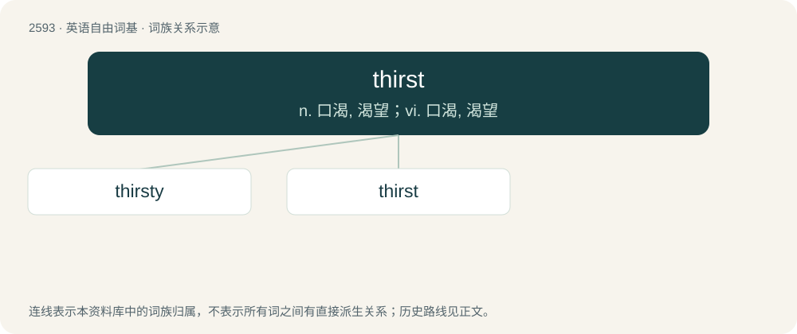

# 2693 · thirst — n. 口渴, 渴望；vi. 口渴, 渴望

[总目录](../00_总目录_按常用程度.md)

**类型**：英语自由词基　｜　**来源语言**：见词源记录

## 核心含义与来源

- 核心含义：n. 口渴, 渴望；vi. 口渴, 渴望
- 英文含义：A sensation of dryness in the throat associated with a craving for liquids, produced by deprivation of drink, or by some other cause (such as fear, excitement, etc.) which stops the secretion of the pharyngeal mucous membrane.
- 词形：thirst

**来源记录 1**（名词；A sensation of dryness in the throat associated with a craving for liquids, produced by deprivation of drink, or by some other cause (such as fear, excitement, etc.) which stops the secretion of the pharyngeal mucous membrane.）

From Middle English thirst, thurst, from Old English þurst, from Proto-West Germanic \*þurstu, from Proto-Germanic \*þurstuz, from Proto-Indo-European \*ters- (“dry”). Germanic cognates include Old High German thurst, Middle High German durst, German Durst, Old Saxon thurst, Old Dutch thursti, Middle Dutch dorst, dorste, Dutch dorst, Old Norse þorsti (Swedish törst, Icelandic þorsti, Faroese tosti, Danish and Norwegian Bokmål tørst, Norwegian Nynorsk tørste). Indo-European cognates include Ancient Greek τέρσομαι (térsomai), Albanian djersë (“sweat”), Sanskrit तृष्णा (tṛṣṇā, “desire; thirst”), Sanskrit तृष्यति (tṛ́ṣyati), Latin terra, Latin torridus.

## 词族图

## 单词速览（常用到不常用）

| 单词 | 音标 | 释义 |
|---|---|---|
| [thirsty](#w-1) | 英 /ˈθɜːs.ti/；美 /ˈθɝs.ti/ | a. 口渴的, 渴望的, 干燥的 |
| [thirst](#w-2) | 英 /θɜːst/；美 /θɝst/ | n. 口渴, 渴望；vi. 口渴, 渴望 |

## 逐词详解

### 1. thirsty

**词性**：形容词　｜　**音标**：英 /ˈθɜːs.ti/；美 /ˈθɝs.ti/

**中文释义**：a. 口渴的, 渴望的, 干燥的

**英文义项**：Needing to drink water or any liquid that can supply water. / Craving alcohol; especially, experiencing some alcohol withdrawal.

**构词拆分**：thirst + -y

**词源与演化**：

From Middle English thirsty, from Old English þurstiġ, from Proto-West Germanic \*þurstug. Equivalent to thirst + -y. Cognate with Dutch dorstig, German durstig.

**例句**：

> This is the third time that girl brought up her crush. She must really be thirsty for him.

该用例对应义项：Craving or desiring sex.

### 2. thirst

**词性**：名词　｜　**音标**：英 /θɜːst/；美 /θɝst/

**中文释义**：n. 口渴, 渴望；vi. 口渴, 渴望

**英文义项**：A sensation of dryness in the throat associated with a craving for liquids, produced by deprivation of drink, or by some other cause (such as fear, excitement, etc.) which stops the secretion of the pharyngeal mucous membrane. / The condition producing the sensation of thirst.

**词源与演化**：

From Middle English thirst, thurst, from Old English þurst, from Proto-West Germanic \*þurstu, from Proto-Germanic \*þurstuz, from Proto-Indo-European \*ters- (“dry”). Germanic cognates include Old High German thurst, Middle High German durst, German Durst, Old Saxon thurst, Old Dutch thursti, Middle Dutch dorst, dorste, Dutch dorst, Old Norse þorsti (Swedish törst, Icelandic þorsti, Faroese tosti, Danish and Norwegian Bokmål tørst, Norwegian Nynorsk tørste). Indo-European cognates include Ancient Greek τέρσομαι (térsomai), Albanian djersë (“sweat”), Sanskrit तृष्णा (tṛṣṇā, “desire; thirst”), Sanskrit तृष्यति (tṛ́ṣyati), Latin terra, Latin torridus.

**例句**：

> If you go out in the desert for long without water, the thirst can drive you mad.

该用例对应义项：The condition producing the sensation of thirst.
