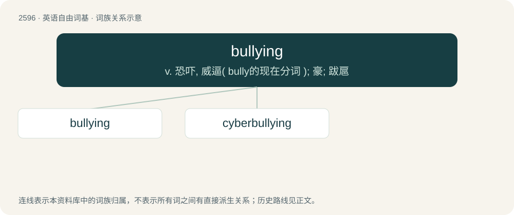

# 2695 · bullying — v. 恐吓, 威逼( bully的现在分词 ); 豪; 跋扈

[总目录](../00_总目录_按常用程度.md)

**类型**：英语自由词基　｜　**来源语言**：见词源记录

## 核心含义与来源

- 核心含义：v. 恐吓, 威逼( bully的现在分词 ); 豪; 跋扈
- 英文含义：An act of intimidating a person to do something, especially such repeated coercion.
- 词形：bullying

**来源记录 1**（名词；An act of intimidating a person to do something, especially such repeated coercion.）

From bully + -ing.

## 词族图

## 单词速览（常用到不常用）

| 单词 | 音标 | 释义 |
|---|---|---|
| [bullying](#w-1) | 英 /ˈbʊ.li.ɪŋ/ | v. 恐吓, 威逼( bully的现在分词 ); 豪; 跋扈 |
| [cyberbullying](#w-2) |  | 网上欺凌 |

## 逐词详解

### 1. bullying

**词性**：名词　｜　**音标**：英 /ˈbʊ.li.ɪŋ/

**中文释义**：v. 恐吓, 威逼( bully的现在分词 ); 豪; 跋扈

**英文义项**：An act of intimidating a person to do something, especially such repeated coercion. / Persistent acts intended to make life unpleasant for another person.

**构词拆分**：bully + -ing

**词源与演化**：

From bully + -ing.

**例句**：

> Bullying is a punishable offense in schools.

该用例对应义项：Persistent acts intended to make life unpleasant for another person.

### 2. cyberbullying

**词性**：名词

**中文释义**：网上欺凌

**英文义项**：Acts in cyberspace intended to make life unpleasant for another person.

**构词拆分**：cyber- + bullying

**词源与演化**：

From cyber- + bullying.

**例句**：

> Sometimes I wonder when the first world championship in cyberbullying will take place.
