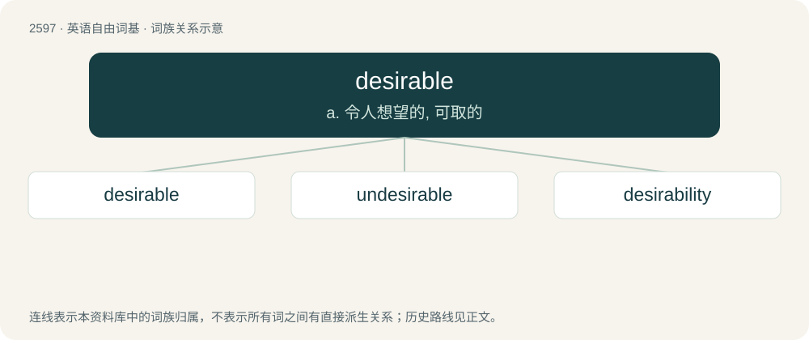

# 2696 · desirable — a. 令人想望的, 可取的

[总目录](../00_总目录_按常用程度.md)

**类型**：英语自由词基　｜　**来源语言**：见词源记录

## 核心含义与来源

- 核心含义：a. 令人想望的, 可取的
- 英文含义：Worthy to be desired; pleasing; agreeable.
- 词形：desirable

**来源记录 1**（形容词；Worthy to be desired; pleasing; agreeable.）

From Old French desirable. Morphologically desire + -able.

## 词族图

## 单词速览（常用到不常用）

| 单词 | 音标 | 释义 |
|---|---|---|
| [desirable](#w-1) | 英 /dɪˈzaɪəɹəbəl/；美 /dɪˈzaɪɹəbəl/ | a. 令人想望的, 可取的 |
| [undesirable](#w-2) | /ˌʌndɪˈzaɪɹəbəl/ | a. 不受欢迎的, 不合乎社会道德标准的；\[法\] 不受欢迎的人, 不良份子, 不法份子 |
| [desirability](#w-3) | /di.zairəˈbiliti/ | n. 值得想望, 可取；\[经\] 合意性, 可用性 |

## 逐词详解

### 1. desirable

**词性**：形容词　｜　**音标**：英 /dɪˈzaɪəɹəbəl/；美 /dɪˈzaɪɹəbəl/

**中文释义**：a. 令人想望的, 可取的

**英文义项**：Worthy to be desired; pleasing; agreeable. / Sexually attractive.

**构词拆分**：desire + -able

**词源与演化**：

From Old French desirable. Morphologically desire + -able.

**例句**：

> This applicant has almost all desirable properties.

该用例对应义项：Worthy to be desired; pleasing; agreeable.

### 2. undesirable

**词性**：形容词　｜　**音标**：/ˌʌndɪˈzaɪɹəbəl/

**中文释义**：a. 不受欢迎的, 不合乎社会道德标准的；\[法\] 不受欢迎的人, 不良份子, 不法份子

**英文义项**：Not desirable, objectionable or not likely to please.

**构词拆分**：un- + desirable

**词源与演化**：

From un- + desirable.

**例句**：

> Undesirable impurities in steel.

该用例对应义项：not wanted

### 3. desirability

**词性**：名词　｜　**音标**：/di.zairəˈbiliti/

**中文释义**：n. 值得想望, 可取；\[经\] 合意性, 可用性

**英文义项**：The state of being desirable.

**构词拆分**：desirable + -ity；desire + -ability

**词源与演化**：

Morphologically desirable + -ity and desire + -ability.

**例句**：

> Scads of online daters constantly check their desirability.
