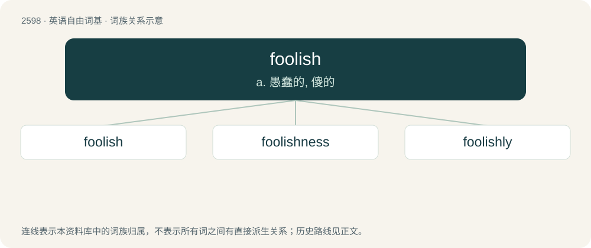

# 2697 · foolish — a. 愚蠢的, 傻的

[总目录](../00_总目录_按常用程度.md)

**类型**：英语自由词基　｜　**来源语言**：见词源记录

## 核心含义与来源

- 核心含义：a. 愚蠢的, 傻的
- 英文含义：Lacking good sense or judgement as a general trait; unwise; stupid.
- 词形：foolish

**来源记录 1**（形容词；Lacking good sense or judgement as a general trait; unwise; stupid.）

From Middle English folisch; equivalent to fool + -ish.

## 词族图

## 单词速览（常用到不常用）

| 单词 | 音标 | 释义 |
|---|---|---|
| [foolish](#w-1) | /ˈfuː.lɪʃ/ | a. 愚蠢的, 傻的 |
| [foolishness](#w-2) | /ˈfuːlɪʃnəs/ | n. 愚蠢；可笑 |
| [foolishly](#w-3) | /ˈfuːlɪʃli/ | adv. 愚笨地, 无聊地 |

## 逐词详解

### 1. foolish

**词性**：形容词　｜　**音标**：/ˈfuː.lɪʃ/

**中文释义**：a. 愚蠢的, 傻的

**英文义项**：Lacking good sense or judgement as a general trait; unwise; stupid. / Not based on good sense or judgement; as a fool would do or conclude.

**构词拆分**：fool + -ish

**词源与演化**：

From Middle English folisch; equivalent to fool + -ish.

**例句**：

> It's foolish to think that smoking has little to do with cancer.

### 2. foolishness

**词性**：名词　｜　**音标**：/ˈfuːlɪʃnəs/

**中文释义**：n. 愚蠢；可笑

**英文义项**：The state of being foolish. / A thing or event that is foolish, or an absurdity.

**构词拆分**：foolish + -ness

**词源与演化**：

From Middle English folishnesse, follissnesse, equivalent to foolish + -ness.

**例句**：

> Adjusting to an insane society is total foolishness.

该用例对应义项：the quality of being rash and foolish

### 3. foolishly

**词性**：副词　｜　**音标**：/ˈfuːlɪʃli/

**中文释义**：adv. 愚笨地, 无聊地

**英文义项**：In a foolish manner. / Without good judgment.

**构词拆分**：foolish + -ly

**词源与演化**：

From Middle English folysly, folysschly; equivalent to foolish + -ly.

**例句**：

> Foolishly, he had decided that, because a home was the best investment, two homes were even better.

该用例对应义项：Without good judgment.
