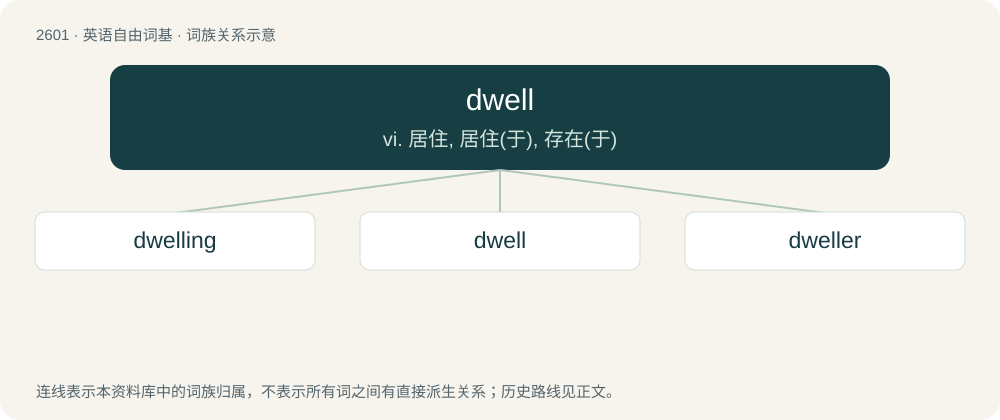

# 2699 · dwell — vi. 居住, 居住(于), 存在(于)

[总目录](../00_总目录_按常用程度.md)

**类型**：英语自由词基　｜　**来源语言**：见词源记录

## 核心含义与来源

- 核心含义：vi. 居住, 居住(于), 存在(于)
- 英文含义：A period of time in which a system or component remains in a given state.
- 词形：dwell

**来源记录 1**（名词；A period of time in which a system or component remains in a given state.）

From Middle English dwellen (“delay, live, remain, persist”), from Old English dwellan (“to mislead, deceive; be led into error, stray”), from Proto-Germanic \*dwaljaną (“to hold up, delay; hesitate”), from Proto-Indo-European \*dʰwelH- (“to whirl, swirl, blur, obfuscate”), which is cognate with Old Norse dvelja and related to Proto-Germanic \*dwelaną (“to go astray”), which underwent semantic change in its descendants. Cognates include Danish dvæle (“to linger, dwell”) and Swedish dväljas (“to dwell, reside”).

## 词族图

## 单词速览（常用到不常用）

| 单词 | 音标 | 释义 |
|---|---|---|
| [dwelling](#w-1) | /ˈdwɛl.ɪŋ/ | n. 住处；\[医\] 住房 |
| [dwell](#w-2) | /dwɛl/ | vi. 居住, 居住(于), 存在(于) |
| [dweller](#w-3) | 英 /ˈdwɛlə/；美 /ˈdwɛlɚ/ | n. 居民 |

## 逐词详解

### 1. dwelling

**词性**：名词　｜　**音标**：/ˈdwɛl.ɪŋ/

**中文释义**：n. 住处；\[医\] 住房

**英文义项**：A house or place in which a person lives; a habitation, a home.

**构词拆分**：dwell + -ing

**词源与演化**：

From Middle English dwellynge, dwellyng (“delay, continuance, abode”), equivalent to dwell + -ing. More at dwell.

**例句**：

> The old house served as a dwelling for Albert.

该用例对应义项：A house or place in which a person lives; a habitation, a home.

### 2. dwell

**词性**：动词　｜　**音标**：/dwɛl/

**中文释义**：vi. 居住, 居住(于), 存在(于)

**英文义项**：To live; to reside. / To linger (on); to remain fixated.

**词源与演化**：

From Middle English dwellen (“delay, live, remain, persist”), from Old English dwellan (“to mislead, deceive; be led into error, stray”), from Proto-Germanic \*dwaljaną (“to hold up, delay; hesitate”), from Proto-Indo-European \*dʰwelH- (“to whirl, swirl, blur, obfuscate”), which is cognate with Old Norse dvelja and related to Proto-Germanic \*dwelaną (“to go astray”), which underwent semantic change in its descendants. Cognates include Danish dvæle (“to linger, dwell”) and Swedish dväljas (“to dwell, reside”).

**例句**：

> Stop dwelling on the past!

该用例对应义项：To linger (on); to remain fixated.

### 3. dweller

**词性**：名词　｜　**音标**：英 /ˈdwɛlə/；美 /ˈdwɛlɚ/

**中文释义**：n. 居民

**英文义项**：An inhabitant of a specific place; an inhabitant or denizen.

**构词拆分**：dwell + -er

**词源与演化**：

From Middle English dweller, equivalent to dwell + -er.

**例句**：

> The new couple are apartment dwellers.

该用例对应义项：An inhabitant of a specific place; an inhabitant or denizen.
