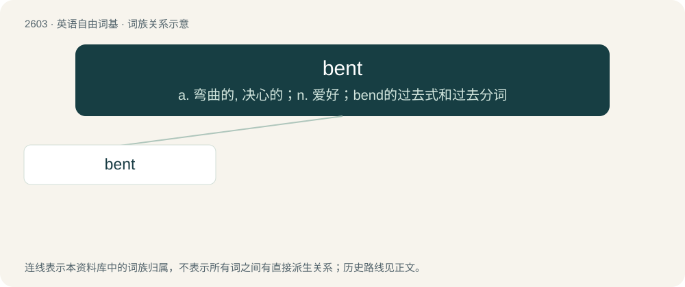

# 2702 · bent — a. 弯曲的, 决心的；n. 爱好；bend的过去式和过去分词

[总目录](../00_总目录_按常用程度.md)

**类型**：英语自由词基　｜　**来源语言**：见词源记录

## 核心含义与来源

- 核心含义：a. 弯曲的, 决心的；n. 爱好；bend的过去式和过去分词
- 英文含义：Folded or dented out of its usual shape.
- 词形：bent

**多个词源／构词路径**：同一拼写可能有不同来源；以下按词性和含义分别列出。

**来源记录 1**（形容词；Folded or dented out of its usual shape.）

From Middle English bent-, preterite stem (as in bente, benten, etc.), and Middle English bent, ibent, ybent, past participle forms of Middle English benden (“to bend”). Equivalent to bend + -t.

**来源记录 2**（名词；Any of various stiff or reedy grasses.）

From Middle English bent, benet, from Old English \*beonot (attested only in place-names and personal names), from Proto-West Germanic \*binut (“reed, rush”), of uncertain origin.

## 词族图

## 单词速览（常用到不常用）

| 单词 | 音标 | 释义 |
|---|---|---|
| [bent](#w-1) | 英 /bɛnt/ | a. 弯曲的, 决心的；n. 爱好；bend的过去式和过去分词 |

## 逐词详解

### 1. bent

**词性**：形容词　｜　**音标**：英 /bɛnt/

**中文释义**：a. 弯曲的, 决心的；n. 爱好；bend的过去式和过去分词

**英文义项**：Folded or dented out of its usual shape. / Corrupt, dishonest.

**构词拆分**：bend + -t

**词源与演化**：

From Middle English bent-, preterite stem (as in bente, benten, etc.), and Middle English bent, ibent, ybent, past participle forms of Middle English benden (“to bend”). Equivalent to bend + -t.

**例句**：

> She was bent about "certain kinds of people" having civil rights; she wanted to roll those back.

该用例对应义项：Annoyed; out of sorts; having a bee in one's bonnet.
