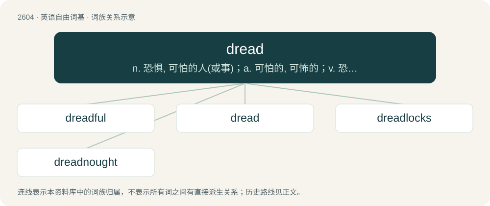

# 2703 · dread — n. 恐惧, 可怕的人(或事)；a. 可怕的, 可怖的；v. 恐惧, 害怕

[总目录](../00_总目录_按常用程度.md)

**类型**：英语自由词基　｜　**来源语言**：见词源记录

## 核心含义与来源

- 核心含义：n. 恐惧, 可怕的人(或事)；a. 可怕的, 可怖的；v. 恐惧, 害怕
- 英文含义：To fear greatly.
- 词形：dread

**多个词源／构词路径**：同一拼写可能有不同来源；以下按词性和含义分别列出。

**来源记录 1**（动词；To fear greatly.）

From Middle English dreden, from Old English drǣdan (“to fear, dread”), aphetic form of ondrǣdan (“to fear, dread”), from Proto-West Germanic \*andarādan, equivalent to Old English and- + rǣdan (whence read); corresponding to an aphesis of earlier adread. Akin to Old Saxon antdrādan, andrādan (“to fear, dread”), Old High German intrātan (“to fear”), Middle High German entrāten (“to fear, dread, frighten”).

**来源记录 2**（名词；Great fear in view of impending evil; fearful apprehension of danger; anticipatory terror.）

From Middle English drede, dred, from the verb (see above). Cognate with Old Frisian drēd, drēde (“fear, dread”).

**来源记录 3**（形容词；Terrible; greatly feared; dreaded.）

From Middle English drede, dredde, dradde, ydreddyd (“feared, dreaded, honoured”), past participle of Middle English dreden (“to fear, dread”). See above.

## 词族图

## 单词速览（常用到不常用）

| 单词 | 音标 | 释义 |
|---|---|---|
| [dreadful](#w-1) | /ˈdɹɛd.fl̩/ | a. 可怕的 |
| [dread](#w-2) | /dɹɛd/ | n. 恐惧, 可怕的人(或事)；a. 可怕的, 可怖的；v. 恐惧, 害怕 |
| [dreadlocks](#w-3) | 英 /ˈdɹɛdlɒks/；美 /ˈdɹɛdˌlɑks/ | (dreadlock 的复数) n."骇人"长发绺 |
| [dreadnought](#w-4) | 英 /ˈdɹɛd.nɔːt/；美 /ˈdɹɛd.nɔt/ | 【英文】One that fears nothing. |

## 逐词详解

### 1. dreadful

**词性**：形容词　｜　**音标**：/ˈdɹɛd.fl̩/

**中文释义**：a. 可怕的

**英文义项**：Genuinely horrific, awful, or alarming; dangerous, risky. / Unpleasant, awful, very bad (also used as an intensifier).

**构词拆分**：By surface analysis, dread + -ful

**词源与演化**：

From Middle English dredful, dredfull, dredeful (also dreful). By surface analysis, dread + -ful.

**例句**：

> It is so dreadful that I don't want to think of it.

### 2. dread

**词性**：动词　｜　**音标**：/dɹɛd/

**中文释义**：n. 恐惧, 可怕的人(或事)；a. 可怕的, 可怖的；v. 恐惧, 害怕

**英文义项**：To fear greatly. / To anticipate with fear.

**词源与演化**：

From Middle English dreden, from Old English drǣdan (“to fear, dread”), aphetic form of ondrǣdan (“to fear, dread”), from Proto-West Germanic \*andarādan, equivalent to Old English and- + rǣdan (whence read); corresponding to an aphesis of earlier adread. Akin to Old Saxon antdrādan, andrādan (“to fear, dread”), Old High German intrātan (“to fear”), Middle High German entrāten (“to fear, dread, frighten”).

**例句**：

> I'm dreading getting the results of the test, as it could decide my whole life.

该用例对应义项：To anticipate with fear.

### 3. dreadlocks

**词性**：名词　｜　**音标**：英 /ˈdɹɛdlɒks/；美 /ˈdɹɛdˌlɑks/

**中文释义**：(dreadlock 的复数) n."骇人"长发绺

**英文义项**：A hairstyle worn by Rastafarians and others in which the hair is left to grow long, and twisted into matted strings.

**构词拆分**：dread (“Rastafarian”, attributive) + locks

**词源与演化**：

Borrowed from Jamaican Creole dreadlocks, from dread (“of or relating to a dread”, adjective) (from dread (“(usually black) male member of the Rastafarian movement who wears his hair in dreadlocks”, noun), from English dread (“reverential or respectful fear; awe”), referring to the awe inspired by God) + English locks (plural of lock (“length or tuft of hair”)). The English word is analyzable as dread (“Rastafarian”, attributive) + locks.

**例句**：

> What do you think of my dreadlocks?

### 4. dreadnought

**词性**：名词　｜　**音标**：英 /ˈdɹɛd.nɔːt/；美 /ˈdɹɛd.nɔt/

**英文义项**：One that fears nothing. / Something that assures against fear.

**构词拆分**：From dread + nought.

**词源与演化**：

From dread + nought.
