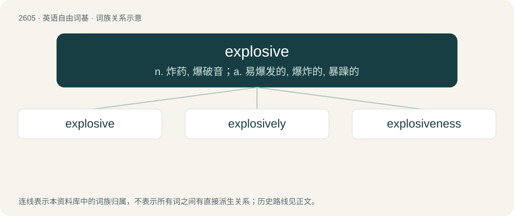

# 2704 · explosive — n. 炸药, 爆破音；a. 易爆发的, 爆炸的, 暴躁的

[总目录](../00_总目录_按常用程度.md)

**类型**：英语自由词基　｜　**来源语言**：见词源记录

## 核心含义与来源

- 核心含义：n. 炸药, 爆破音；a. 易爆发的, 爆炸的, 暴躁的
- 英文含义：Able to, or likely to, explode.
- 词形：explosive

**来源记录 1**（形容词；Able to, or likely to, explode.）

From Latin explōs-, stem of the perfect passive participle of explōdō + the suffix -ive.

## 词族图

## 单词速览（常用到不常用）

| 单词 | 音标 | 释义 |
|---|---|---|
| [explosive](#w-1) | 英 /ɛkˈspləʊsɪv/；美 /ɛkˈsploʊsɪv/ | n. 炸药, 爆破音；a. 易爆发的, 爆炸的, 暴躁的 |
| [explosively](#w-2) |  | adv. 爆发地, 引起爆炸地 |
| [explosiveness](#w-3) | /ɪkspˈləʊsɪvnəs/ | 爆炸性; 可爆性 |

## 逐词详解

### 1. explosive

**词性**：形容词　｜　**音标**：英 /ɛkˈspləʊsɪv/；美 /ɛkˈsploʊsɪv/

**中文释义**：n. 炸药, 爆破音；a. 易爆发的, 爆炸的, 暴躁的

**英文义项**：Able to, or likely to, explode. / Having the character of an explosion.

**词源与演化**：

From Latin explōs-, stem of the perfect passive participle of explōdō + the suffix -ive.

**例句**：

> He has an explosive personality.

该用例对应义项：Easily driven to anger, usually with reference to a person.

### 2. explosively

**词性**：副词

**中文释义**：adv. 爆发地, 引起爆炸地

**英文义项**：In an explosive manner.

**构词拆分**：explosive + -ly

**词源与演化**：

From explosive + -ly.

**例句**：

> The political situation in Kashmir and Jammu is explosively unstable.

该用例对应义项：in an explosive manner

### 3. explosiveness

**词性**：名词　｜　**音标**：/ɪkspˈləʊsɪvnəs/

**中文释义**：爆炸性; 可爆性

**英文义项**：The state of being explosive.

**构词拆分**：explosive + -ness

**词源与演化**：

From explosive + -ness.
