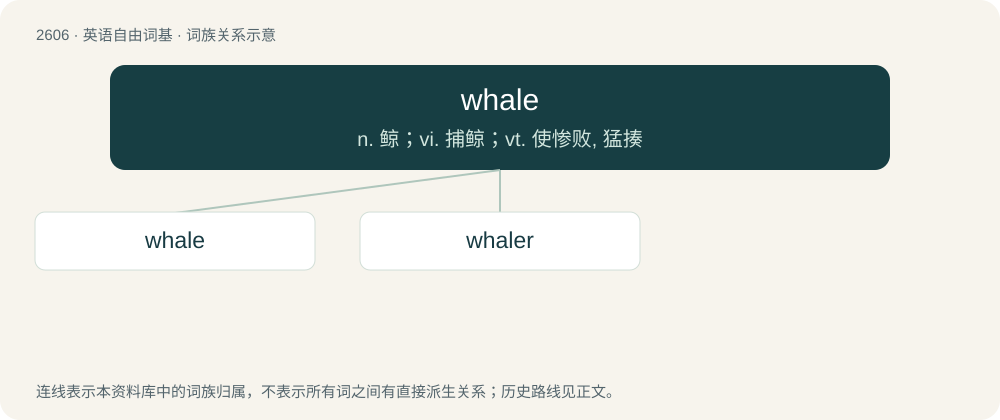

# 2705 · whale — n. 鲸；vi. 捕鲸；vt. 使惨败, 猛揍

[总目录](../00_总目录_按常用程度.md)

**类型**：英语自由词基　｜　**来源语言**：见词源记录

## 核心含义与来源

- 核心含义：n. 鲸；vi. 捕鲸；vt. 使惨败, 猛揍
- 英文含义：Any large cetacean, usually with the exclusion of dolphins and porpoises.
- 词形：whale

**多个词源／构词路径**：同一拼写可能有不同来源；以下按词性和含义分别列出。

**来源记录 1**（名词；Any large cetacean, usually with the exclusion of dolphins and porpoises.）

From Middle English whal, whale, from Old English hwæl (“whale”), from Proto-West Germanic \*hwal, from Proto-Germanic \*hwalaz (“whale”) (compare German Wal, Swedish val, Danish and Norwegian Bokmål hval, Norwegian Nynorsk kval; compare also Dutch walvis, West Frisian walfisk, from Proto-Indo-European \*(s)kʷálos (“sheatfish”) (compare German Wels, Latin squalus (“big sea fish”), Old Prussian kalis, Ancient Greek ἄσπαλος (áspalos), Avestan 𐬐𐬀𐬭𐬀 (kara, “kind of fish”)).

**来源记录 2**（动词；To thrash, to flog, to beat vigorously or soundly.）

Uncertain. Perhaps a variant of wale influenced by whack, whap, etc.

## 词族图

## 单词速览（常用到不常用）

| 单词 | 音标 | 释义 |
|---|---|---|
| [whale](#w-1) | 英 /ˈweɪl/ | n. 鲸；vi. 捕鲸；vt. 使惨败, 猛揍 |
| [whaler](#w-2) | 英 /ˈweɪlə/；美 /ˈweɪlɚ/ | n. 捕鲸者, 捕鲸船 |

## 逐词详解

### 1. whale

**词性**：名词　｜　**音标**：英 /ˈweɪl/

**中文释义**：n. 鲸；vi. 捕鲸；vt. 使惨败, 猛揍

**英文义项**：Any large cetacean, usually with the exclusion of dolphins and porpoises. / Any species of Cetacea, including dolphins and porpoises.

**词源与演化**：

From Middle English whal, whale, from Old English hwæl (“whale”), from Proto-West Germanic \*hwal, from Proto-Germanic \*hwalaz (“whale”) (compare German Wal, Swedish val, Danish and Norwegian Bokmål hval, Norwegian Nynorsk kval; compare also Dutch walvis, West Frisian walfisk, from Proto-Indo-European \*(s)kʷálos (“sheatfish”) (compare German Wels, Latin squalus (“big sea fish”), Old Prussian kalis, Ancient Greek ἄσπαλος (áspalos), Avestan 𐬐𐬀𐬭𐬀 (kara, “kind of fish”)).

**例句**：

> The whale is a very large mammal which lives in the sea.

### 2. whaler

**词性**：名词　｜　**音标**：英 /ˈweɪlə/；美 /ˈweɪlɚ/

**中文释义**：n. 捕鲸者, 捕鲸船

**英文义项**：One who hunts whales; any person employed in the whaling industry. / A seagoing vessel used for hunting whales.

**构词拆分**：whale + -er

**词源与演化**：

From whale + -er. In sense 1, displaced Old English hwælhunta (literally “whale hunter”).
