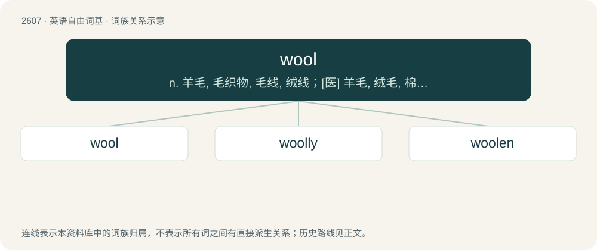

# 2706 · wool — n. 羊毛, 毛织物, 毛线, 绒线；\[医\] 羊毛, 绒毛, 棉\[花\]

[总目录](../00_总目录_按常用程度.md)

**类型**：英语自由词基　｜　**来源语言**：见词源记录

## 核心含义与来源

- 核心含义：n. 羊毛, 毛织物, 毛线, 绒线；\[医\] 羊毛, 绒毛, 棉\[花\]
- 英文含义：The hair of the sheep, llama and some other ruminants.
- 词形：wool

**来源记录 1**（名词；The hair of the sheep, llama and some other ruminants.）

From Middle English wolle, from Old English wull, from Proto-West Germanic \*wullu, from Proto-Germanic \*wullō, from Proto-Indo-European \*h₂wĺ̥h₁neh₂. Cognates Cognate with Saterland Frisian Wulle, German Low German Wull, Dutch wol, German Wolle, Faroese, Icelandic, Norwegian Bokmål, Norwegian Nynorsk, and Swedish ull, Danish uld; also Welsh gwlân, Latin lāna, Lithuanian vi̇̀lna, Russian во́лос (vólos), Slovak vlna, Bulgarian влас (vlas), Albanian lesh (“wool, hair, fleece”). Doublet of lana. The vowel development u → o → oo is purely graphical. Modern English generally avoids the string ⟨wu⟩ in favour of ⟨wo⟩, and the resulting woll was then altered to wool (as supposedly better representing the pronunciation).

## 词族图

## 单词速览（常用到不常用）

| 单词 | 音标 | 释义 |
|---|---|---|
| [wool](#w-1) | 英 /wʊl/；美 /wʊl/ | n. 羊毛, 毛织物, 毛线, 绒线；\[医\] 羊毛, 绒毛, 棉\[花\] |
| [woolly](#w-2) | /ˈwʊli/ | a. 羊毛制的, 模糊的, 似羊毛的, 蓬乱的 |
| [woolen](#w-3) | /ˈwʊlən/ | n. 毛制品；a. 羊毛的, 羊毛制的, 毛织的 |

## 逐词详解

### 1. wool

**词性**：名词　｜　**音标**：英 /wʊl/；美 /wʊl/

**中文释义**：n. 羊毛, 毛织物, 毛线, 绒线；\[医\] 羊毛, 绒毛, 棉\[花\]

**英文义项**：The hair of the sheep, llama and some other ruminants. / A cloth or yarn made from such hair.

**词源与演化**：

From Middle English wolle, from Old English wull, from Proto-West Germanic \*wullu, from Proto-Germanic \*wullō, from Proto-Indo-European \*h₂wĺ̥h₁neh₂. Cognates Cognate with Saterland Frisian Wulle, German Low German Wull, Dutch wol, German Wolle, Faroese, Icelandic, Norwegian Bokmål, Norwegian Nynorsk, and Swedish ull, Danish uld; also Welsh gwlân, Latin lāna, Lithuanian vi̇̀lna, Russian во́лос (vólos), Slovak vlna, Bulgarian влас (vlas), Albanian lesh (“wool, hair, fleece”). Doublet of lana. The vowel development u → o → oo is purely graphical. Modern English generally avoids the string ⟨wu⟩ in favour of ⟨wo⟩, and the resulting woll was then altered to wool (as supposedly better representing the pronunciation).

**例句**：

> I cannot spin wool. Only my grandmother knows how to do it.

### 2. woolly

**词性**：形容词　｜　**音标**：/ˈwʊli/

**中文释义**：a. 羊毛制的, 模糊的, 似羊毛的, 蓬乱的

**英文义项**：Made of wool. / Having a thick, soft texture, as if made of wool.

**构词拆分**：wool + -y

**词源与演化**：

From Middle English wolly, equivalent to wool + -y. Cognate with Saterland Frisian wullich (“woolly”), Dutch wollig (“woolly”), German wollig (“woolly”), Swedish ullig (“woolly”).

**例句**：

> There was nothing left in the fruit bowl but a brown banana and a couple of woolly pears.

该用例对应义项：Having a thick, soft texture, as if made of wool.

### 3. woolen

**词性**：形容词　｜　**音标**：/ˈwʊlən/

**中文释义**：n. 毛制品；a. 羊毛的, 羊毛制的, 毛织的

**英文义项**：Made of wool. / Of or relating to wool or woolen cloths.

**构词拆分**：wool + -en

**词源与演化**：

From Middle English wollen, wullen, from Old English wyllen, from Proto-Germanic \*wullīnaz (“woollen”), equivalent to wool + -en. Cognate with Scots wollin, wolne, wowne (“woollen”), Dutch wollen (“woollen”), German wollen (“woollen”), Danish uldne (“woollen”), Norwegian Bokmål ullen (“fuzzy; woolen”).

**用法示例／搭配（非完整句）**：

> woolen manufactures

该用例对应义项：Of or relating to wool or woolen cloths.
