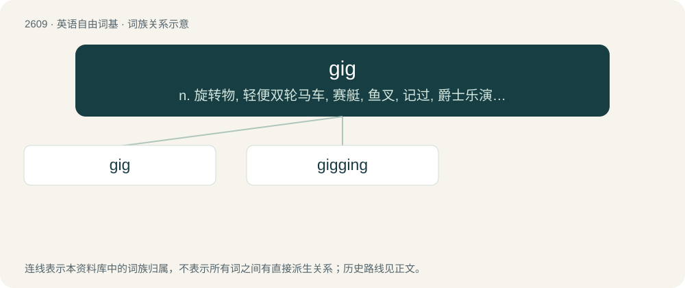

# 2708 · gig — n. 旋转物, 轻便双轮马车, 赛艇, 鱼叉, 记过, 爵士乐演奏会；vi. 乘轻便双轮马车, 乘快艇, (用鱼叉)叉鱼；vt. (用鱼叉)叉, 刺激, 记过

[总目录](../00_总目录_按常用程度.md)

**类型**：英语自由词基　｜　**来源语言**：见词源记录

## 核心含义与来源

- 核心含义：n. 旋转物, 轻便双轮马车, 赛艇, 鱼叉, 记过, 爵士乐演奏会；vi. 乘轻便双轮马车, 乘快艇, (用鱼叉)叉鱼；vt. (用鱼叉)叉, 刺激, 记过
- 英文含义：Originally (music), a performing engagement by a musician or musical group; (by extension, film, television, theater) a job or role for a performer.
- 词形：gig

**多个词源／构词路径**：同一拼写可能有不同来源；以下按词性和含义分别列出。

**来源记录 1**（名词；Originally (music), a performing engagement by a musician or musical group; (by extension, film, television, theater) a job or role for a performer.）

The etymology of the noun is unknown, but compare Old French gigue (“a fiddle”). The verb is derived from the noun.

**来源记录 2**（名词；Any unit of measurement having the SI prefix giga-.）

Sense 1 is a clipping of gigabyte, while sense 2 is a clipping of giga- (prefix multiplying the unit to which it is attached by one billion).

**来源记录 3**（名词；A small, narrow, open boat carried in a larger ship, and used for transportation between the ship and the shore, another vessel, etc.）

The noun is derived from Middle English gigg, gigge, gygge (“spinning object; a top”); further origin uncertain, possibly: \* from Old Norse \[Term?\] (compare Danish gig (“a top”), dialectal Norwegian giga (“to shake about”)), from Proto-Germanic \*gīganą (“to move, wish, desire”), from Proto-Indo-European \*gʰeyǵʰ-, \*gʰeygʰ- (“to yawn, gape, long for, desire”); or \* ultimately onomatopoeic. Senses 2–4 are thought to derive from sense 1 (“whipping-top”), but their exact relationship is unclear. The verb is derived from the noun.

**来源记录 4**（名词；Synonym of fishgig or fizgig (“a spear with a barb on the end of it, used for catching fish, frogs, or other small animals”).）

The noun is derived from a clipping of fishgig, fizgig, possibly from Spanish fisga (“harpoon”). The verb is derived from the noun.

## 词族图

## 单词速览（常用到不常用）

| 单词 | 音标 | 释义 |
|---|---|---|
| [gig](#w-1) | 英 /ɡɪɡ/ | n. 旋转物, 轻便双轮马车, 赛艇, 鱼叉, 记过, 爵士乐演奏会；vi. 乘轻便双轮马车, 乘快艇, (用鱼叉)叉鱼；vt. (用鱼叉)叉, 刺激, 记过 |
| [gigging](#w-2) | 英 /ˈɡɪɡɪŋ/ | (gig 的现在分词) n. 旋转物, 轻便双轮马车, 赛艇, 鱼叉, 记过, 爵士乐演奏会；vi. 乘轻便双轮马车, 乘快艇, (用鱼叉)叉鱼；vt. (用鱼叉)叉, 刺激, 记过 |

## 逐词详解

### 1. gig

**词性**：名词　｜　**音标**：英 /ɡɪɡ/

**中文释义**：n. 旋转物, 轻便双轮马车, 赛艇, 鱼叉, 记过, 爵士乐演奏会；vi. 乘轻便双轮马车, 乘快艇, (用鱼叉)叉鱼；vt. (用鱼叉)叉, 刺激, 记过

**英文义项**：Originally (music), a performing engagement by a musician or musical group; (by extension, film, television, theater) a job or role for a performer. / Any job, especially one that is freelance or temporary, or done on an on-demand basis.

**词源与演化**：

The etymology of the noun is unknown, but compare Old French gigue (“a fiddle”). The verb is derived from the noun.

**例句**：

> That guy’s got a great gig over at the bike shop. He hardly works all day.

该用例对应义项：Any job, especially one that is freelance or temporary, or done on an on-demand basis.

### 2. gigging

**词性**：名词　｜　**音标**：英 /ˈɡɪɡɪŋ/

**中文释义**：(gig 的现在分词) n. 旋转物, 轻便双轮马车, 赛艇, 鱼叉, 记过, 爵士乐演奏会；vi. 乘轻便双轮马车, 乘快艇, (用鱼叉)叉鱼；vt. (用鱼叉)叉, 刺激, 记过

**英文义项**：The act of engaging in a musical performance, acting in a theatre production, etc. / The practice of working at a job, especially one that is freelance or temporary, or done on an on-demand basis.

**构词拆分**：gig + -ing

**词源与演化**：

From gig + -ing.
