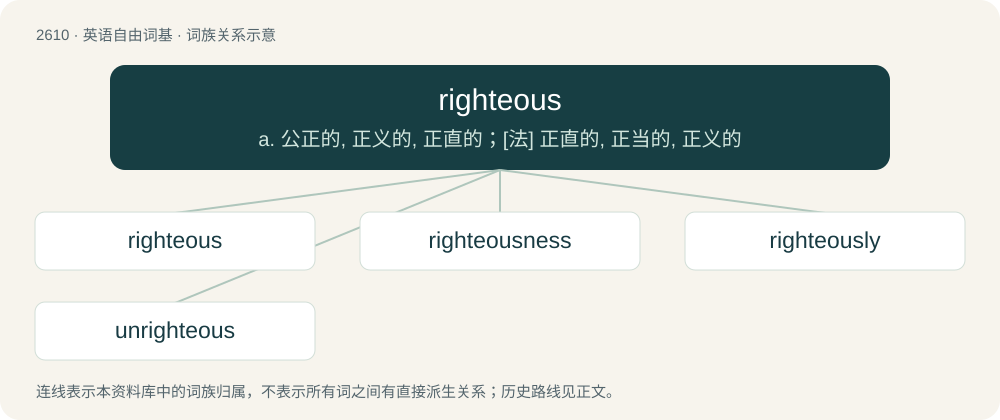

# 2709 · righteous — a. 公正的, 正义的, 正直的；\[法\] 正直的, 正当的, 正义的

[总目录](../00_总目录_按常用程度.md)

**类型**：英语自由词基　｜　**来源语言**：见词源记录

## 核心含义与来源

- 核心含义：a. 公正的, 正义的, 正直的；\[法\] 正直的, 正当的, 正义的
- 英文含义：Free from sin or guilt.
- 词形：righteous

**来源记录 1**（形容词；Free from sin or guilt.）

From earlier rightuous, rightwose, rightwos, rightwise, from Middle English rightwise, rightwis, from Old English rihtwīs (“righteous, just”), corresponding to right + -wise (with assimilation of second element to -ous), or to right + wise (“way, manner”). Cognate with Scots richtwis (“righteous”), Old High German rehtwīsic (“righteous, just”), Icelandic réttvíss (“righteous, just”). Compare also thefteous, mighteous.

## 词族图

## 单词速览（常用到不常用）

| 单词 | 音标 | 释义 |
|---|---|---|
| [righteous](#w-1) | /ˈɹaɪt͡ʃəs/ | a. 公正的, 正义的, 正直的；\[法\] 正直的, 正当的, 正义的 |
| [righteousness](#w-2) | /ˈɹaɪt͡ʃəsnəs/ | n. 正义, 公正, 正直 |
| [righteously](#w-3) |  | adv. 正直地；公正地 |
| [unrighteous](#w-4) | /.ʌnˈraitʃəs/ | a. 不正直的, 罪深的, 邪恶的, 不公正的 |

## 逐词详解

### 1. righteous

**词性**：形容词　｜　**音标**：/ˈɹaɪt͡ʃəs/

**中文释义**：a. 公正的, 正义的, 正直的；\[法\] 正直的, 正当的, 正义的

**英文义项**：Free from sin or guilt. / Moral and virtuous, perhaps to the point of sanctimony.

**构词拆分**：right + -wise；right + wise (“way, manner”)

**词源与演化**：

From earlier rightuous, rightwose, rightwos, rightwise, from Middle English rightwise, rightwis, from Old English rihtwīs (“righteous, just”), corresponding to right + -wise (with assimilation of second element to -ous), or to right + wise (“way, manner”). Cognate with Scots richtwis (“righteous”), Old High German rehtwīsic (“righteous, just”), Icelandic réttvíss (“righteous, just”). Compare also thefteous, mighteous.

**例句**：

> Human beings should take a righteous path, and so should art. We should promote kindness and beauty through art.

该用例对应义项：Moral and virtuous, perhaps to the point of sanctimony.

### 2. righteousness

**词性**：名词　｜　**音标**：/ˈɹaɪt͡ʃəsnəs/

**中文释义**：n. 正义, 公正, 正直

**英文义项**：The quality or state of being righteous. / Holiness; conformity of life to the divine law.

**构词拆分**：righteous + -ness

**词源与演化**：

From earlier rightwiseness, from Middle English rightwisnes, from Old English rihtwīsnes (“justice”), equivalent to righteous + -ness.

**例句**：

> Education is the path to happiness, peace, righteousness, and success.

### 3. righteously

**词性**：副词

**中文释义**：adv. 正直地；公正地

**英文义项**：In a righteous manner.

**构词拆分**：righteous + -ly

**词源与演化**：

From Middle English rightwisly, from Old English rihtwīslīce; equivalent to righteous + -ly.

**例句**：

> We should act righteously and must remember that the future will pass a harsh judgement on our actions.

### 4. unrighteous

**词性**：形容词　｜　**音标**：/.ʌnˈraitʃəs/

**中文释义**：a. 不正直的, 罪深的, 邪恶的, 不公正的

**英文义项**：Not righteous; wicked.

**构词拆分**：un- + righteous

**词源与演化**：

From Middle English unrightwis, from Old English unrihtwīs; equivalent to un- + righteous.
