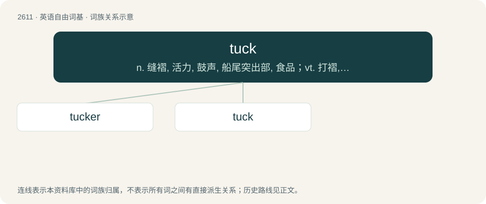

# 2712 · tuck — n. 缝褶, 活力, 鼓声, 船尾突出部, 食品；vt. 打褶, 卷起, 挤进, 塞, 收藏；vi. 缝褶裥, 缩拢

[总目录](../00_总目录_按常用程度.md)

**类型**：英语自由词基　｜　**来源语言**：见词源记录

## 核心含义与来源

- 核心含义：n. 缝褶, 活力, 鼓声, 船尾突出部, 食品；vt. 打褶, 卷起, 挤进, 塞, 收藏；vi. 缝褶裥, 缩拢
- 英文含义：To pull or gather up (an item of fabric).
- 词形：tuck

**多个词源／构词路径**：同一拼写可能有不同来源；以下按词性和含义分别列出。

**来源记录 1**（动词；To pull or gather up (an item of fabric).）

From Middle English tuken, touken (“to torment, to stretch (cloth)”), from Old English tūcian (“to torment, vex”) and Middle Dutch tucken (“to tuck”), both from Proto-Germanic \*teuh-, \*teug- (“to draw, pull”) (compare also \*tukkōną), from Proto-Indo-European \*dewk- (“to pull”). Akin to Old High German zucchen (“to snatch, tug”), zuchôn (“to jerk”), German Low German tuken (“to tug, pluck, grab and pull towards”), Old English tēon (“to draw, pull, train”). Doublet of touch.

**来源记录 2**（名词；The beat of a drum.）

Compare tocsin.

## 词族图

## 单词速览（常用到不常用）

| 单词 | 音标 | 释义 |
|---|---|---|
| [tucker](#w-1) | 英 /ˈtʌkə/；美 /ˈtʌkɚ/ | n. 打横褶的人, 打褶装置；vt. 使疲倦, 使筋疲力尽 |
| [tuck](#w-2) | /tʌk/ | n. 缝褶, 活力, 鼓声, 船尾突出部, 食品；vt. 打褶, 卷起, 挤进, 塞, 收藏；vi. 缝褶裥, 缩拢 |

## 逐词详解

### 1. tucker

**词性**：动词　｜　**音标**：英 /ˈtʌkə/；美 /ˈtʌkɚ/

**中文释义**：n. 打横褶的人, 打褶装置；vt. 使疲倦, 使筋疲力尽

**英文义项**：To tire out or exhaust a person or animal.

**构词拆分**：tuck + -er

**词源与演化**：

From tuck + -er.

**例句**：

> Man, I’m so tuckered from my run today.

该用例对应义项：To tire out or exhaust a person or animal.

### 2. tuck

**词性**：动词　｜　**音标**：/tʌk/

**中文释义**：n. 缝褶, 活力, 鼓声, 船尾突出部, 食品；vt. 打褶, 卷起, 挤进, 塞, 收藏；vi. 缝褶裥, 缩拢

**英文义项**：To pull or gather up (an item of fabric). / To push into a snug position; to place somewhere safe, or handy, or somewhat hidden.

**词源与演化**：

From Middle English tuken, touken (“to torment, to stretch (cloth)”), from Old English tūcian (“to torment, vex”) and Middle Dutch tucken (“to tuck”), both from Proto-Germanic \*teuh-, \*teug- (“to draw, pull”) (compare also \*tukkōną), from Proto-Indo-European \*dewk- (“to pull”). Akin to Old High German zucchen (“to snatch, tug”), zuchôn (“to jerk”), German Low German tuken (“to tug, pluck, grab and pull towards”), Old English tēon (“to draw, pull, train”). Doublet of touch.

**例句**：

> Tuck in your shirt. I tucked in the sheet. He tucked the $10 bill into his shirt pocket.

该用例对应义项：To push into a snug position; to place somewhere safe, or handy, or somewhat hidden.
