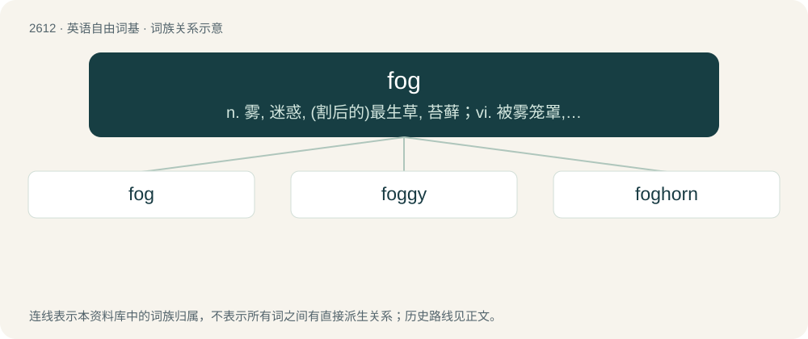

# 2713 · fog — n. 雾, 迷惑, (割后的)最生草, 苔藓；vi. 被雾笼罩, 变模糊；vt. 使困惑, 以雾笼罩

[总目录](../00_总目录_按常用程度.md)

**类型**：英语自由词基　｜　**来源语言**：见词源记录

## 核心含义与来源

- 核心含义：n. 雾, 迷惑, (割后的)最生草, 苔藓；vi. 被雾笼罩, 变模糊；vt. 使困惑, 以雾笼罩
- 英文含义：A thick cloud that forms near the ground; the obscurity of such a cloud.
- 词形：fog

**多个词源／构词路径**：同一拼写可能有不同来源；以下按词性和含义分别列出。

**来源记录 1**（名词；A thick cloud that forms near the ground; the obscurity of such a cloud.）

Origin uncertain; but probably of North Germanic origin. Probably either a back-formation from foggy (“covered with tall grass; thick, marshy”), from the earlier-attested fog (“tall grass”) (see below), or from or related to Danish fog (“spray, shower, drift, storm”), related to Icelandic fok (“spray, any light thing tossed by the wind, snowdrift”), Icelandic fjúka (“to blow, drive”), from Proto-Germanic \*feukaną (“to whisk, blow”), from Proto-Indo-European \*pug- (“billow, bulge, drift”), from \*pew-, \*pow- (“to blow, drift, billow”), in which case related to German fauchen (“to hiss, spit, spray”).

**来源记录 2**（名词；A new growth of grass appearing on a field that has been mowed or grazed.）

From Middle English fogge (“tall grass”), probably from Norwegian fogg (“tall, worthless grass”); compare Scots fog (“moss; lichen”).

## 词族图

## 单词速览（常用到不常用）

| 单词 | 音标 | 释义 |
|---|---|---|
| [fog](#w-1) | 英 /fɒɡ/；美 /fɑɡ/ | n. 雾, 迷惑, (割后的)最生草, 苔藓；vi. 被雾笼罩, 变模糊；vt. 使困惑, 以雾笼罩 |
| [foggy](#w-2) | /ˈfɒɡi/ | a. 雾深的, 模糊的 |
| [foghorn](#w-3) | /ˈfɒghɒːn/ | n. 雾号, 响而尖的声音 |

## 逐词详解

### 1. fog

**词性**：名词　｜　**音标**：英 /fɒɡ/；美 /fɑɡ/

**中文释义**：n. 雾, 迷惑, (割后的)最生草, 苔藓；vi. 被雾笼罩, 变模糊；vt. 使困惑, 以雾笼罩

**英文义项**：A thick cloud that forms near the ground; the obscurity of such a cloud. / A mist or film clouding a surface.

**词源与演化**：

Origin uncertain; but probably of North Germanic origin. Probably either a back-formation from foggy (“covered with tall grass; thick, marshy”), from the earlier-attested fog (“tall grass”) (see below), or from or related to Danish fog (“spray, shower, drift, storm”), related to Icelandic fok (“spray, any light thing tossed by the wind, snowdrift”), Icelandic fjúka (“to blow, drive”), from Proto-Germanic \*feukaną (“to whisk, blow”), from Proto-Indo-European \*pug- (“billow, bulge, drift”), from \*pew-, \*pow- (“to blow, drift, billow”), in which case related to German fauchen (“to hiss, spit, spray”).

**例句**：

> He did so many drugs, he was still in a fog three months after going through detox.

该用例对应义项：A state of mind characterized by lethargy and confusion.

### 2. foggy

**词性**：形容词　｜　**音标**：/ˈfɒɡi/

**中文释义**：a. 雾深的, 模糊的

**英文义项**：Obscured by mist or fog; unclear; hazy. / Confused, befuddled, or vague.

**构词拆分**：fog + -y

**词源与演化**：

From fog + -y, originally in the sense "covered with tall grass; marshy; thick". It is not clear whether fog (“mist”) is a back-formation from foggy (“covered with tall, obscuring grass”) or has a separate Germanic origin, and hence whether foggy (“covered with tall grass”) and foggy (“obscured by mist”) represent one word or two. See fog ("mist"; "tall grass") for more.

**例句**：

> He was still foggy with sleep.

该用例对应义项：Confused, befuddled, or vague.

### 3. foghorn

**词性**：名词　｜　**音标**：/ˈfɒghɒːn/

**中文释义**：n. 雾号, 响而尖的声音

**英文义项**：A very loud low-pitched horn, used especially in lighthouses and on large boats. / A strong gossiper.

**构词拆分**：fog + horn

**词源与演化**：

From fog + horn.

**例句**：

> We could hear a foghorn in the distance.
