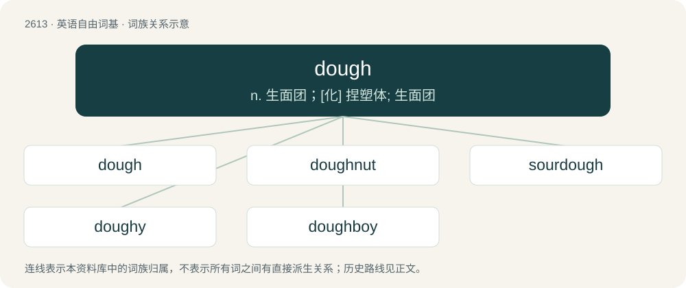

# 2715 · dough — n. 生面团；\[化\] 捏塑体; 生面团

[总目录](../00_总目录_按常用程度.md)

**类型**：英语自由词基　｜　**来源语言**：见词源记录

## 核心含义与来源

- 核心含义：n. 生面团；\[化\] 捏塑体; 生面团
- 英文含义：A thick, malleable substance made by mixing flour with other ingredients such as water, eggs, or butter, that is made into a particular form and then baked.
- 词形：dough

**来源记录 1**（名词；A thick, malleable substance made by mixing flour with other ingredients such as water, eggs, or butter, that is made into a particular form and then baked.）

From Middle English dow, dogh, dagh, from Old English dāg, from Proto-Germanic \*daigaz (“dough”), from Proto-Indo-European \*dʰeyǵʰ- (“to knead, form, mold”). Cognate with Scots daich, dauch, doach (“dough”), North Frisian dii, Jai (“dough”), West Frisian daai (“dough”), Dutch deeg (“dough”), German Teig (“dough”), Low German and Luxembourgish Deeg (“dough”), Vilamovian taag (“dough”), Yiddish טייג (teyg, “dough”), Danish dej (“dough”), Faroese deiggj (“dough”), Icelandic, Norwegian Bokmål, and Norwegian Nynorsk deig (“dough”), Swedish deg (“dough”), Gothic 𐌳𐌰𐌹𐌲𐍃 (daigs, “dough”). The derivation of the second meaning (of money) is obscure, but dates to the mid 19th century.

## 词族图

## 单词速览（常用到不常用）

| 单词 | 音标 | 释义 |
|---|---|---|
| [dough](#w-1) | 英 /dəʊ/；美 /doʊ/ | n. 生面团；\[化\] 捏塑体; 生面团 |
| [doughnut](#w-2) | 英 /ˈdəʊnʌt/；美 /ˈdoʊ(ˌ)nʌt/ | n. 油炸圈饼, 环状物；\[计\] 圆环图 |
| [sourdough](#w-3) | 英 /ˈsaʊəˌdəʊ/；美 /ˈsaʊɚˌdoʊ/ | n. 含酵母的面团 |
| [doughy](#w-4) | 英 /ˈdəʊˌi/；美 /ˈdoʊi/ | a. 面团的, 半熟的, 苍白的；\[医\] 柔软的, 生面团似的, 迟钝的 |
| [doughboy](#w-5) | /ˈdəubɒi/ | n. 团子, 步兵 |

## 逐词详解

### 1. dough

**词性**：名词　｜　**音标**：英 /dəʊ/；美 /doʊ/

**中文释义**：n. 生面团；\[化\] 捏塑体; 生面团

**英文义项**：A thick, malleable substance made by mixing flour with other ingredients such as water, eggs, or butter, that is made into a particular form and then baked. / Money.

**词源与演化**：

From Middle English dow, dogh, dagh, from Old English dāg, from Proto-Germanic \*daigaz (“dough”), from Proto-Indo-European \*dʰeyǵʰ- (“to knead, form, mold”). Cognate with Scots daich, dauch, doach (“dough”), North Frisian dii, Jai (“dough”), West Frisian daai (“dough”), Dutch deeg (“dough”), German Teig (“dough”), Low German and Luxembourgish Deeg (“dough”), Vilamovian taag (“dough”), Yiddish טייג (teyg, “dough”), Danish dej (“dough”), Faroese deiggj (“dough”), Icelandic, Norwegian Bokmål, and Norwegian Nynorsk deig (“dough”), Swedish deg (“dough”), Gothic 𐌳𐌰𐌹𐌲𐍃 (daigs, “dough”). The derivation of the second meaning (of money) is obscure, but dates to the mid 19th century.

**例句**：

> His mortgage payments left him short on dough.

该用例对应义项：Money.

### 2. doughnut

**词性**：名词　｜　**音标**：英 /ˈdəʊnʌt/；美 /ˈdoʊ(ˌ)nʌt/

**中文释义**：n. 油炸圈饼, 环状物；\[计\] 圆环图

**英文义项**：A deep-fried piece of dough or batter, usually mixed with various sweeteners and flavors, often made in a toroidal or ellipsoidal shape flattened sphere shape filled with jelly/jam, custard, or cream. / A circular life raft.

**构词拆分**：dough + nut

**词源与演化**：

From dough + nut, 1809 because originally small, nut-sized balls of fried dough, or, more likely, from nut in the earlier sense of "small rounded cake or cookie", with the toroidal shape becoming common in the twentieth century. First attested in Knickerbocker’s History of New York, by Washington Irving, 1809.

**例句**：

> Nice going, you doughnut!

该用例对应义项：A foolish or stupid person; an idiot.

### 3. sourdough

**词性**：名词　｜　**音标**：英 /ˈsaʊəˌdəʊ/；美 /ˈsaʊɚˌdoʊ/

**中文释义**：n. 含酵母的面团

**英文义项**：A type of bread dough leavened with yeast and lactobacilli that produce acids giving a sour taste. / An old-timer, especially in Alaska.

**构词拆分**：sour + dough

**词源与演化**：

From Middle English sour dogh, equivalent to sour + dough. Compare Saterland Frisian Suurdee (“sourdough”), Dutch zuurdeeg (“sourdough”), Low German Suurdeeg (“sourdough”), German Sauerteig (“sourdough”), Danish surdej (“sourdough”), Swedish surdeg (“sourdough”), Icelandic súrdeig (“sourdough”). The senses pertaining to California, Alaska and the Yukon derive from the distinctive pouches of bread starter (starter dough used to make sourdough) worn on a belt or around the neck by experienced prospectors during the Klondike Gold Rush and California Gold Rush.

**例句**：

> Tom makes his bread with only 4 ingredients: flour, water, salt and sourdough.

### 4. doughy

**词性**：形容词　｜　**音标**：英 /ˈdəʊˌi/；美 /ˈdoʊi/

**中文释义**：a. 面团的, 半熟的, 苍白的；\[医\] 柔软的, 生面团似的, 迟钝的

**英文义项**：Pale and flabby, / Soft and heavy.

**构词拆分**：dough + -y

**词源与演化**：

From dough + -y.

### 5. doughboy

**词性**：名词　｜　**音标**：/ˈdəubɒi/

**中文释义**：n. 团子, 步兵

**英文义项**：An American infantryman, especially one from World War I. / A kind of flour dumpling.

**构词拆分**：dough + boy

**词源与演化**：

From dough + boy; its use to refer to an infantryman is unknown, but dates from 1847, during the Mexican–American War.
