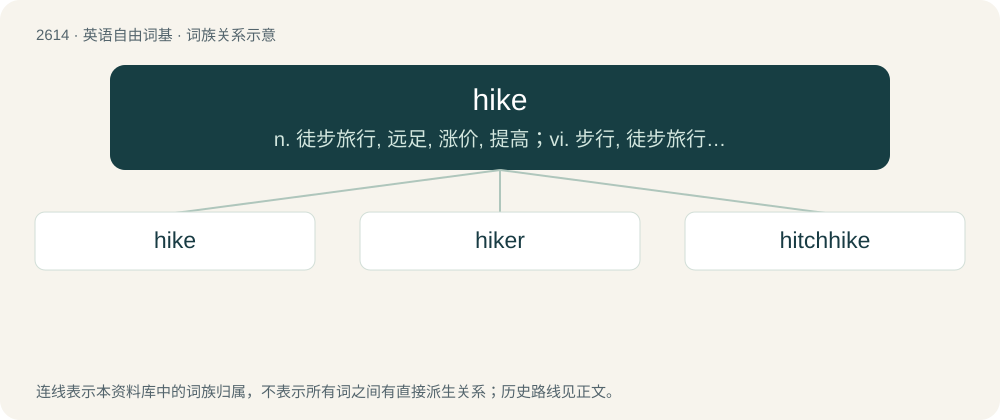

# 2717 · hike — n. 徒步旅行, 远足, 涨价, 提高；vi. 步行, 徒步旅行, 上升；vt. 使高涨, 拉起

[总目录](../00_总目录_按常用程度.md)

**类型**：英语自由词基　｜　**来源语言**：见词源记录

## 核心含义与来源

- 核心含义：n. 徒步旅行, 远足, 涨价, 提高；vi. 步行, 徒步旅行, 上升；vt. 使高涨, 拉起
- 英文含义：A long walk, usually for pleasure or exercise.
- 词形：hike

**来源记录 1**（名词；A long walk, usually for pleasure or exercise.）

From English dialectal hyke (“to walk vigorously”), probably a Northern form of hitch, from Middle English hytchen, hichen, icchen (“to move, jerk, stir”). Cognate with Scots hyke (“to move with a jerk”), dialectal German hicken (“to hobble, walk with a limp”), Danish hinke (“to hop”).

## 词族图

## 单词速览（常用到不常用）

| 单词 | 音标 | 释义 |
|---|---|---|
| [hike](#w-1) | /haɪk/ | n. 徒步旅行, 远足, 涨价, 提高；vi. 步行, 徒步旅行, 上升；vt. 使高涨, 拉起 |
| [hiker](#w-2) | 英 /ˈhaɪ̯kə/；美 /ˈhaɪ̯kɚ/ | n. 徒步旅行者 |
| [hitchhike](#w-3) | /ˈhɪt͡ʃhaɪk/ | vi. 搭便车；vt. 要求(搭便车) |

## 逐词详解

### 1. hike

**词性**：名词　｜　**音标**：/haɪk/

**中文释义**：n. 徒步旅行, 远足, 涨价, 提高；vi. 步行, 徒步旅行, 上升；vt. 使高涨, 拉起

**英文义项**：A long walk, usually for pleasure or exercise. / An abrupt increase.

**词源与演化**：

From English dialectal hyke (“to walk vigorously”), probably a Northern form of hitch, from Middle English hytchen, hichen, icchen (“to move, jerk, stir”). Cognate with Scots hyke (“to move with a jerk”), dialectal German hicken (“to hobble, walk with a limp”), Danish hinke (“to hop”).

**例句**：

> The tenants were not happy with the rent hike.

该用例对应义项：An abrupt increase.

### 2. hiker

**词性**：名词　｜　**音标**：英 /ˈhaɪ̯kə/；美 /ˈhaɪ̯kɚ/

**中文释义**：n. 徒步旅行者

**英文义项**：One who hikes, especially frequently.

**构词拆分**：hike + -er

**词源与演化**：

From hike + -er.

**例句**：

> Ziri and his rescue team were searching for a lost hiker.

### 3. hitchhike

**词性**：动词　｜　**音标**：/ˈhɪt͡ʃhaɪk/

**中文释义**：vi. 搭便车；vt. 要求(搭便车)

**英文义项**：To try to get a ride in a passing vehicle while standing at the side of a road, generally by either sticking out one's finger or thumb or holding a sign with one's stated destination. / To try to get (a ride) in this manner.

**构词拆分**：hitch + hike

**词源与演化**：

From hitch + hike.

**例句**：

> I didn't hitchhike home, even though I told Tom that I would.
