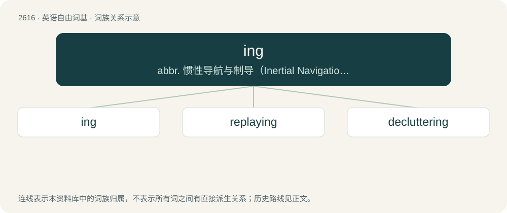

# 2719 · ing — abbr. 惯性导航与制导（Inertial Navigation and Guidance）；强中子发生器（Intense Neutron Generator）

[总目录](../00_总目录_按常用程度.md)

**类型**：英语自由词基　｜　**来源语言**：见词源记录

## 核心含义与来源

- 核心含义：abbr. 惯性导航与制导（Inertial Navigation and Guidance）；强中子发生器（Intense Neutron Generator）
- 英文含义：A meadow, especially a low meadow near a river; water meadow.
- 词形：ing

**多个词源／构词路径**：同一拼写可能有不同来源；以下按词性和含义分别列出。

**来源记录 1**（名词；A meadow, especially a low meadow near a river; water meadow.）

From Middle English ing, ynge, enge, from Old English ing, \*eng (“a meadow; ing”), from Proto-Germanic \*angijō (“meadow”), from Proto-Indo-European \*h₂énkos (“a bend; curve; bowl; hollow; dell; glen”), from \*h₂enk- (“to bend; curve; bow”). Cognate with Scots eng (“ing; meadow”), Dutch eng (“pasture; farmland”), Danish eng (“meadow”), Swedish äng (“meadow; field”), Norwegian eng (“meadow”), Faroese ong (“grassland; meadow; pasture”), Icelandic eng (“a meadow”), Icelandic engi (“a meadow; meadowland”).

**来源记录 2**（名词；The letter for the ng sound /ŋ/ in Pitman shorthand.）

From Pitman em and en, which it is related to phonetically and graphically, and the sound it represents. The change in vowel probably reflects the familiar suffix -ing.

## 词族图

## 单词速览（常用到不常用）

| 单词 | 音标 | 释义 |
|---|---|---|
| [ing](#w-1) | 英 /ɪŋ/ | abbr. 惯性导航与制导（Inertial Navigation and Guidance）；强中子发生器（Intense Neutron Generator） |
| [replaying](#w-2) | /riːˈpleɪŋ/ | v. 重播, 重放( replay的现在分词 ) |
| [decluttering](#w-3) |  | 【英文】The act or process of removing clutter; tidying, removing unwanted or messy items from a given place. |

## 逐词详解

### 1. ing

**词性**：名词　｜　**音标**：英 /ɪŋ/

**中文释义**：abbr. 惯性导航与制导（Inertial Navigation and Guidance）；强中子发生器（Intense Neutron Generator）

**英文义项**：A meadow, especially a low meadow near a river; water meadow.

**词源与演化**：

From Middle English ing, ynge, enge, from Old English ing, \*eng (“a meadow; ing”), from Proto-Germanic \*angijō (“meadow”), from Proto-Indo-European \*h₂énkos (“a bend; curve; bowl; hollow; dell; glen”), from \*h₂enk- (“to bend; curve; bow”). Cognate with Scots eng (“ing; meadow”), Dutch eng (“pasture; farmland”), Danish eng (“meadow”), Swedish äng (“meadow; field”), Norwegian eng (“meadow”), Faroese ong (“grassland; meadow; pasture”), Icelandic eng (“a meadow”), Icelandic engi (“a meadow; meadowland”).

**例句**：

> Ings, glens, and fens of the Highlands.

该用例对应义项：A meadow, especially a low meadow near a river; water meadow.

### 2. replaying

**词性**：名词　｜　**音标**：/riːˈpleɪŋ/

**中文释义**：v. 重播, 重放( replay的现在分词 )

**英文义项**：The act by which something is replayed.

**构词拆分**：re- + play + -ing

**词源与演化**：

From re- + play + -ing.

**例句**：

> It took several replayings before I could write down the entire recorded message.

该用例对应义项：The act by which something is replayed.

### 3. decluttering

**词性**：名词

**英文义项**：The act or process of removing clutter; tidying, removing unwanted or messy items from a given place.

**构词拆分**：de- + clutter + -ing

**词源与演化**：

From de- + clutter + -ing. Compare declutter (attested later).
