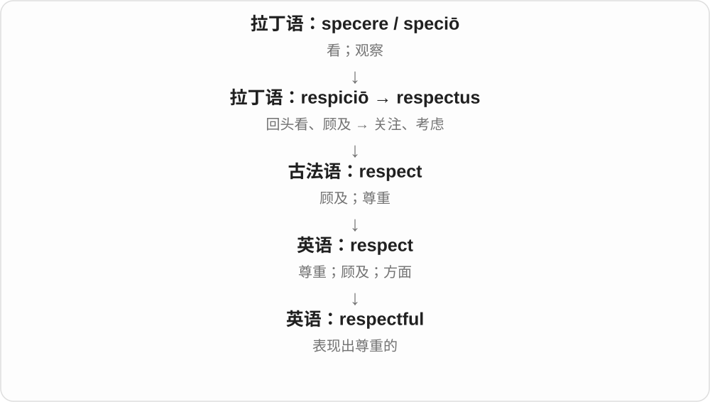

# 2719 · respectful — 有尊重的性质、表达方式与否定

[逐词精讲目录](../00_逐词精讲目录.md) · [总目录](../00_总目录_按常用程度.md)

## 核心词根与来源

核心看态度、方式，不是看每一句是否赞同。respectfully 的近形词 respectively 另有分别地的含义，要按语境辨。

**RESPECTFUL：给对方应有尊重，意见可以仍然不同**

respectful → respectfully；disrespectful 是否定。

- **尊重的性质与方式**：respectful · respectfully
- **缺少尊重**：disrespectful

## 词形与演化规律

respect + -ful；-ly 形成 respectfully；dis- 否定形成 disrespectful。

## 单词速览（按词族由简到繁）

同一基础词的相关扩展放在一起，先读基础形式，再读扩展；各组之间优先读常用的。具体词源关系见各词讲解。

| 单词 | 音标 | 核心意思 |
|---|---|---|
| [respectful](#w-1) | /rɪˈspektfəl/ | 尊重人的；恭敬的 |
| [respectfully](#w-3) | /rɪˈspektfəli/ | 恭敬、尊重地；敬上 |
| [disrespectful](#w-2) | /ˌdɪsrɪˈspektfəl/ | 不尊重人的、无礼的 |

## 逐词讲解

### 1. respectful — 尊重人的；恭敬的

**音标**：/rɪˈspektfəl/

**先抓住这个画面**

respectful 描述你的态度：认真听别人说话，不随意踩过别人的边界。

**怎么拆**

respect + -ful，把“尊重”变成表现出这种态度的形容词。

**怎么变成今天的意思**

可以尊重地表达反对，也可以保持适当距离；它不是要求卑微服从。

**常见搭配与例句**

a respectful tone；be respectful of；a respectful distance。

> Please use a respectful tone during the discussion.

讨论时请保持尊重人的语气。

> They remained respectful of each other’s opinions.

他们仍尊重彼此的意见。

**别混淆**

respectful 是态度，respectable 是值得尊重或体面；respective 是各自的。

### 2. respectfully — 恭敬、尊重地；敬上

**音标**：/rɪˈspektfəli/

**先抓住这个画面**

意见可以不同，讲话方式仍给对方面子、承认对方应受尊重，就是 respectfully；正式信函里也可作为敬意收尾。

**怎么拆**

respectful + -ly，形成方式副词；-ful 自身一个 l，接 -ly 后拼成 -fully。

**怎么变成今天的意思**

**respect 尊重 + -ful → respectful**  
表现出尊重的

↓

**respectful 的方式、否定形式**  
respectfully 以尊重的方式；disrespectful 缺乏尊重

listen respectfully 尊重地倾听，respectfully disagree 恭敬地表示异议，Respectfully yours 正式信函结尾。

**常见搭配与例句**

listen respectfully；respectfully disagree。

> The students listened respectfully to the guest.

学生们尊重地听来宾讲话。

> I respectfully disagree with your conclusion.

我尊重地表达不同意见：我不同意你的结论。

**别混淆**

respectfully 不等于 respectively 分别地；一个说尊重的方式，一个安排各自对应关系。

### 3. disrespectful — 不尊重人的、无礼的

**音标**：/ˌdɪsrɪˈspektfəl/

**先抓住这个画面**

把别人的身份、感受当作不值得在意，说话做事缺少应有尊重，就是 disrespectful。它评价行为方式和态度。

**怎么拆**

dis- 否定、缺乏 + respectful；也能与 disrespect 不尊重 + -ful 的词族关系一起理解。

**怎么变成今天的意思**

**respect 尊重 + -ful → respectful**  
表现出尊重的

↓

**respectful 的方式、否定形式**  
respectfully 以尊重的方式；disrespectful 缺乏尊重

↓

**dis- + respectful → disrespectful**  
缺乏尊重的

be disrespectful to someone 对某人无礼，a disrespectful comment 不尊重人的评论，a disrespectful tone 无礼口气。

**常见搭配与例句**

be disrespectful to；a disrespectful tone。

> His disrespectful tone upset the other participants.

他不尊重人的口气让其他参与者不快。

> She apologised for being disrespectful to the teacher.

她为自己对老师无礼而道歉。

**别混淆**

不同意别人不自动是 disrespectful；不同意见与表达方式是否尊重，是两件可分别判断的事。

## 这一组要分清什么

respectful 表现尊重，respectable 值得尊重，respective 各自；respectfully、respectively 不能混。

## 串起来练习

She remained respectful and expressed her disagreement respectfully.

她保持尊重，并有礼地表达了异议。
