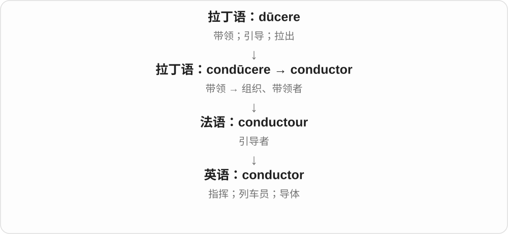

# 2720 · conductor — 引导者；指挥；导体

[逐词精讲目录](../00_逐词精讲目录.md) · [总目录](../00_总目录_按常用程度.md)

## 核心词根与来源

conductor 经法语、拉丁相关名词传入，联系 conduct。semiconductor 是半导体，superconductor 是超导体，科学含义不由日常半、超两个字就能说明完整。

**CONDUCTOR：把人、交通或能量带过一定路线**

乐团指挥引导演奏，材料则传导电或热。

- **人或普通传导材料**：conductor
- **专门材料类别**：semiconductor · superconductor
- **conductor → conductors：指挥、列车员和导体**：conductor · conductors

## 词形与演化规律

conductor 可是人或材料；semi- 在材料分类中不表示恰好传一半电。superconductor 的命名还可联系欧洲语言术语传播。

-or 的执行者可以是人物，也可以是传导物；复数不替你决定具体哪种义。

## 单词速览（按词族由简到繁）

同一基础词的相关扩展放在一起，先读基础形式，再读扩展；各组之间优先读常用的。具体词源关系见各词讲解。

| 单词 | 音标 | 核心意思 |
|---|---|---|
| [conductor](#w-1) | 英 /kənˈdʌktə/；美 /kənˈdʌktər/ | 指挥；列车员；导体 |
| [conductors](#w-4) | 英 /kənˈdʌktəz/；美 /kənˈdʌktərz/ | 指挥；列车员；导体〔复数〕 |
| [semiconductor](#w-2) | 英 /ˌsemikənˈdʌktə/；美 /ˌsemikənˈdʌktər/ | 半导体；半导体器件 |
| [superconductor](#w-3) | 英 /ˌsuːpəkənˈdʌktə/；美 /ˌsuːpərkənˈdʌktər/ | 超导体 |

## 逐词讲解

### 1. conductor — 指挥；列车员；导体

**音标**：英 /kənˈdʌktə/；美 /kənˈdʌktər/

**先抓住这个画面**

conductor 是带着某个东西走的一方：指挥带领乐队，列车员协助乘客乘车，导体让热或电通过。

**怎么拆**

经法语 conductour 等形式来自拉丁语 conductor。现代可看成 conduct + -or，表示执行引导或传导的一方。

**怎么变成今天的意思**

别把三个中文义当成互不相干。共同点都是引导、传递；只是乐队、交通服务和物理学给了它不同角色。

**常见搭配与例句**

an orchestra conductor（乐队指挥）；a train conductor（列车员）；a good conductor of heat（热的良导体）。

> The conductor raised her hands and the orchestra began.

指挥抬起双手，乐队开始演奏。

> Copper is a good conductor of electricity.

铜是电的良导体。

**别混淆**

conductor 让热或电容易通过；insulator 阻碍它们传递。音乐里的 conductor 与作曲者 composer 也不是同一角色。

### 2. conductors — 指挥；列车员；导体〔复数〕

**音标**：英 /kənˈdʌktəz/；美 /kənˈdʌktərz/

**先抓住这个画面**

乐队有人带着走，乘客有人引导查票，电流也有材料让它通过。conductors 把引导、传导这幅画面落到不同对象上。

**怎么拆**

conductor + -s。现代对应 conduct + -or，历史另有法语 conductour、拉丁 conductor 的整词借入路线。

**怎么变成今天的意思**

**拉丁 con- + ducere → conducere、conductus**  
带到一起、引领

↓

**conduct、拉丁 conductor 及法语相关人物名 → 英语词族**  
指挥、实施、传导；指挥者、列车员、导体

↓

**conductor + -s → conductors**  
多个执行引导或传导作用的人、物

orchestral conductors 是乐团指挥，train conductors 是列车员，electrical conductors 是导电物。

**常见搭配与例句**

good conductors of electricity 良好的电导体；guest conductors 客座指挥。

> The orchestra worked with three guest conductors.

乐团与三位客座指挥合作。

> Copper and aluminium are good conductors of electricity.

铜和铝是良好的电导体。

**别混淆**

-or 不保证是人：metal conductors 是导体；看被引导、被传导的对象，意义就容易对上。

### 3. semiconductor — 半导体；半导体器件

**音标**：英 /ˌsemikənˈdʌktə/；美 /ˌsemikənˈdʌktər/

**先抓住这个画面**

像能调节通行程度的道路：材料的导电表现可以被精细改变，因此适合做电子器件。

**怎么拆**

semi- 部分、介于其间 + conductor 导体；英语用已有成分构成科学名称。这里的半描述材料类别，不是一个固定的百分之五十。

**怎么变成今天的意思**

**拉丁 semi- 半；相关名词 semis 一半**  
英语采用为可继续造词的前缀，既可指一半，也可指部分

↓

**英语 semi- + conductor → semiconductor**  
从部分导电的名称发展为现代半导体材料及器件术语

silicon is a semiconductor 是说硅属于半导体材料。添加少量特定杂质等手段能改变导电性；新闻里的 semiconductor industry 指半导体产业，常围绕芯片及相关制造。

**常见搭配与例句**

semiconductor materials；the semiconductor industry；semiconductor manufacturing。

> Silicon is widely used as a semiconductor.

硅被广泛用作半导体。

> The region has invested in semiconductor manufacturing.

该地区投资了半导体制造业。

**别混淆**

conductor 容易导电，insulator 阻碍导电；semiconductor 的价值在于导电特性可调控，不是导线只能工作一半时间。

### 4. superconductor — 超导体

**音标**：英 /ˌsuːpəkənˈdʌktə/；美 /ˌsuːpərkənˈdʌktər/

**先抓住这个画面**

在合适条件下能进入超导状态的材料；“超导”不是这块材料永远不变的表现。

**怎么拆**

英语 super- + conductor；有来源把这一术语联系到荷兰语 suprageleider 的仿译。英语构词透明，但不把术语历史硬归成完全孤立的造词。

**怎么变成今天的意思**

**拉丁 super**  
在上方、超过、越过

↓

**英语构词成分 super-**  
超出一般程度；在上、额外或超过某界限

↓

**英语 super- + conductor → superconductor〔有荷兰语 suprageleider 仿译分析〕**  
能在相应条件下表现超导的材料

a superconductor below its critical temperature 说低于其临界温度的超导体，但电流与磁场也有限制。不能把超导体误说成拒绝电流的绝缘体。

**常见搭配与例句**

a superconducting material；a high-temperature superconductor。

> The sample behaves as a superconductor only within a limited range of conditions.

样品只在有限的条件范围内表现为超导体。

> Researchers compared two types of superconductor.

研究人员比较了两类超导体。

**别混淆**

conductor 泛指能导电的材料；superconductor 是能出现超导状态的特定材料。

## 这一组要分清什么

电导体与乐团指挥共享传导、引导的命名背景，却不是一个对象；超导现象也有特定条件。

## 串起来练习

The conductor led the orchestra, while the physics class studied electrical conductors.

指挥带领乐团，物理课则研究电导体。
