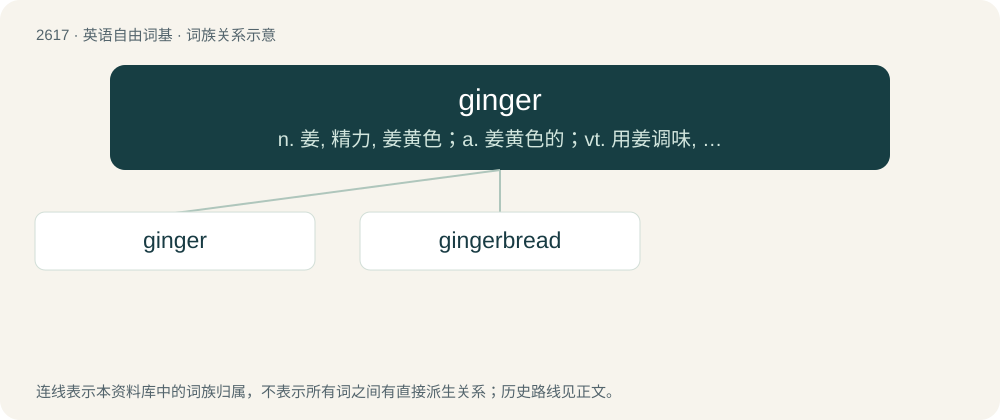

# 2720 · ginger — n. 姜, 精力, 姜黄色；a. 姜黄色的；vt. 用姜调味, 使活泼, 使有生气

[总目录](../00_总目录_按常用程度.md)

**类型**：英语自由词基　｜　**来源语言**：见词源记录

## 核心含义与来源

- 核心含义：n. 姜, 精力, 姜黄色；a. 姜黄色的；vt. 用姜调味, 使活泼, 使有生气
- 英文含义：The pungent aromatic rhizome of a tropical Asian herb, Zingiber officinale, used as a spice and as a stimulant and acarminative.
- 词形：ginger

**多个词源／构词路径**：同一拼写可能有不同来源；以下按词性和含义分别列出。

**来源记录 1**（名词；The pungent aromatic rhizome of a tropical Asian herb, Zingiber officinale, used as a spice and as a stimulant and acarminative.）

Inherited from Middle English gingere, alteration of gingivere, from Old English gingifer, gingiber (influenced by Old French gingembre), from Medieval Latin gingiber, zingiber, from Latin zingiberi, from Late Ancient Greek ζιγγίβερις (zingíberis), from Sauraseni Prakrit 𑀲𑀺𑀁𑀕𑀺𑀯𑁂𑀭 (siṃgivera), ultimately from Old Tamil 𑀇𑀜𑁆𑀘𑀺𑀯𑁂𑀭𑁆 (iñcivēr), a compound of 𑀇𑀜𑁆𑀘𑀺 (iñci, “ginger”) and 𑀯𑁂𑀭𑁆 (vēr, “root”) (compare modern Tamil இஞ்சிவேர் (iñcivēr), from இஞ்சி (iñci, “ginger”) + வேர் (vēr, “root”)).

**来源记录 2**（形容词；Very careful or cautious; also, delicate, sensitive.）

Back-formation from gingerly (adverb).

**来源记录 3**（名词；A homosexual.）

Cockney rhyming slang: ginger beer, queer.

## 词族图

## 单词速览（常用到不常用）

| 单词 | 音标 | 释义 |
|---|---|---|
| [ginger](#w-1) | 英 /ˈdʒɪndʒə/；美 /ˈd͡ʒɪnd͡ʒɚ/ | n. 姜, 精力, 姜黄色；a. 姜黄色的；vt. 用姜调味, 使活泼, 使有生气 |
| [gingerbread](#w-2) | 英 /ˈd͡ʒɪn.(d͡)ʒəˌbɹɛd/；美 /ˈd͡ʒɪn.d͡ʒɚˌbɹɛd/ | n. 姜饼, 俗艳的装饰；a. 俗艳的, 华而不实的 |

## 逐词详解

### 1. ginger

**词性**：名词　｜　**音标**：英 /ˈdʒɪndʒə/；美 /ˈd͡ʒɪnd͡ʒɚ/

**中文释义**：n. 姜, 精力, 姜黄色；a. 姜黄色的；vt. 用姜调味, 使活泼, 使有生气

**英文义项**：The pungent aromatic rhizome of a tropical Asian herb, Zingiber officinale, used as a spice and as a stimulant and acarminative. / The plant that produces this rhizome.

**词源与演化**：

Inherited from Middle English gingere, alteration of gingivere, from Old English gingifer, gingiber (influenced by Old French gingembre), from Medieval Latin gingiber, zingiber, from Latin zingiberi, from Late Ancient Greek ζιγγίβερις (zingíberis), from Sauraseni Prakrit 𑀲𑀺𑀁𑀕𑀺𑀯𑁂𑀭 (siṃgivera), ultimately from Old Tamil 𑀇𑀜𑁆𑀘𑀺𑀯𑁂𑀭𑁆 (iñcivēr), a compound of 𑀇𑀜𑁆𑀘𑀺 (iñci, “ginger”) and 𑀯𑁂𑀭𑁆 (vēr, “root”) (compare modern Tamil இஞ்சிவேர் (iñcivēr), from இஞ்சி (iñci, “ginger”) + வேர் (vēr, “root”)).

**例句**：

> Is it true that ginger increases circulation and improves your metabolism?

### 2. gingerbread

**词性**：名词　｜　**音标**：英 /ˈd͡ʒɪn.(d͡)ʒəˌbɹɛd/；美 /ˈd͡ʒɪn.d͡ʒɚˌbɹɛd/

**中文释义**：n. 姜饼, 俗艳的装饰；a. 俗艳的, 华而不实的

**英文义项**：A type of cake whose main flavoring is ginger. / A flamboyant Victorian-era architectural style.

**构词拆分**：ginger + bread

**词源与演化**：

From Middle English gyngebred, gyngebrede, from Old French gingembras, gingimbrat (“preserved ginger”), from Medieval Latin \*gingimbrātus (“gingered”, presumably referring to ginger that perhaps had a pharmaceutical use for some medicinal preparation), with the intrusive m added to gingiber, from Latin zingiber (“ginger”), of earlier Sanskrit origin, through Ancient Greek ζιγγίβερις (zingíberis). The third syllable was earlier confounded with bread, and the insertion of an r in the second syllable completed the semblance of a compound word: ginger + bread.

**例句**：

> The house of the witch is a gingerbread house in a forest.
