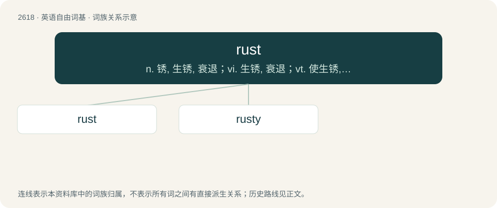

# 2721 · rust — n. 锈, 生锈, 衰退；vi. 生锈, 衰退；vt. 使生锈, 腐蚀

[总目录](../00_总目录_按常用程度.md)

**类型**：英语自由词基　｜　**来源语言**：见词源记录

## 核心含义与来源

- 核心含义：n. 锈, 生锈, 衰退；vi. 生锈, 衰退；vt. 使生锈, 腐蚀
- 英文含义：The deteriorated state of iron or steel as a result of moisture and oxidation; it consists mostly of iron(III) oxide (ferric oxide) and iron(II) oxide (ferrous oxide).
- 词形：rust

**多个词源／构词路径**：同一拼写可能有不同来源；以下按词性和含义分别列出。

**来源记录 1**（名词；The deteriorated state of iron or steel as a result of moisture and oxidation; it consists mostly of iron(III) oxide (ferric oxide) and iron(II) oxide (ferrous oxide).）

From Middle English rust, rost, roust, from Old English rust, rūst (“rust”), from Proto-West Germanic \*rust, from Proto-Germanic \*rustaz (“rust”), from Proto-Indo-European \*rudʰso- (“red”), from Proto-Indo-European \*h₁rewdʰ- (“red”). Cognate with Scots roust (“rust”), Saterland Frisian rust (“rust”), West Frisian roast (“rust”), Dutch roest (“rust”), German Rost (“rust”), Danish rust (“rust”), Swedish rost (“rust”), Norwegian rust, ryst (“rust”), Finnish ruoste, Estonian rooste. Related to red.

**来源记录 2**（动词；To oxidize, especially of iron or steel.）

From Middle English rusten, from the noun (see above).

## 词族图

## 单词速览（常用到不常用）

| 单词 | 音标 | 释义 |
|---|---|---|
| [rust](#w-1) | 英 /ɹʌst/ | n. 锈, 生锈, 衰退；vi. 生锈, 衰退；vt. 使生锈, 腐蚀 |
| [rusty](#w-2) | /ˈɹʌsti/ | a. 生锈的, 腐蚀的, 生疏的, 顽固的, 腐烂的；\[医\] 锈色的 |

## 逐词详解

### 1. rust

**词性**：名词　｜　**音标**：英 /ɹʌst/

**中文释义**：n. 锈, 生锈, 衰退；vi. 生锈, 衰退；vt. 使生锈, 腐蚀

**英文义项**：The deteriorated state of iron or steel as a result of moisture and oxidation; it consists mostly of iron(III) oxide (ferric oxide) and iron(II) oxide (ferrous oxide). / A similar substance based on another metal.

**词源与演化**：

From Middle English rust, rost, roust, from Old English rust, rūst (“rust”), from Proto-West Germanic \*rust, from Proto-Germanic \*rustaz (“rust”), from Proto-Indo-European \*rudʰso- (“red”), from Proto-Indo-European \*h₁rewdʰ- (“red”). Cognate with Scots roust (“rust”), Saterland Frisian rust (“rust”), West Frisian roast (“rust”), Dutch roest (“rust”), German Rost (“rust”), Danish rust (“rust”), Swedish rost (“rust”), Norwegian rust, ryst (“rust”), Finnish ruoste, Estonian rooste. Related to red.

**例句**：

> The rust on my bicycle chain made cycling to work very dangerous.

该用例对应义项：The deteriorated state of iron or steel as a result of moisture and oxidation; it consists mostly of iron(III) oxide (ferric oxide) and iron(II) oxide (ferrous oxide).

### 2. rusty

**词性**：形容词　｜　**音标**：/ˈɹʌsti/

**中文释义**：a. 生锈的, 腐蚀的, 生疏的, 顽固的, 腐烂的；\[医\] 锈色的

**英文义项**：Marked or corroded by rust. / Of the rust color, reddish or reddish-brown.

**构词拆分**：rust + -y

**词源与演化**：

From Middle English rusty, from Old English rūstiġ (“rusty”), from Proto-Germanic \*rustagaz (“rusty”), equivalent to rust + -y. Cognate with Saterland Frisian rusterch (“rusty”), West Frisian rustich, roastich (“rusty”), Dutch roestig (“rusty”), German Low German rusterig, rüsterig (“rusty”), German rostig (“rusty”), Swedish rostig (“rusty”).

**例句**：

> You get rusty if you haven't spoken English for a long time.
