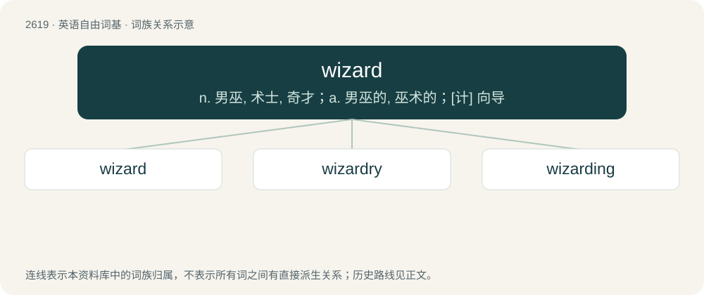

# 2722 · wizard — n. 男巫, 术士, 奇才；a. 男巫的, 巫术的；\[计\] 向导

[总目录](../00_总目录_按常用程度.md)

**类型**：英语自由词基　｜　**来源语言**：见词源记录

## 核心含义与来源

- 核心含义：n. 男巫, 术士, 奇才；a. 男巫的, 巫术的；\[计\] 向导
- 英文含义：Someone, usually male, who uses (or has skill with) magic, mystic items, and magical and mystical practices.
- 词形：wizard

**来源记录 1**（名词；Someone, usually male, who uses (or has skill with) magic, mystic items, and magical and mystical practices.）

From Middle English wysard, wysarde, equivalent to wise + -ard. A uniquely medieval English word with no known morphologically exact cognates in other Germanic languages; did not gain distinct sense of "occultist, magic user" (as opposed to a philosopher or sage) until circa 1500s, aligning roughly with the starting English Renaissance. However, via Proto-Indo-European \*weyd- cognate with Proto-Celtic \*druwits (whence English druid), Proto-Slavic \*vědьma (Polish wiedźma, Russian ве́дьма (védʹma)), Russian веду́н (vedún). The sense of "old (male) virgin" is from a Japanese Internet meme in which virgins who are typically friendless, shy outcasts and loners who don't fit in anywhere legendarily gain magical powers upon reaching 30 years of age; popularized ultimately by 4chan and adjacent online incel spaces. Compare typologically specialist (&lt;&lt; Latin speciō).

## 词族图

## 单词速览（常用到不常用）

| 单词 | 音标 | 释义 |
|---|---|---|
| [wizard](#w-1) | 英 /ˈwɪzəd/；美 /ˈwɪzɚd/ | n. 男巫, 术士, 奇才；a. 男巫的, 巫术的；\[计\] 向导 |
| [wizardry](#w-2) | 美 /ˈwɪzədɹi/ | n. 巫术 |
| [wizarding](#w-3) |  | v. 向导( Wizard的现在分词 ); （尤指故事中的）男巫( wizard的现在分词 ); 术士; &lt;褒&gt;有特殊才干的人; 奇才 |

## 逐词详解

### 1. wizard

**词性**：名词　｜　**音标**：英 /ˈwɪzəd/；美 /ˈwɪzɚd/

**中文释义**：n. 男巫, 术士, 奇才；a. 男巫的, 巫术的；\[计\] 向导

**英文义项**：Someone, usually male, who uses (or has skill with) magic, mystic items, and magical and mystical practices. / One who is especially skilled or unusually talented in a particular field.

**构词拆分**：wise + -ard

**词源与演化**：

From Middle English wysard, wysarde, equivalent to wise + -ard. A uniquely medieval English word with no known morphologically exact cognates in other Germanic languages; did not gain distinct sense of "occultist, magic user" (as opposed to a philosopher or sage) until circa 1500s, aligning roughly with the starting English Renaissance. However, via Proto-Indo-European \*weyd- cognate with Proto-Celtic \*druwits (whence English druid), Proto-Slavic \*vědьma (Polish wiedźma, Russian ве́дьма (védʹma)), Russian веду́н (vedún). The sense of "old (male) virgin" is from a Japanese Internet meme in which virgins who are typically friendless, shy outcasts and loners who don't fit in anywhere legendarily gain magical powers upon reaching 30 years of age; popularized ultimately by 4chan and adjacent online incel spaces. Compare typologically specialist (&lt;&lt; Latin speciō).

**例句**：

> Use the "Add Network Connection" wizard to connect to a network in a series of simple steps.

该用例对应义项：A computer program or script used to simplify complex operations, often for an inexperienced user.

### 2. wizardry

**词性**：名词　｜　**音标**：美 /ˈwɪzədɹi/

**中文释义**：n. 巫术

**英文义项**：The art of a wizard; sorcery. / Something, such as an advanced technology, that gives the appearance of magic.

**构词拆分**：wizard + -ry

**词源与演化**：

From wizard + -ry.

**例句**：

> He used his computing wizardry to automate the search-and-replace process.

该用例对应义项：Great ability in some specified field.

### 3. wizarding

**词性**：名词

**中文释义**：v. 向导( Wizard的现在分词 ); （尤指故事中的）男巫( wizard的现在分词 ); 术士; &lt;褒&gt;有特殊才干的人; 奇才

**英文义项**：The magical work of a wizard; sorcery, witchcraft.

**构词拆分**：wizard + -ing

**词源与演化**：

From wizard + -ing, popularized in the late 1990s by J. K. Rowling's Harry Potter novels.
