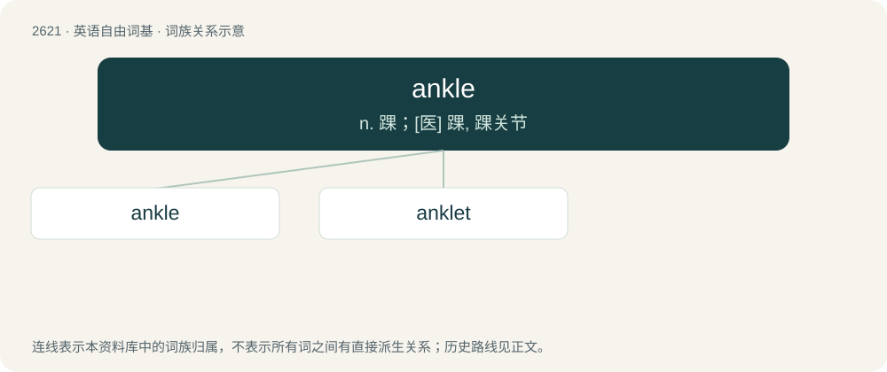

# 2724 · ankle — n. 踝；\[医\] 踝, 踝关节

[总目录](../00_总目录_按常用程度.md)

**类型**：英语自由词基　｜　**来源语言**：见词源记录

## 核心含义与来源

- 核心含义：n. 踝；\[医\] 踝, 踝关节
- 英文含义：The skeletal joint which connects the foot with the leg; the uppermost portion of the foot and lowermost portion of the leg, which contain this skeletal joint.
- 词形：ankle

**来源记录 1**（名词；The skeletal joint which connects the foot with the leg; the uppermost portion of the foot and lowermost portion of the leg, which contain this skeletal joint.）

From Middle English ankel, ancle, ankyll, from Old English ancol (compare anclēow (“ankle”) &gt; Modern English anclef, ancliff, ancley), from Proto-West Germanic \*ankul, from Proto-Germanic \*ankulaz (“ankle”); akin to Icelandic ökkla, ökli, Danish and Swedish ankel, Dutch enkel, enklaauw, German Enkel, Old Norse akka, Old Frisian anckel, and perhaps Old High German encha, ancha (“thigh, shin”), from the Proto-Germanic \*ankijǭ (“ankle, joint”). Compare with Sanskrit अङ्ग (aṅga, “limb”), अङ्गुरि (aṅguri, “finger”), Latin angulus. Compare haunch and Greek prefix ἀγκυλο- (ankulo-, “joint, crooked, bent”). Doublet of angulus and angle.

## 词族图

## 单词速览（常用到不常用）

| 单词 | 音标 | 释义 |
|---|---|---|
| [ankle](#w-1) | 英 /ˈæŋ.kəl/；/ˈeɪ̯ŋ.kəl/ | n. 踝；\[医\] 踝, 踝关节 |
| [anklet](#w-2) | /ˈæŋklət/ | n. 短袜, 脚镯, 脚镣 |

## 逐词详解

### 1. ankle

**词性**：名词　｜　**音标**：英 /ˈæŋ.kəl/；/ˈeɪ̯ŋ.kəl/

**中文释义**：n. 踝；\[医\] 踝, 踝关节

**英文义项**：The skeletal joint which connects the foot with the leg; the uppermost portion of the foot and lowermost portion of the leg, which contain this skeletal joint.

**词源与演化**：

From Middle English ankel, ancle, ankyll, from Old English ancol (compare anclēow (“ankle”) &gt; Modern English anclef, ancliff, ancley), from Proto-West Germanic \*ankul, from Proto-Germanic \*ankulaz (“ankle”); akin to Icelandic ökkla, ökli, Danish and Swedish ankel, Dutch enkel, enklaauw, German Enkel, Old Norse akka, Old Frisian anckel, and perhaps Old High German encha, ancha (“thigh, shin”), from the Proto-Germanic \*ankijǭ (“ankle, joint”). Compare with Sanskrit अङ्ग (aṅga, “limb”), अङ्गुरि (aṅguri, “finger”), Latin angulus. Compare haunch and Greek prefix ἀγκυλο- (ankulo-, “joint, crooked, bent”). Doublet of angulus and angle.

**例句**：

> I could have won the race if I hadn't sprained my ankle.

### 2. anklet

**词性**：名词　｜　**音标**：/ˈæŋklət/

**中文释义**：n. 短袜, 脚镯, 脚镣

**英文义项**：A piece of jewelry/jewellery, resembling a bracelet but worn around the ankle. / An ankle sock.

**构词拆分**：ankle + -et

**词源与演化**：

From ankle + -et, based on bracelet.

**例句**：

> All Tom could envision was her gold anklet jingling against her bronze skin.
