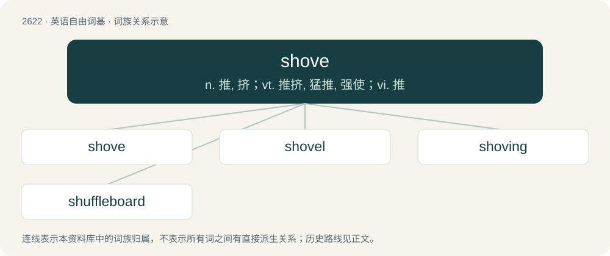

# 2725 · shove — n. 推, 挤；vt. 推挤, 猛推, 强使；vi. 推

[总目录](../00_总目录_按常用程度.md)

**类型**：英语自由词基　｜　**来源语言**：见词源记录

## 核心含义与来源

- 核心含义：n. 推, 挤；vt. 推挤, 猛推, 强使；vi. 推
- 英文含义：To push, especially roughly or with force.
- 词形：shove

**来源记录 1**（动词；To push, especially roughly or with force.）

From Middle English schouven, from Old English sċūfan, from Proto-West Germanic \*skeuban, from Proto-Germanic \*skeubaną, from Proto-Indo-European \*skewbʰ-. See also West Frisian skowe, Low German schuven, Dutch schuiven, German schieben, Danish skubbe, Norwegian Bokmål skyve, Norwegian Nynorsk skuva; also Lithuanian skùbti (“to hurry”), Polish skubać (“to pluck”), Albanian humb (“to lose”).

## 词族图

## 单词速览（常用到不常用）

| 单词 | 音标 | 释义 |
|---|---|---|
| [shove](#w-1) | /ʃʌv/ | n. 推, 挤；vt. 推挤, 猛推, 强使；vi. 推 |
| [shovel](#w-2) | 英 /ˈʃʌv.əl/ | n. 铲, 铁铲；v. 铲 |
| [shoving](#w-3) | /ˈʃʌvɪŋ/ | v. 推开, 挤浆（shove的ing形式） |
| [shuffleboard](#w-4) | /ˈʃʌflbɒːd/ | n. 推圆盘游戏 |

## 逐词详解

### 1. shove

**词性**：动词　｜　**音标**：/ʃʌv/

**中文释义**：n. 推, 挤；vt. 推挤, 猛推, 强使；vi. 推

**英文义项**：To push, especially roughly or with force. / To move off or along by an act of pushing, as with an oar or pole used in a boat; sometimes with off.

**词源与演化**：

From Middle English schouven, from Old English sċūfan, from Proto-West Germanic \*skeuban, from Proto-Germanic \*skeubaną, from Proto-Indo-European \*skewbʰ-. See also West Frisian skowe, Low German schuven, Dutch schuiven, German schieben, Danish skubbe, Norwegian Bokmål skyve, Norwegian Nynorsk skuva; also Lithuanian skùbti (“to hurry”), Polish skubać (“to pluck”), Albanian humb (“to lose”).

**例句**：

> If he had insulted me, I would have given him a shove.

### 2. shovel

**词性**：动词　｜　**音标**：英 /ˈʃʌv.əl/

**中文释义**：n. 铲, 铁铲；v. 铲

**英文义项**：To move materials with a shovel. / To move with a shoveling motion.

**构词拆分**：shove + -el (instrumental/agent suffix)

**词源与演化**：

From Middle English schovele, schovel, showell, shole (&gt; English dialectal shoul, shool), from Old English scofl (“shovel”), from Proto-Germanic \*skuflō, \*skūflō (“shovel”), equivalent to shove + -el (instrumental/agent suffix). Cognate with Scots shuffle, shule, shuil (“shovel”), Saterland Frisian Sköifel (“shovel”), West Frisian skoffel, schoffel (“hoe, spade, shovel”), Dutch schoffel (“spade, hoe”), Low German Schüfel, Schuffel (“shovel”), German Schaufel (“shovel”), Danish skovl (“shovel”), Faroese skupla (“shovel”), Icelandic skófla (“shovel”), Norwegian skyfle (“shovel”), skyffel (“shovel, hoe”), Swedish skyffel, skovel (“shovel”). Compare typologically Russian пешня (pešnja) (akin to пиха́ть (pixátʹ)), сово́к (sovók) (akin to сова́ть (sovátʹ)).

**例句**：

> After the blizzard, we shoveled the driveway for the next two days.

该用例对应义项：To move materials with a shovel.

### 3. shoving

**词性**：名词　｜　**音标**：/ˈʃʌvɪŋ/

**中文释义**：v. 推开, 挤浆（shove的ing形式）

**英文义项**：The act of one who shoves.

**构词拆分**：shove + -ing

**词源与演化**：

From Middle English schovynge; equivalent to shove + -ing.

**例句**：

> We were soon separated by the pushings and shovings of the crowd.

该用例对应义项：The act of one who shoves.

### 4. shuffleboard

**词性**：名词　｜　**音标**：/ˈʃʌflbɒːd/

**中文释义**：n. 推圆盘游戏

**英文义项**：A game that involves sliding a puck or coin towards a target. / The long, narrow board on which this game is played.

**构词拆分**：shove + board

**词源与演化**：

From earlier shovillaborde (“shovel board”), an alteration of shove-board, from shove + board.
