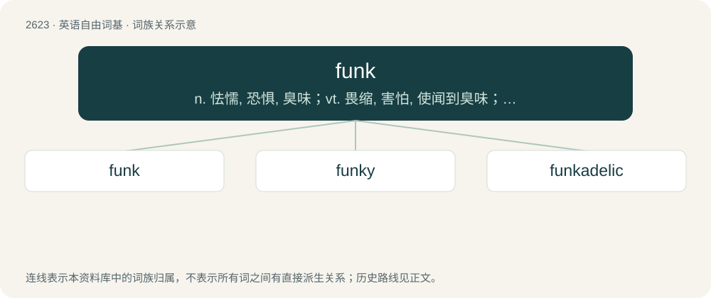

# 2726 · funk — n. 怯懦, 恐惧, 臭味；vt. 畏缩, 害怕, 使闻到臭味；vi. 惊恐, 发出臭味

[总目录](../00_总目录_按常用程度.md)

**类型**：英语自由词基　｜　**来源语言**：见词源记录

## 核心含义与来源

- 核心含义：n. 怯懦, 恐惧, 臭味；vt. 畏缩, 害怕, 使闻到臭味；vi. 惊恐, 发出臭味
- 英文含义：Foul or unpleasant smell, especially body odor.
- 词形：funk

**多个词源／构词路径**：同一拼写可能有不同来源；以下按词性和含义分别列出。

**来源记录 1**（名词；Foul or unpleasant smell, especially body odor.）

1620, from French dialectal (Norman) funquer, funquier (“to smoke, reek”), from Old Northern French fungier (“to smoke”), from Vulgar Latin fūmicāre, alteration of Latin fūmigāre (“to smoke, fumigate”). Related to French dialect funkière (“smoke”). More at fumigate.

**来源记录 2**（名词；Mental depression.）

1743, Scottish and Northern English dialectal word, originally a verb meaning “to panic, fail due to panic”. Perhaps from or cognate with obsolete Dutch fonck (“distress, agitation”), from Middle Dutch fonck (“perturbation, agitation”). More at flunk.

## 词族图

## 单词速览（常用到不常用）

| 单词 | 音标 | 释义 |
|---|---|---|
| [funk](#w-1) | 英 /fʌŋk/ | n. 怯懦, 恐惧, 臭味；vt. 畏缩, 害怕, 使闻到臭味；vi. 惊恐, 发出臭味 |
| [funky](#w-2) | /fʌŋki/ | a. 畏缩的, 怯懦的, 恶臭的 |
| [funkadelic](#w-3) | /ˌfʌŋkəˈdɛlɪk/ | 【英文】Of, or relating to, funkadelia. |

## 逐词详解

### 1. funk

**词性**：动词　｜　**音标**：英 /fʌŋk/

**中文释义**：n. 怯懦, 恐惧, 臭味；vt. 畏缩, 害怕, 使闻到臭味；vi. 惊恐, 发出臭味

**英文义项**：To emit an offensive smell; to stink. / To envelop with an offensive smell or smoke.

**词源与演化**：

1620, from French dialectal (Norman) funquer, funquier (“to smoke, reek”), from Old Northern French fungier (“to smoke”), from Vulgar Latin fūmicāre, alteration of Latin fūmigāre (“to smoke, fumigate”). Related to French dialect funkière (“smoke”). More at fumigate.

**用法示例／搭配（非完整句）**：

> Funk this!

该用例对应义项：Fuck (the taboo swear word).

### 2. funky

**词性**：形容词　｜　**音标**：/fʌŋki/

**中文释义**：a. 畏缩的, 怯懦的, 恶臭的

**英文义项**：Offbeat, unconventional or eccentric. / Not quite right; of questionable quality; not appropriate to the context.

**构词拆分**：funk + -y

**词源与演化**：

From funk + -y.

**例句**：

> She likes funky clothes.

该用例对应义项：stylish and modern in an unconventional way

### 3. funkadelic

**词性**：形容词　｜　**音标**：/ˌfʌŋkəˈdɛlɪk/

**英文义项**：Of, or relating to, funkadelia. / Having a funky beat.

**构词拆分**：funk + -adelic

**词源与演化**：

From funk + -adelic.
