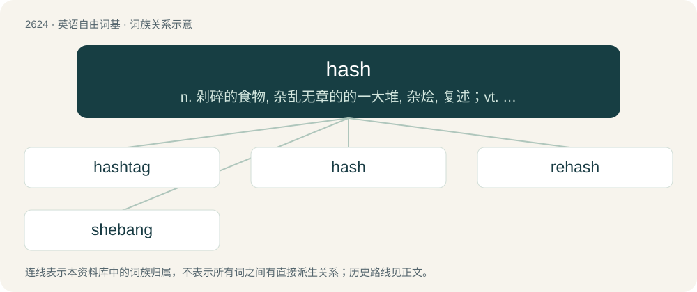

# 2727 · hash — n. 剁碎的食物, 杂乱无章的的一大堆, 杂烩, 复述；vt. 切碎, 搞糟

[总目录](../00_总目录_按常用程度.md)

**类型**：英语自由词基　｜　**来源语言**：见词源记录

## 核心含义与来源

- 核心含义：n. 剁碎的食物, 杂乱无章的的一大堆, 杂烩, 复述；vt. 切碎, 搞糟
- 英文含义：Food, especially meat and potatoes, chopped and mixed together.
- 词形：hash

**多个词源／构词路径**：同一拼写可能有不同来源；以下按词性和含义分别列出。

**来源记录 1**（名词；Food, especially meat and potatoes, chopped and mixed together.）

From French hacher (“to chop”), from Middle French hacher, from Old French hacher, from Old French hache (“axe”), from Frankish \*happjā (“axe”). Compare also Old English ġehæċċa (“sausage meat”, literally “that which is hacked or chopped up”).

**来源记录 2**（名词；Hashish, a drug derived from the cannabis plant.）

Clipping of hashish.

## 词族图

## 单词速览（常用到不常用）

| 单词 | 音标 | 释义 |
|---|---|---|
| [hashtag](#w-1) | 美 /ˈhæʃˌtæɡ/ | n. 井号(#)标签（微博twitter中用来标注线索主题的标签） |
| [hash](#w-2) | /ˈhæʃ/ | n. 剁碎的食物, 杂乱无章的的一大堆, 杂烩, 复述；vt. 切碎, 搞糟 |
| [rehash](#w-3) | /ɹiːˈhæʃ/ | vt. 重讲, 改头换面地重复；n. 改头换面的作品 |
| [shebang](#w-4) | /ʃɪˈbæŋ(ɡ)/ | 【英文】The character string "#!" used at the beginning of a computer file to indicate which interpreter can process the commands in the file, chiefly used in Unix and related operating systems. |

## 逐词详解

### 1. hashtag

**词性**：名词　｜　**音标**：美 /ˈhæʃˌtæɡ/

**中文释义**：n. 井号(#)标签（微博twitter中用来标注线索主题的标签）

**英文义项**：A metadata tag, signaled by a preceding hash sign (#), used to label content. / The hash sign itself, especially when used as part of a hashtag.

**构词拆分**：hash (sign) + tag

**词源与演化**：

From earlier hash tag, from hash (sign) + tag. The hash sign # was initially proposed as tag hash by Chris Messina to create groups on Twitter, modeled after the IRC channel prefix. First published use as hash tag by Stowe Boyd in 2007.

**例句**：

> Since 2019, the hashtag #okboomer has been used 3.7 billion times on TikTok.

### 2. hash

**词性**：动词　｜　**音标**：/ˈhæʃ/

**中文释义**：n. 剁碎的食物, 杂乱无章的的一大堆, 杂烩, 复述；vt. 切碎, 搞糟

**英文义项**：To chop into small pieces, to make into a hash. / To make a quick, rough version.

**词源与演化**：

From French hacher (“to chop”), from Middle French hacher, from Old French hacher, from Old French hache (“axe”), from Frankish \*happjā (“axe”). Compare also Old English ġehæċċa (“sausage meat”, literally “that which is hacked or chopped up”).

**例句**：

> We need to quickly hash up some plans.

该用例对应义项：To make a quick, rough version.

### 3. rehash

**词性**：动词　｜　**音标**：/ɹiːˈhæʃ/

**中文释义**：vt. 重讲, 改头换面地重复；n. 改头换面的作品

**英文义项**：To hash (chop food into small pieces) again. / To repeat with minor variation.

**构词拆分**：re- + hash

**词源与演化**：

From re- + hash.

**例句**：

> The CEO of the company only rehashed a speech for the news conference.

该用例对应义项：To repeat with minor variation.

### 4. shebang

**词性**：名词　｜　**音标**：/ʃɪˈbæŋ(ɡ)/

**英文义项**：The character string "#!" used at the beginning of a computer file to indicate which interpreter can process the commands in the file, chiefly used in Unix and related operating systems.

**构词拆分**：hash + bang；sharp + bang

**词源与演化**：

From hash + bang or sharp + bang, after Etymology 1.
