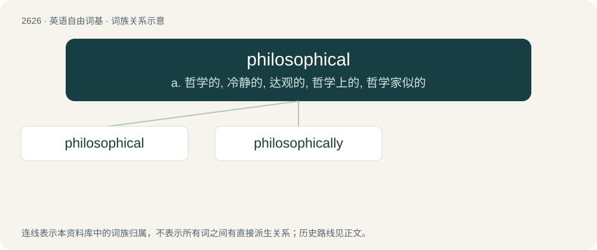

# 2729 · philosophical — a. 哲学的, 冷静的, 达观的, 哲学上的, 哲学家似的

[总目录](../00_总目录_按常用程度.md)

**类型**：英语自由词基　｜　**来源语言**：见词源记录

## 核心含义与来源

- 核心含义：a. 哲学的, 冷静的, 达观的, 哲学上的, 哲学家似的
- 英文含义：Of, or pertaining to, philosophy.
- 词形：philosophical

**来源记录 1**（形容词；Of, or pertaining to, philosophy.）

From philosophy + -ical, from Ancient Greek φιλοσοφία (philosophía, “love of knowledge, scientific learning”). Displaced native Old English ūþwitlīċ.

## 词族图

## 单词速览（常用到不常用）

| 单词 | 音标 | 释义 |
|---|---|---|
| [philosophical](#w-1) | 英 /ˌfɪl.əˈsɒf.ɪ.kl̩/；美 /ˌfɪl.əˈsɑ.fɪ.kl̩/ | a. 哲学的, 冷静的, 达观的, 哲学上的, 哲学家似的 |
| [philosophically](#w-2) |  | adv. 哲学上；贤明地 |

## 逐词详解

### 1. philosophical

**词性**：形容词　｜　**音标**：英 /ˌfɪl.əˈsɒf.ɪ.kl̩/；美 /ˌfɪl.əˈsɑ.fɪ.kl̩/

**中文释义**：a. 哲学的, 冷静的, 达观的, 哲学上的, 哲学家似的

**英文义项**：Of, or pertaining to, philosophy. / Rational; analytic or critically minded; thoughtful.

**构词拆分**：philosophy + -ical

**词源与演化**：

From philosophy + -ical, from Ancient Greek φιλοσοφία (philosophía, “love of knowledge, scientific learning”). Displaced native Old English ūþwitlīċ.

**例句**：

> A considerable knowledge of philosophical terminology.

该用例对应义项：of or relating to philosophy or philosophers

### 2. philosophically

**词性**：副词

**中文释义**：adv. 哲学上；贤明地

**英文义项**：With regards to philosophy / In a philosophical (calm and stoically accepting) manner.

**构词拆分**：philosophical + -ly

**词源与演化**：

From philosophical + -ly.

**例句**：

> She took it philosophically.

该用例对应义项：in a philosophic manner
