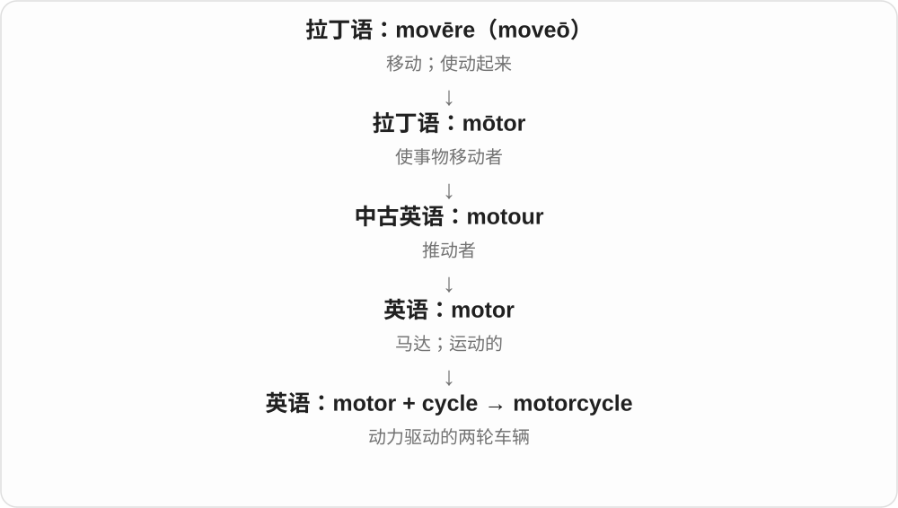
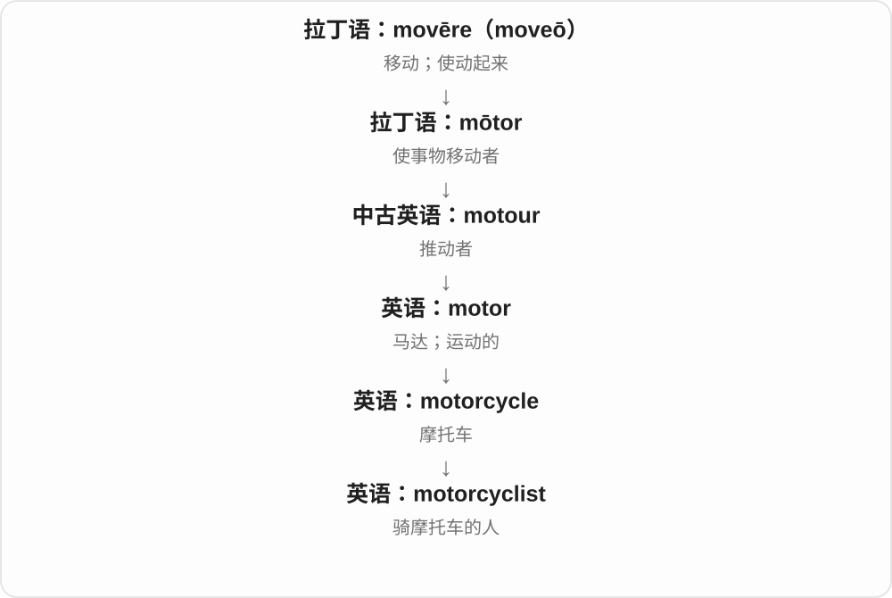

# 2730 · motorcycle — 摩托车；摩托车手

[逐词精讲目录](../00_逐词精讲目录.md) · [总目录](../00_总目录_按常用程度.md)

## 核心词根与来源

motorcycle 由 motor 与 cycle 的交通工具用法组合。motorcyclist 是相应骑乘者，现代使用 -ist 的人物名称。

**MOTORCYCLE：用发动机驱动的两轮车辆**

从车本身，走到骑这类车的人。

- **车辆与骑乘者**：motorcycle · motorcyclist

## 词形与演化规律

motorcycle 的复数 motorcycles；motorcyclist 中不保留 cycle 词尾 e。英语也常用 motorbike。

## 单词速览（按词族由简到繁）

同一基础词的相关扩展放在一起，先读基础形式，再读扩展；各组之间优先读常用的。具体词源关系见各词讲解。

| 单词 | 音标 | 核心意思 |
|---|---|---|
| [motorcycle](#w-1) | 英 /ˈməʊtəsaɪkəl/；美 /ˈmoʊtərsaɪkəl/ | 摩托车 |
| [motorcyclist](#w-2) | 英 /ˈməʊtəsaɪklɪst/；美 /ˈmoʊtərsaɪklɪst/ | 摩托车骑手 |

## 逐词讲解

### 1. motorcycle — 摩托车

**音标**：英 /ˈməʊtəsaɪkəl/；美 /ˈmoʊtərsaɪkəl/

**先抓住这个画面**

motorcycle 是把 motor 的动力装到两轮车结构上，不再只靠人蹬踏前进。

**怎么拆**

motor + cycle；词形与早期法国 Motorcyclette 的命名历史有关。

**怎么变成今天的意思**

cycle 指轮式车辆这一支；现代通常是有车把、开放式乘坐的摩托车。

**常见搭配与例句**

ride a motorcycle；a motorcycle helmet；a motorcycle engine。

> She rides a motorcycle to work.

她骑摩托车上班。

> The museum displays an early motorcycle.

博物馆展示了一辆早期摩托车。

**别混淆**

motorcycle 用 ride；普通汽车常用 drive。motorbike 是更口语的近义词。

### 2. motorcyclist — 摩托车骑手

**音标**：英 /ˈməʊtəsaɪklɪst/；美 /ˈmoʊtərsaɪklɪst/

**先抓住这个画面**

motorcyclist 是坐在摩托车上驾驶的人，而不只是喜欢看摩托车的人。

**怎么拆**

motorcycle + -ist；也能看作 motor + cyclist。

**怎么变成今天的意思**

这个名称常从道路使用者或运动参与者角度分类，不说明他是职业车手。

**常见搭配与例句**

a motorcyclist’s helmet；passing motorcyclists；an experienced motorcyclist。

> The motorcyclist stopped at the crossing.

摩托车骑手在人行横道前停下。

> Several motorcyclists were waiting by the café.

几位摩托车骑手在咖啡馆旁等候。

**别混淆**

cyclist 常指骑自行车的人；motorcyclist 明确是摩托车骑手。

## 这一组要分清什么

motorcyclist 骑摩托，cyclist 通常骑自行车；不要只按末尾都相似就忽略前面的 motor。

## 串起来练习

The motorcyclist parked her motorcycle beside the station.

摩托车手把摩托车停在车站旁。
