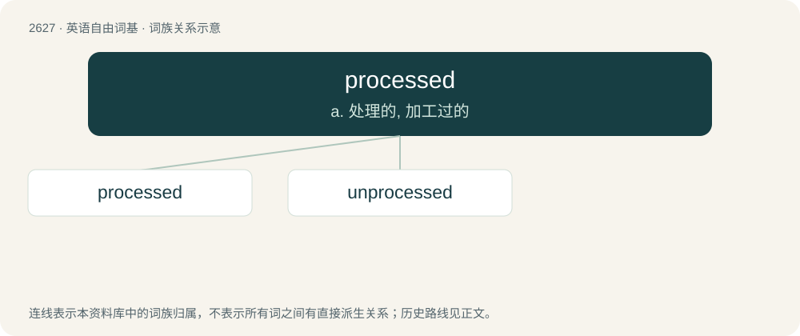

# 2730 · processed — a. 处理的, 加工过的

[总目录](../00_总目录_按常用程度.md)

**类型**：英语自由词基　｜　**来源语言**：见词源记录

## 核心含义与来源

- 核心含义：a. 处理的, 加工过的
- 英文含义：That has completed a required process.
- 词形：processed

**来源记录 1**（形容词；That has completed a required process.）

From process + -ed.

## 词族图

## 单词速览（常用到不常用）

| 单词 | 音标 | 释义 |
|---|---|---|
| [processed](#w-1) | 英 /ˈpɹəʊsɛst/；美 /ˈpɹɑsɛst/ | a. 处理的, 加工过的 |
| [unprocessed](#w-2) | /,ʌnˈprəjsest; -ˈprɔ-/ | a. 未被加工的 |

## 逐词详解

### 1. processed

**词性**：形容词　｜　**音标**：英 /ˈpɹəʊsɛst/；美 /ˈpɹɑsɛst/

**中文释义**：a. 处理的, 加工过的

**英文义项**：That has completed a required process. / Modified through manufacture such as refinement or food processing.

**构词拆分**：process + -ed

**词源与演化**：

From process + -ed.

**例句**：

> The processed data can now be used to generate statistics.

该用例对应义项：That has completed a required process.

### 2. unprocessed

**词性**：形容词　｜　**音标**：/,ʌnˈprəjsest; -ˈprɔ-/

**中文释义**：a. 未被加工的

**英文义项**：Not processed.

**构词拆分**：un- + processed

**词源与演化**：

From un- + processed.

**例句**：

> I've cured all my maladies with a diet of unprocessed food and by forgoing gluten, wheat, and grains.
