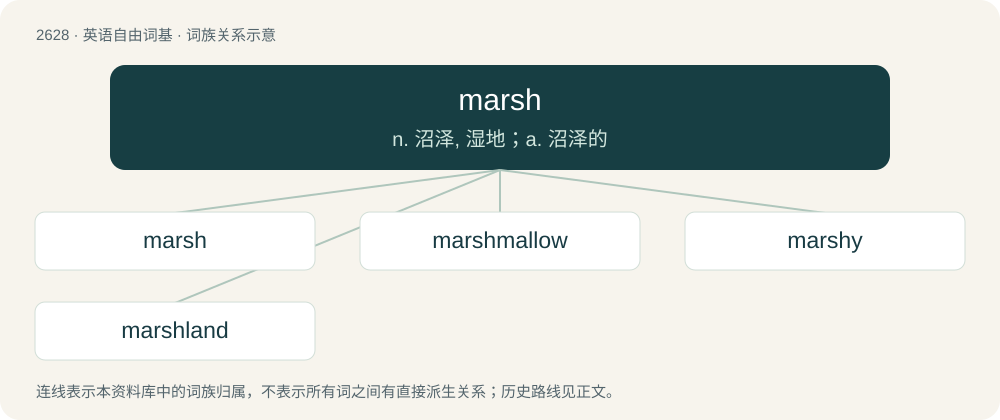

# 2731 · marsh — n. 沼泽, 湿地；a. 沼泽的

[总目录](../00_总目录_按常用程度.md)

**类型**：英语自由词基　｜　**来源语言**：见词源记录

## 核心含义与来源

- 核心含义：n. 沼泽, 湿地；a. 沼泽的
- 英文含义：An area of low, wet land, often with tall grass or herbaceous plants.
- 词形：marsh

**来源记录 1**（名词；An area of low, wet land, often with tall grass or herbaceous plants.）

From Middle English mersch, from Old English mersċ, merisċ, from Proto-West Germanic \*marisk, derived from \*mari, equivalent to mere (“sea, body of water”) + -ish. Doublet of marish, morass, and merse. Cognate with West Frisian mersk, Dutch meers (“grassland, meadow”) and Dutch moeras, German Marsch. More at mere.

## 词族图

## 单词速览（常用到不常用）

| 单词 | 音标 | 释义 |
|---|---|---|
| [marsh](#w-1) | 英 /mɑːʃ/；美 /mɑɹʃ/ | n. 沼泽, 湿地；a. 沼泽的 |
| [marshmallow](#w-2) | 英 /mɑːʃˈmæləʊ/；美 /ˈmɑɹʃˌmɛl.oʊ/ | n. 药用蜀葵, 蜀葵糖剂 |
| [marshy](#w-3) | 美 /ˈmɑɹʃi/ | a. 多沼地的, 湿地的, 沼地的 |
| [marshland](#w-4) |  | n. 沼泽地区, 沼泽地 |

## 逐词详解

### 1. marsh

**词性**：名词　｜　**音标**：英 /mɑːʃ/；美 /mɑɹʃ/

**中文释义**：n. 沼泽, 湿地；a. 沼泽的

**英文义项**：An area of low, wet land, often with tall grass or herbaceous plants.

**构词拆分**：mere (“sea, body of water”) + -ish

**词源与演化**：

From Middle English mersch, from Old English mersċ, merisċ, from Proto-West Germanic \*marisk, derived from \*mari, equivalent to mere (“sea, body of water”) + -ish. Doublet of marish, morass, and merse. Cognate with West Frisian mersk, Dutch meers (“grassland, meadow”) and Dutch moeras, German Marsch. More at mere.

**例句**：

> Čepkeliai Marsh consists mainly of bog.

该用例对应义项：An area of low, wet land, often with tall grass or herbaceous plants.

### 2. marshmallow

**词性**：名词　｜　**音标**：英 /mɑːʃˈmæləʊ/；美 /ˈmɑɹʃˌmɛl.oʊ/

**中文释义**：n. 药用蜀葵, 蜀葵糖剂

**英文义项**：Marsh mallow, a species of mallow, Althaea officinalis, that grows in marshy terrain. / A type of confectionery, originally (since Ancient Egyptian times) made from this plant, but now generally made of sugar or corn syrup, gelatin that has been presoftened in water, gum arabic, flavorings, and sometimes beaten egg whites, all whipped to a spongy consistency.

**构词拆分**：marsh + mallow

**词源与演化**：

From Old English mersċmealwe, corresponding to marsh + mallow.

**例句**：

> He acts like a total badass, but he's really just a marshmallow once you get to know him.

该用例对应义项：Someone who is soft and benign.

### 3. marshy

**词性**：形容词　｜　**音标**：美 /ˈmɑɹʃi/

**中文释义**：a. 多沼地的, 湿地的, 沼地的

**英文义项**：Of, or resembling a marsh; boggy. / Growing in marshy ground.

**构词拆分**：marsh + -y

**词源与演化**：

From Middle English mersshy, mershi, equivalent to marsh + -y.

**用法示例／搭配（非完整句）**：

> the marshy nature of the ground

该用例对应义项：Of, or resembling a marsh; boggy.

### 4. marshland

**词性**：名词

**中文释义**：n. 沼泽地区, 沼泽地

**英文义项**：Marshy land; bog or fen.

**构词拆分**：marsh + land

**词源与演化**：

From marsh + land.

**例句**：

> Thousands of acres of marshland.

该用例对应义项：low-lying wet land with grassy vegetation; usually is a transition zone between land and water
