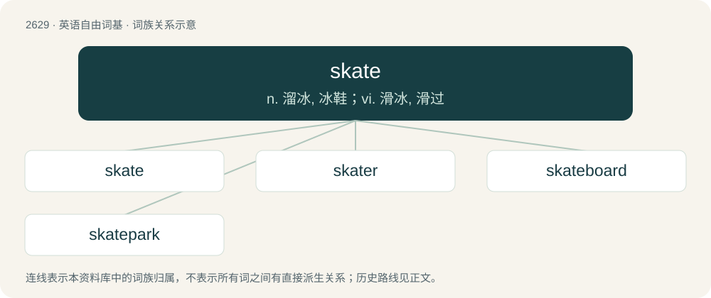

# 2732 · skate — n. 溜冰, 冰鞋；vi. 滑冰, 滑过

[总目录](../00_总目录_按常用程度.md)

**类型**：英语自由词基　｜　**来源语言**：见词源记录

## 核心含义与来源

- 核心含义：n. 溜冰, 冰鞋；vi. 滑冰, 滑过
- 英文含义：A runner or blade, usually of steel, with a frame shaped to fit the sole of a shoe, made to be fastened under the foot, and used for gliding on ice.
- 词形：skate

**多个词源／构词路径**：同一拼写可能有不同来源；以下按词性和含义分别列出。

**来源记录 1**（名词；A runner or blade, usually of steel, with a frame shaped to fit the sole of a shoe, made to be fastened under the foot, and used for gliding on ice.）

Back-formation from Dutch schaats, from Middle Dutch schāetse, from Old Northern French escache (“a stilt, trestle”) (compare French échasse and English scatch), from a Germanic language, perhaps Frankish \*skakkjā (“stilt”, literally “thing that moves”), related to \*skakan (“to shake, swing”).

**来源记录 2**（名词；A fish of the family Rajidae in the superorder Batoidea (rays) which inhabit most seas. Skates generally have small heads with protruding muzzles, and wide fins attached to a flat body.）

From Middle English skat, scate (also schat), from Old Norse skata (“skate”). Cognate with Icelandic skata (“skate, ray”), Norwegian skate (“skate”).

**来源记录 3**（名词；A worn-out horse, a nag, a jade.）

Origin uncertain, but probably related to skite.

## 词族图

## 单词速览（常用到不常用）

| 单词 | 音标 | 释义 |
|---|---|---|
| [skate](#w-1) | /skeɪt/ | n. 溜冰, 冰鞋；vi. 滑冰, 滑过 |
| [skater](#w-2) | 英 /ˈskeɪ.tə(ɹ)/ | n. 溜冰者 |
| [skateboard](#w-3) | 英 /ˈskeɪt.bɔːd/；美 /ˈskeɪt.bɔɹd/ | n. 溜冰板 |
| [skatepark](#w-4) | /ˈskeitpɑːk/ | n. 滑板运动场地 |

## 逐词详解

### 1. skate

**词性**：名词　｜　**音标**：/skeɪt/

**中文释义**：n. 溜冰, 冰鞋；vi. 滑冰, 滑过

**英文义项**：A runner or blade, usually of steel, with a frame shaped to fit the sole of a shoe, made to be fastened under the foot, and used for gliding on ice. / The act of skateboarding

**词源与演化**：

Back-formation from Dutch schaats, from Middle Dutch schāetse, from Old Northern French escache (“a stilt, trestle”) (compare French échasse and English scatch), from a Germanic language, perhaps Frankish \*skakkjā (“stilt”, literally “thing that moves”), related to \*skakan (“to shake, swing”).

**例句**：

> The boys had a skate every morning when the lake was frozen.

该用例对应义项：The act of roller skating or ice skating

### 2. skater

**词性**：名词　｜　**音标**：英 /ˈskeɪ.tə(ɹ)/

**中文释义**：n. 溜冰者

**英文义项**：A person who skates. / A skateboarder.

**构词拆分**：From skate + -er.

**词源与演化**：

From skate + -er.

**例句**：

> Tom is studying figure skating with a world famous figure skater.

### 3. skateboard

**词性**：名词　｜　**音标**：英 /ˈskeɪt.bɔːd/；美 /ˈskeɪt.bɔɹd/

**中文释义**：n. 溜冰板

**英文义项**：A narrow, wooden or plastic platform mounted on pairs of wheels, on which one stands and propels oneself by pushing along the ground with one foot. / A skateboard vehicle chassis: a chassis format, used for electric vehicles, which holds the drive motors and power energy store (i.e. batteries), forming the vehicular base; an instance of this format.

**构词拆分**：skate + board

**词源与演化**：

From skate + board. The foot-treadable skateboard sense (noun sense 1) came first (mid-20th century). The vehicle chassis sense (noun sense 2) was named for its resemblance thereto (late 20th or early 21st century).

**例句**：

> A new crossover model will arrive next year and will be based on an existing skateboard.

该用例对应义项：A skateboard vehicle chassis: a chassis format, used for electric vehicles, which holds the drive motors and power energy store (i.e. batteries), forming the vehicular base; an instance of this format.

### 4. skatepark

**词性**：名词　｜　**音标**：/ˈskeitpɑːk/

**中文释义**：n. 滑板运动场地

**英文义项**：A recreational area designed for skateboarders.

**构词拆分**：skate + park

**词源与演化**：

From skate + park.

**例句**：

> Benedito loves to ride his skateboard at the skatepark.
