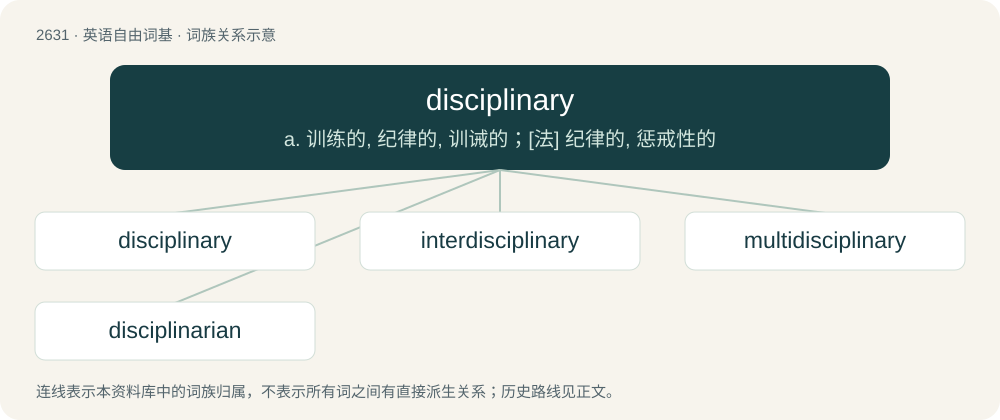

# 2733 · disciplinary — a. 训练的, 纪律的, 训诫的；\[法\] 纪律的, 惩戒性的

[总目录](../00_总目录_按常用程度.md)

**类型**：英语自由词基　｜　**来源语言**：见词源记录

## 核心含义与来源

- 核心含义：a. 训练的, 纪律的, 训诫的；\[法\] 纪律的, 惩戒性的
- 英文含义：Having to do with discipline, or with the imposition of discipline.
- 词形：disciplinary

**来源记录 1**（形容词；Having to do with discipline, or with the imposition of discipline.）

From Medieval Latin disciplinarius, from Latin disciplina (“instruction, teaching, field of study, habit”).

## 词族图

## 单词速览（常用到不常用）

| 单词 | 音标 | 释义 |
|---|---|---|
| [disciplinary](#w-1) | 英 /ˌdɪsɪˈplɪnəɹi/；美 /ˈdɪs.ə.pləˌnɛɹi/ | a. 训练的, 纪律的, 训诫的；\[法\] 纪律的, 惩戒性的 |
| [interdisciplinary](#w-2) | /,intə(ː)ˈdisiplinəri/ | \[计\] 学科间的 |
| [multidisciplinary](#w-3) | 英 /ˌmʌltiˈdɪsɪplɪnəɹi/；美 /ˌmʌltiˈdɪsəpləˌnɛɹi/ | a. 多学科的 |
| [disciplinarian](#w-4) | 英 /dɪsɪplɪˈnɛəɹɪən/ | a. 惩戒性的, 纪律的；n. 执行纪律者, 厉行纪律的人 |

## 逐词详解

### 1. disciplinary

**词性**：形容词　｜　**音标**：英 /ˌdɪsɪˈplɪnəɹi/；美 /ˈdɪs.ə.pləˌnɛɹi/

**中文释义**：a. 训练的, 纪律的, 训诫的；\[法\] 纪律的, 惩戒性的

**英文义项**：Having to do with discipline, or with the imposition of discipline. / For the purpose of imposing punishment.

**词源与演化**：

From Medieval Latin disciplinarius, from Latin disciplina (“instruction, teaching, field of study, habit”).

**例句**：

> Debt can motivate or act as a disciplinary force for executives to achieve organizational efficiency.

该用例对应义项：Having to do with discipline, or with the imposition of discipline.

### 2. interdisciplinary

**词性**：形容词　｜　**音标**：/,intə(ː)ˈdisiplinəri/

**中文释义**：\[计\] 学科间的

**英文义项**：Of or pertaining to multiple distinct academic disciplines or fields of study. / Of or pertaining to a linkage between multiple distinct academic disciplines or fields of study.

**构词拆分**：inter- + disciplinary

**词源与演化**：

From inter- + disciplinary.

**例句**：

> This journal is interdisciplinary: it has articles on everything from biology to electrical engineering.

该用例对应义项：Of or pertaining to multiple distinct academic disciplines or fields of study.

### 3. multidisciplinary

**词性**：形容词　｜　**音标**：英 /ˌmʌltiˈdɪsɪplɪnəɹi/；美 /ˌmʌltiˈdɪsəpləˌnɛɹi/

**中文释义**：a. 多学科的

**英文义项**：Relating to multiple areas of study or work.

**构词拆分**：multi- + disciplinary

**词源与演化**：

From multi- + disciplinary.

**例句**：

> She engaged in a multidisciplinary study that spanned six departments at the university.

### 4. disciplinarian

**词性**：名词　｜　**音标**：英 /dɪsɪplɪˈnɛəɹɪən/

**中文释义**：a. 惩戒性的, 纪律的；n. 执行纪律者, 厉行纪律的人

**英文义项**：One who exercises discipline. / One who believes in discipline as a tool for regulation or control.

**构词拆分**：discipline + -arian；disciplinary + -an

**词源与演化**：

From discipline + -arian or disciplinary + -an.

**例句**：

> He is the chief disciplinarian in the school.

该用例对应义项：One who exercises discipline.
