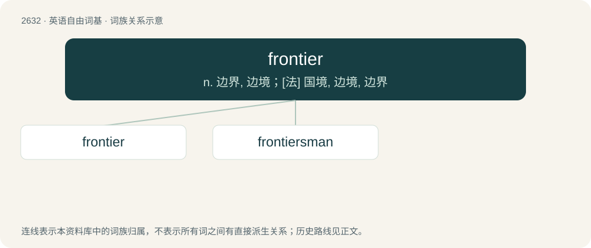

# 2735 · frontier — n. 边界, 边境；\[法\] 国境, 边境, 边界

[总目录](../00_总目录_按常用程度.md)

**类型**：英语自由词基　｜　**来源语言**：见词源记录

## 核心含义与来源

- 核心含义：n. 边界, 边境；\[法\] 国境, 边境, 边界
- 英文含义：The part of a country which borders or faces another country or unsettled region.
- 词形：frontier

**来源记录 1**（名词；The part of a country which borders or faces another country or unsettled region.）

From Middle English frounter, from Old French fronter (whence Modern French frontière), from front.

## 词族图

## 单词速览（常用到不常用）

| 单词 | 音标 | 释义 |
|---|---|---|
| [frontier](#w-1) | 英 /ˈfɹʌntɪə/；美 /fɹʌnˈtɪɹ/ | n. 边界, 边境；\[法\] 国境, 边境, 边界 |
| [frontiersman](#w-2) | /ˈfrʌn,tiəzmən/ | n. 边疆居民 |

## 逐词详解

### 1. frontier

**词性**：名词　｜　**音标**：英 /ˈfɹʌntɪə/；美 /fɹʌnˈtɪɹ/

**中文释义**：n. 边界, 边境；\[法\] 国境, 边境, 边界

**英文义项**：The part of a country which borders or faces another country or unsettled region. / The most advanced or recent version of something; the leading edge.

**词源与演化**：

From Middle English frounter, from Old French fronter (whence Modern French frontière), from front.

**用法示例／搭配（非完整句）**：

> the frontier of solid state electronics

该用例对应义项：The most advanced or recent version of something; the leading edge.

### 2. frontiersman

**词性**：名词　｜　**音标**：/ˈfrʌn,tiəzmən/

**中文释义**：n. 边疆居民

**英文义项**：A person who lives on the borders of a country, or in a wild and undeveloped area on the fringes of civilization.

**构词拆分**：frontiers + man

**词源与演化**：

From frontiers + man.
