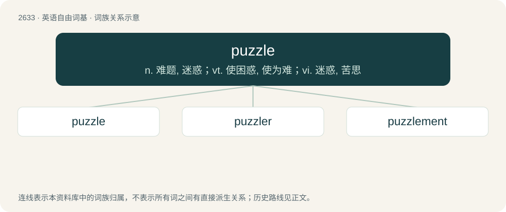

# 2737 · puzzle — n. 难题, 迷惑；vt. 使困惑, 使为难；vi. 迷惑, 苦思

[总目录](../00_总目录_按常用程度.md)

**类型**：英语自由词基　｜　**来源语言**：见词源记录

## 核心含义与来源

- 核心含义：n. 难题, 迷惑；vt. 使困惑, 使为难；vi. 迷惑, 苦思
- 英文含义：The state of feeling confused or mystified because one cannot understand a complicated matter, a problem, etc.; bewilderment, confusion; (countable) often in in a puzzle: an instance of this.
- 词形：puzzle

**来源记录 1**（名词；The state of feeling confused or mystified because one cannot understand a complicated matter, a problem, etc.; bewilderment, confusion; (countable) often in in a puzzle: an instance of this.）

The verb, of uncertain origin, is attested first. Apparently cognate with Scots pousle, pouzle, poozle (“to trifle; poke or potter around aimlessly; search about with uncertainty”), Saterland Frisian puzelje (“to work hard and continuously”), West Frisian peuzelje (“to trifle, work slowly; eat slowly and daintifully, snack”), Dutch peuzelen (“to perform insignificant work, dawdle; pick at, eat with relish in small pieces, snack”), German Low German pusseln (“to tinker, fiddle; trifle”) and pöseln (“to work hard, toil; to slave away; suffer at work; work slowly and ineffectively”), German posseln, bosseln (“to perform trivial work, tinker”), Danish pusle (“to busy oneself with light work or chores; to be occupied with a task requiring ingenuity, care, and patience; to tinker”), Swedish pyssla (“to do light work; tinker; putter or potter around”), Norwegian Nynorsk pusla, putla (“to potter about”), Faroese putla (“to trifle; potter about; do one's work slowly; be dilatory”), Faroese puss (“damage, trick”). \* An early form of the word is pusle, which is similar to Old English puslian (“to pick out the best bits, carefully select, cull”). It is possible that the meaning of the word evolved from “to pick out the best bits”, to “to think long and carefully in bewilderment while choosing what to pick out”, to “to think long and carefully in bewilderment”. However, there is no evidence in Middle English or modern English of any intermediate words with these meanings. \* Alternatively, it has been suggested that the word is from pose (“(obsolete) to interrogate, question”) + -le (frequentative suffix). However, the Oxford English Dictionary notes that early forms of the word are all spelled with -u-, and that a sound change in Middle English from ō to u “is not easily accounted for”. \* Finally, it has been suggested that the past participle form of the word is attested by Middle English poselet. This is thought to be unlikely by the Oxford English Dictionary as poselet is attested in only one quotation with the meaning “jostled, pushed”, which does not have any connection with the current senses of the word. The noun appears to be derived from the verb.

## 词族图

## 单词速览（常用到不常用）

| 单词 | 音标 | 释义 |
|---|---|---|
| [puzzle](#w-1) | 英 /ˈpʌzəl/ | n. 难题, 迷惑；vt. 使困惑, 使为难；vi. 迷惑, 苦思 |
| [puzzler](#w-2) | /ˈpʌzlə/ | n. 令人困惑的人, 难题 |
| [puzzlement](#w-3) | /ˈpʌzlmənt/ | n. 迷惑 |

## 逐词详解

### 1. puzzle

**词性**：名词　｜　**音标**：英 /ˈpʌzəl/

**中文释义**：n. 难题, 迷惑；vt. 使困惑, 使为难；vi. 迷惑, 苦思

**英文义项**：The state of feeling confused or mystified because one cannot understand a complicated matter, a problem, etc.; bewilderment, confusion; (countable) often in in a puzzle: an instance of this. / A thing such as a complicated matter or a problem which is difficult to make sense of or understand; also, a person who is difficult to make sense of or understand; an enigma.

**构词拆分**：pose (“(obsolete) to interrogate, question”) + -le (frequentative suffix)

**词源与演化**：

The verb, of uncertain origin, is attested first. Apparently cognate with Scots pousle, pouzle, poozle (“to trifle; poke or potter around aimlessly; search about with uncertainty”), Saterland Frisian puzelje (“to work hard and continuously”), West Frisian peuzelje (“to trifle, work slowly; eat slowly and daintifully, snack”), Dutch peuzelen (“to perform insignificant work, dawdle; pick at, eat with relish in small pieces, snack”), German Low German pusseln (“to tinker, fiddle; trifle”) and pöseln (“to work hard, toil; to slave away; suffer at work; work slowly and ineffectively”), German posseln, bosseln (“to perform trivial work, tinker”), Danish pusle (“to busy oneself with light work or chores; to be occupied with a task requiring ingenuity, care, and patience; to tinker”), Swedish pyssla (“to do light work; tinker; putter or potter around”), Norwegian Nynorsk pusla, putla (“to potter about”), Faroese putla (“to trifle; potter about; do one's work slowly; be dilatory”), Faroese puss (“damage, trick”). \* An early form of the word is pusle, which is similar to Old English puslian (“to pick out the best bits, carefully select, cull”). It is possible that the meaning of the word evolved from “to pick out the best bits”, to “to think long and carefully in bewilderment while choosing what to pick out”, to “to think long and carefully in bewilderment”. However, there is no evidence in Middle English or modern English of any intermediate words with these meanings. \* Alternatively, it has been suggested that the word is from pose (“(obsolete) to interrogate, question”) + -le (frequentative suffix). However, the Oxford English Dictionary notes that early forms of the word are all spelled with -u-, and that a sound change in Middle English from ō to u “is not easily accounted for”. \* Finally, it has been suggested that the past participle form of the word is attested by Middle English poselet. This is thought to be unlikely by the Oxford English Dictionary as poselet is attested in only one quotation with the meaning “jostled, pushed”, which does not have any connection with the current senses of the word. The noun appears to be derived from the verb.

**例句**：

> Where he went after he left the house is a puzzle.

该用例对应义项：A thing such as a complicated matter or a problem which is difficult to make sense of or understand; also, a person who is difficult to make sense of or understand; an enigma.

### 2. puzzler

**词性**：名词　｜　**音标**：/ˈpʌzlə/

**中文释义**：n. 令人困惑的人, 难题

**英文义项**：A puzzling situation or problem. / One who is mysterious.

**构词拆分**：From puzzle + -er.

**词源与演化**：

From puzzle + -er.

**例句**：

> That's a real puzzler.

该用例对应义项：a particularly baffling problem that is said to have a correct solution

### 3. puzzlement

**词性**：名词　｜　**音标**：/ˈpʌzlmənt/

**中文释义**：n. 迷惑

**英文义项**：The confusing state of being puzzled; bewilderment. / A puzzle; something baffling.

**构词拆分**：puzzle + -ment

**词源与演化**：

From puzzle + -ment.

**例句**：

> The puzzlement caused by the complex system led to great anger.

该用例对应义项：The confusing state of being puzzled; bewilderment.
