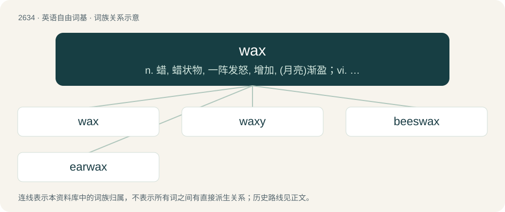

# 2738 · wax — n. 蜡, 蜡状物, 一阵发怒, 增加, (月亮)渐盈；vi. 变大, 增大, 月亮渐满；vt. 上蜡于

[总目录](../00_总目录_按常用程度.md)

**类型**：英语自由词基　｜　**来源语言**：见词源记录

## 核心含义与来源

- 核心含义：n. 蜡, 蜡状物, 一阵发怒, 增加, (月亮)渐盈；vi. 变大, 增大, 月亮渐满；vt. 上蜡于
- 英文含义：Any oily, water-resistant, solid or semisolid substance; normally long-chain hydrocarbons, alcohols or esters.
- 词形：wax

**多个词源／构词路径**：同一拼写可能有不同来源；以下按词性和含义分别列出。

**来源记录 1**（名词；Any oily, water-resistant, solid or semisolid substance; normally long-chain hydrocarbons, alcohols or esters.）

From Middle English wax, from Old English weax, from Proto-Germanic \*wahsą, possibly from Proto-Indo-European \*woḱ-so-. Cognate with Saterland Frisian Woaks (“wax”), West Frisian waaks (“wax”), Dutch was (“wax”), German Wachs (“wax”), German Low German Wass (“wax”), Luxembourgish Wuess (“wax”), Vilamovian wāhs (“wax”), Danish, Norwegian Bokmål, Norwegian Nynorsk voks (“wax”), Faroese vaks (“wax”), Icelandic, Swedish vax (“wax”); and with Lithuanian vaškas (“wax”), Proto-Slavic \*voskъ (“wax”).

**来源记录 2**（动词；To apply wax to (something, such as a shoe, a floor, a car, or an apple), usually to make it shiny.）

From Middle English waxen, from the noun (see above).

**来源记录 3**（动词；To greaten.）

From Middle English waxen, from Old English weaxan (“to wax, grow, be fruitful, increase, become powerful, flourish”), from Proto-West Germanic \*wahsan, from Proto-Germanic \*wahsijaną (“to grow”), from Proto-Indo-European \*h₂weks- (“to grow, increase”). Cognate with Scots wax (“to grow”), West Frisian waakse (“to greaten”), Low German wassen, Dutch wassen (“to greaten”), German wachsen (“to greaten”), Danish and Norwegian vokse (“to greaten”), Swedish växa (“to greaten”), Icelandic vaxa (“to greaten”), Gothic 𐍅𐌰𐌷𐍃𐌾𐌰𐌽 (wahsjan, “to grow”); and with Ancient Greek ἀέξειν (aéxein), Latin auxilium. It is in its turn cognate with augeo. See eke.

**来源记录 4**（名词；An outburst of anger, a loss of temper, a fit of rage.）

Uncertain; probably from phrases like to wax angry, wax wode, and similar (see Etymology 2, above).

## 词族图

## 单词速览（常用到不常用）

| 单词 | 音标 | 释义 |
|---|---|---|
| [wax](#w-1) | 英 /waks/；美 /wæks/ | n. 蜡, 蜡状物, 一阵发怒, 增加, (月亮)渐盈；vi. 变大, 增大, 月亮渐满；vt. 上蜡于 |
| [waxy](#w-2) | /ˈwæksi/ | a. 蜡制的, 像蜡的, 蜡色的, 苍白的, 生气的, 柔软的, 光滑的；\[医\] 蜡状的, 蜡的 |
| [beeswax](#w-3) | /ˈbiːzwæks/ | n. 蜂蜡, 蜜蜡；vt. 用蜡上光 |
| [earwax](#w-4) | 美 /ˈiɹ.wæks/ | n. 耳垢；\[医\] 耵聍, 耳垢 |

## 逐词详解

### 1. wax

**词性**：名词　｜　**音标**：英 /waks/；美 /wæks/

**中文释义**：n. 蜡, 蜡状物, 一阵发怒, 增加, (月亮)渐盈；vi. 变大, 增大, 月亮渐满；vt. 上蜡于

**英文义项**：Any oily, water-resistant, solid or semisolid substance; normally long-chain hydrocarbons, alcohols or esters. / Beeswax (a wax secreted by bees).

**词源与演化**：

From Middle English wax, from Old English weax, from Proto-Germanic \*wahsą, possibly from Proto-Indo-European \*woḱ-so-. Cognate with Saterland Frisian Woaks (“wax”), West Frisian waaks (“wax”), Dutch was (“wax”), German Wachs (“wax”), German Low German Wass (“wax”), Luxembourgish Wuess (“wax”), Vilamovian wāhs (“wax”), Danish, Norwegian Bokmål, Norwegian Nynorsk voks (“wax”), Faroese vaks (“wax”), Icelandic, Swedish vax (“wax”); and with Lithuanian vaškas (“wax”), Proto-Slavic \*voskъ (“wax”).

**例句**：

> He was charged with two felonies, for possession of Xanax and wax.

该用例对应义项：Any of a class of drugs with weed oil and butane as main ingredients; hash oil.

### 2. waxy

**词性**：形容词　｜　**音标**：/ˈwæksi/

**中文释义**：a. 蜡制的, 像蜡的, 蜡色的, 苍白的, 生气的, 柔软的, 光滑的；\[医\] 蜡状的, 蜡的

**英文义项**：Resembling wax in texture or appearance. / Low in starch; tending to remain firm when cooked.

**构词拆分**：wax (“soft oily substance”) + -y

**词源与演化**：

From Middle English waxi, wexy, equivalent to wax (“soft oily substance”) + -y.

**例句**：

> A thin face with a waxy paleness.

该用例对应义项：having the paleness of wax

### 3. beeswax

**词性**：名词　｜　**音标**：/ˈbiːzwæks/

**中文释义**：n. 蜂蜡, 蜜蜡；vt. 用蜡上光

**英文义项**：A wax secreted by bees from which they make honeycomb; or, the processed form of this wax used in the manufacture of various goods. / Business.

**构词拆分**：bee + -s- + wax

**词源与演化**：

From bee + -s- + wax.

**例句**：

> She polished the furniture with beeswax to give it a shine.

该用例对应义项：A wax secreted by bees from which they make honeycomb; or, the processed form of this wax used in the manufacture of various goods.

### 4. earwax

**词性**：名词　｜　**音标**：美 /ˈiɹ.wæks/

**中文释义**：n. 耳垢；\[医\] 耵聍, 耳垢

**英文义项**：A waxy substance secreted by the ear.

**构词拆分**：ear + wax

**词源与演化**：

From Middle English erewax, from ere + wax. Equivalent to ear + wax.

**例句**：

> I'm trying to get the earwax out of my earbuds with a pencil.
