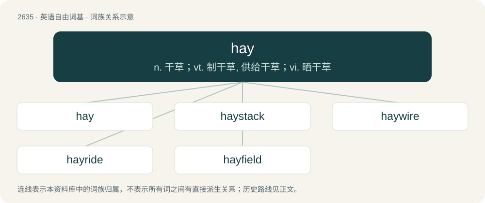

# 2739 · hay — n. 干草；vt. 制干草, 供给干草；vi. 晒干草

[总目录](../00_总目录_按常用程度.md)

**类型**：英语自由词基　｜　**来源语言**：见词源记录

## 核心含义与来源

- 核心含义：n. 干草；vt. 制干草, 供给干草；vi. 晒干草
- 英文含义：Grass cut and dried for use as animal fodder.
- 词形：hay

**多个词源／构词路径**：同一拼写可能有不同来源；以下按词性和含义分别列出。

**来源记录 1**（名词；Grass cut and dried for use as animal fodder.）

From Middle English hey, from Old English hīeġ, from Proto-West Germanic \*hawi, from Proto-Germanic \*hawją, from \*hawwaną (“to hew, cut down”). Cognate with West Frisian hea (“hay”), Alemannic German Heuw (“hay”), Cimbrian höobe (“hay”), Dutch hooi (“hay”), German Heu (“hay”), Luxembourgish Hee (“hay”), Mòcheno hei (“hay”), Yiddish היי (hey, “hay”), Danish hø (“hay”), Faroese hoyggj (“hay”), Gutnish hoy (“hay”), Icelandic hey (“hay”), Norwegian Bokmål, Norwegian Nynorsk høy (“hay”), Swedish hö (“hay”), Gothic 𐌷𐌰𐍅𐌹 (hawi, “grass, hay”). More at hew.

**来源记录 2**（名词；The letter for the h sound in Pitman shorthand.）

From the sound it represents, by analogy with other letters such as kay and gay. The expected form in English if the h had survived in the Latin name of the letter "h", hā.

## 词族图

## 单词速览（常用到不常用）

| 单词 | 音标 | 释义 |
|---|---|---|
| [hay](#w-1) | /heɪ/ | n. 干草；vt. 制干草, 供给干草；vi. 晒干草 |
| [haystack](#w-2) | /ˈheɪˌstæk/ | n. 干草堆 |
| [haywire](#w-3) | 英 /ˈheɪ.waɪ.ə(ɹ)/；美 /ˈheɪ.waɪɚ/ | \[计\] 临时的 |
| [hayride](#w-4) | /ˈheiraid/ | n. &lt;美&gt;(尤指夜间)乘坐装有干草的大车(或拖橇等)出游 |
| [hayfield](#w-5) | /ˈheifiːld/ | n. 草田 |

## 逐词详解

### 1. hay

**词性**：名词　｜　**音标**：/heɪ/

**中文释义**：n. 干草；vt. 制干草, 供给干草；vi. 晒干草

**英文义项**：Grass cut and dried for use as animal fodder. / Any mix of green leafy plants used for fodder.

**词源与演化**：

From Middle English hey, from Old English hīeġ, from Proto-West Germanic \*hawi, from Proto-Germanic \*hawją, from \*hawwaną (“to hew, cut down”). Cognate with West Frisian hea (“hay”), Alemannic German Heuw (“hay”), Cimbrian höobe (“hay”), Dutch hooi (“hay”), German Heu (“hay”), Luxembourgish Hee (“hay”), Mòcheno hei (“hay”), Yiddish היי (hey, “hay”), Danish hø (“hay”), Faroese hoyggj (“hay”), Gutnish hoy (“hay”), Icelandic hey (“hay”), Norwegian Bokmål, Norwegian Nynorsk høy (“hay”), Swedish hö (“hay”), Gothic 𐌷𐌰𐍅𐌹 (hawi, “grass, hay”). More at hew.

**例句**：

> We hit the hay early in order to get up at dawn.

### 2. haystack

**词性**：名词　｜　**音标**：/ˈheɪˌstæk/

**中文释义**：n. 干草堆

**英文义项**：A mound, pile, or stack of stored hay. / A standing wave in a rapid.

**构词拆分**：hay + stack

**词源与演化**：

From Middle English haystak, haystake, hey stak, equivalent to hay + stack.

**例句**：

> The boys were playing in the field, near the new haystack.

### 3. haywire

**词性**：形容词　｜　**音标**：英 /ˈheɪ.waɪ.ə(ɹ)/；美 /ˈheɪ.waɪɚ/

**中文释义**：\[计\] 临时的

**英文义项**：Roughly-made, unsophisticated, decrepit (from the use of haywire for temporary repairs). / Behaviorally erratic or uncontrollable, especially of a machine or mechanical process.

**构词拆分**：hay + wire

**词源与演化**：

From hay + wire. The original meaning of “likely to become tangled unpredictably or unusably, or fall apart”, as though only bound with the kind of soft, springy wire used to bind hay bales comes from usage in New England lumber camps circa 1905 where haywire outfit became the common term to refer to slap-dash collections of logging tools. To go haywire has since evolved to represent the act of falling apart or behaving unpredictably, as would wire spooled under tension springing into an unmanageable tangle once a piece had been removed from the factory spool, e.g., “he took off the back of his watch, removed a gear and the whole works went haywire.”

**例句**：

> It was working fine until it went haywire and wouldn't stop printing blank sheets.

该用例对应义项：Behaviorally erratic or uncontrollable, especially of a machine or mechanical process.

### 4. hayride

**词性**：名词　｜　**音标**：/ˈheiraid/

**中文释义**：n. &lt;美&gt;(尤指夜间)乘坐装有干草的大车(或拖橇等)出游

**英文义项**：A recreational ride in a vehicle full of hay.

**构词拆分**：hay + ride

**词源与演化**：

From hay + ride.

### 5. hayfield

**词性**：名词　｜　**音标**：/ˈheifiːld/

**中文释义**：n. 草田

**英文义项**：A field of hay.

**构词拆分**：hay + field

**词源与演化**：

From hay + field.

**例句**：

> They hurried to the hayfield below the barn where Matthew was coiling hay.
