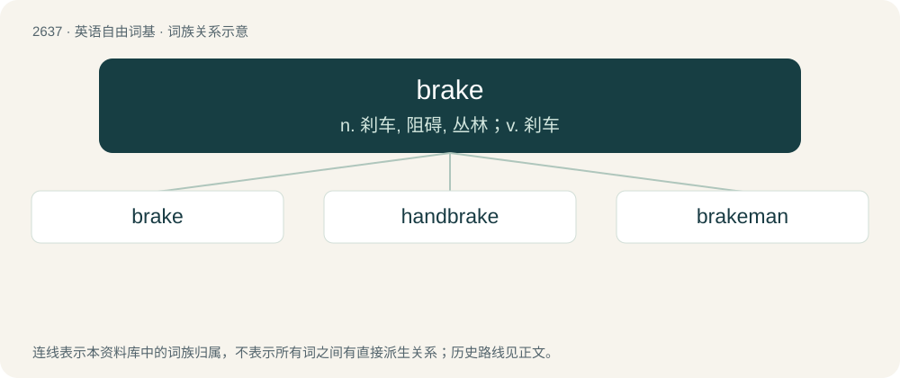

# 2740 · brake — n. 刹车, 阻碍, 丛林；v. 刹车

[总目录](../00_总目录_按常用程度.md)

**类型**：英语自由词基　｜　**来源语言**：见词源记录

## 核心含义与来源

- 核心含义：n. 刹车, 阻碍, 丛林；v. 刹车
- 英文含义：A device used to slow or stop the motion of a wheel, or of a vehicle, usually by friction (although other resistive forces, such as electromagnetic fields or aerodynamic drag, can also be used); also, the controls or apparatus used to engage such a mechanism such as the pedal in a car.
- 词形：brake

**多个词源／构词路径**：同一拼写可能有不同来源；以下按词性和含义分别列出。

**来源记录 1**（名词；A device used to slow or stop the motion of a wheel, or of a vehicle, usually by friction (although other resistive forces, such as electromagnetic fields or aerodynamic drag, can also be used); also, the controls or apparatus used to engage such a mechanism such as the pedal in a car.）

Origin uncertain; possibly from Middle Dutch or Middle Low German brake (“nose ring, curb, flax brake”), which according to Watkins is related to sense 4 and from Proto-Germanic \*brekaną (“to break”).

**来源记录 2**（名词；Any fern in the genus Pteris.）

Apparently a shortened form of bracken. (Compare chick, chicken.)

**来源记录 3**（名词；A thicket, or an area overgrown with briers etc.）

From Old English \*bracu, attested in a plural compound form fearnbraca (“thickets of fern”), probably from Proto-Germanic \*brekaną (“to break”) and influenced by sense 2 (“fern”). Compare Middle Low German brake (“stump, branch”).

**来源记录 4**（名词；A type of machine for bending sheet metal. (See wikipedia.)）

Late Middle English, from Middle Low German brake, Dutch braak, Old Dutch braeke; possibly related to sense 1.

## 词族图

## 单词速览（常用到不常用）

| 单词 | 音标 | 释义 |
|---|---|---|
| [brake](#w-1) | /bɹeɪk/ | n. 刹车, 阻碍, 丛林；v. 刹车 |
| [handbrake](#w-2) |  | n. 手煞车 |
| [brakeman](#w-3) | /ˈbreikmən/ | n. 司闸员, 制动手 |

## 逐词详解

### 1. brake

**词性**：名词　｜　**音标**：/bɹeɪk/

**中文释义**：n. 刹车, 阻碍, 丛林；v. 刹车

**英文义项**：A device used to slow or stop the motion of a wheel, or of a vehicle, usually by friction (although other resistive forces, such as electromagnetic fields or aerodynamic drag, can also be used); also, the controls or apparatus used to engage such a mechanism such as the pedal in a car. / The act of braking, of using a brake to slow down a machine or vehicle

**词源与演化**：

Origin uncertain; possibly from Middle Dutch or Middle Low German brake (“nose ring, curb, flax brake”), which according to Watkins is related to sense 4 and from Proto-Germanic \*brekaną (“to break”).

**例句**：

> She slammed the brakes when she saw a child run in front of the car.

该用例对应义项：A device used to slow or stop the motion of a wheel, or of a vehicle, usually by friction (although other resistive forces, such as electromagnetic fields or aerodynamic drag, can also be used); also, the controls or apparatus used to engage such a mechanism such as the pedal in a car.

### 2. handbrake

**词性**：名词

**中文释义**：n. 手煞车

**英文义项**：A brake in a vehicle, set by hand, and usually locking on until released by hand, enabling its use when parked. / The mechanism, particularly the locking hand-operated lever or foot-operated toggle lever in a motorcar or the hand-operated crank on a railcar, which is used to set and release such a brake.

**构词拆分**：hand + brake

**词源与演化**：

From hand + brake.

**例句**：

> Tom drove through town with his handbrake on, without noticing it.

### 3. brakeman

**词性**：名词　｜　**音标**：/ˈbreikmən/

**中文释义**：n. 司闸员, 制动手

**英文义项**：A railroad employee responsible for a train's brakes, couplings etc. / A person who pulls the brake lever in the sport of bobsleigh.

**构词拆分**：brake + -man

**词源与演化**：

From brake + -man.
