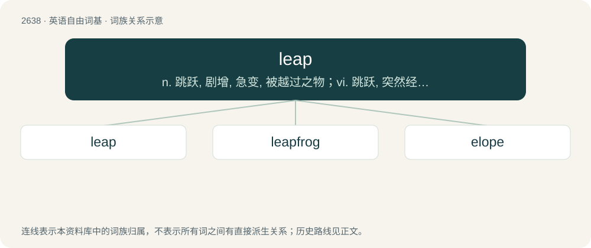

# 2741 · leap — n. 跳跃, 剧增, 急变, 被越过之物；vi. 跳跃, 突然经过；vt. 跃过, 使跃过

[总目录](../00_总目录_按常用程度.md)

**类型**：英语自由词基　｜　**来源语言**：见词源记录

## 核心含义与来源

- 核心含义：n. 跳跃, 剧增, 急变, 被越过之物；vi. 跳跃, 突然经过；vt. 跃过, 使跃过
- 英文含义：To jump.
- 词形：leap

**多个词源／构词路径**：同一拼写可能有不同来源；以下按词性和含义分别列出。

**来源记录 1**（动词；To jump.）

From Middle English lepen, from Old English hlēapan, from Proto-West Germanic \*hlaupan, from Proto-Germanic \*hlaupaną. Doublet of lope, lowp, elope, gallop, galop, interlope, and loop. Cognate with North Frisian laap, luup, luupe (“to jog, run, walk”), Saterland Frisian lope, loope (“to run”), West Frisian ljeppe (“to jump”), Dutch lopen (“to run; to walk”), German laufen (“to run; to walk”), Limburgish loupe (“to jog, run, walk”), Low German lopen, loupen (“to run”), Luxembourgish lafen (“to run”), Vilamovian łaojfa (“to run”), Danish løbe (“to run”), Faroese leypa (“to jump”), Icelandic hlaupa (“to run; to jump”), Norwegian Bokmål løpe (“to run”), Norwegian Nynorsk laupa, laupe, løpa, løpe (“to run”), Swedish löpa (“to run”), from Proto-Indo-European \*klewb- (“to spring, stumble”) (compare Lithuanian šlùbti ‘to become lame’, klùbti ‘to stumble’).

**来源记录 2**（名词；A trap or snare for fish, made from twigs; a weely.）

From Middle English lep, from Old English lēap (“basket”), from Proto-West Germanic \*laup, from Proto-Germanic \*laupaz (“container, basket”). Cognate with Icelandic laupur (“basket”).

## 词族图

## 单词速览（常用到不常用）

| 单词 | 音标 | 释义 |
|---|---|---|
| [leap](#w-1) | /ˈliːp/ | n. 跳跃, 剧增, 急变, 被越过之物；vi. 跳跃, 突然经过；vt. 跃过, 使跃过 |
| [leapfrog](#w-2) | 英 /ˈliːpfɹɒɡ/；美 /ˈliːpfɹɑɡ/ | n. 跳背游戏, 竞相提高；vi. 跳背, 交替前进；vt. 跃过 |
| [elope](#w-3) | 英 /ɪˈləʊp/；美 /ɪˈloʊp/ | vi. 私奔, 潜逃；\[法\] 私奔, 弃职, 逃亡 |

## 逐词详解

### 1. leap

**词性**：动词　｜　**音标**：/ˈliːp/

**中文释义**：n. 跳跃, 剧增, 急变, 被越过之物；vi. 跳跃, 突然经过；vt. 跃过, 使跃过

**英文义项**：To jump. / To pass over by a leap or jump.

**词源与演化**：

From Middle English lepen, from Old English hlēapan, from Proto-West Germanic \*hlaupan, from Proto-Germanic \*hlaupaną. Doublet of lope, lowp, elope, gallop, galop, interlope, and loop. Cognate with North Frisian laap, luup, luupe (“to jog, run, walk”), Saterland Frisian lope, loope (“to run”), West Frisian ljeppe (“to jump”), Dutch lopen (“to run; to walk”), German laufen (“to run; to walk”), Limburgish loupe (“to jog, run, walk”), Low German lopen, loupen (“to run”), Luxembourgish lafen (“to run”), Vilamovian łaojfa (“to run”), Danish løbe (“to run”), Faroese leypa (“to jump”), Icelandic hlaupa (“to run; to jump”), Norwegian Bokmål løpe (“to run”), Norwegian Nynorsk laupa, laupe, løpa, løpe (“to run”), Swedish löpa (“to run”), from Proto-Indo-European \*klewb- (“to spring, stumble”) (compare Lithuanian šlùbti ‘to become lame’, klùbti ‘to stumble’).

**用法示例／搭配（非完整句）**：

> to leap a horse across a ditch

该用例对应义项：To cause to leap.

### 2. leapfrog

**词性**：动词　｜　**音标**：英 /ˈliːpfɹɒɡ/；美 /ˈliːpfɹɑɡ/

**中文释义**：n. 跳背游戏, 竞相提高；vi. 跳背, 交替前进；vt. 跃过

**英文义项**：To jump over some obstacle, as in the game of leapfrog. / To overtake.

**构词拆分**：leap + frog

**词源与演化**：

From leap + frog.

**例句**：

> This new product will leapfrog the competition.

该用例对应义项：To overtake.

### 3. elope

**词性**：动词　｜　**音标**：英 /ɪˈləʊp/；美 /ɪˈloʊp/

**中文释义**：vi. 私奔, 潜逃；\[法\] 私奔, 弃职, 逃亡

**英文义项**：Of a married or engaged person, to run away from home with a paramour. / Of an unmarried person, to run away secretly for the purpose of getting married with one's intended spouse; to marry in a quick or private fashion, especially without a public period of engagement.

**构词拆分**：and- + lope；and- + leap

**词源与演化**：

From Anglo-Norman aloper (“to abduct, run away”), itself borrowed from Proto-West Germanic \*andihlaupan (“to run away”). Equivalent to and- + lope as well as and- + leap (these being doublets). More at lope.
