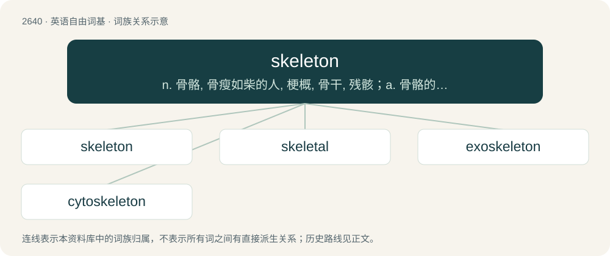

# 2743 · skeleton — n. 骨骼, 骨瘦如柴的人, 梗概, 骨干, 残骸；a. 骨骼的, 概略的, 基层的, 骨干的；\[计\] 骨架

[总目录](../00_总目录_按常用程度.md)

**类型**：英语自由词基　｜　**来源语言**：见词源记录

## 核心含义与来源

- 核心含义：n. 骨骼, 骨瘦如柴的人, 梗概, 骨干, 残骸；a. 骨骼的, 概略的, 基层的, 骨干的；\[计\] 骨架
- 英文含义：The system that provides support to an organism, where in vertebrates it is internal and consists of bones and cartilage, and external in some other animals.
- 词形：skeleton

**多个词源／构词路径**：同一拼写可能有不同来源；以下按词性和含义分别列出。

**来源记录 1**（名词；The system that provides support to an organism, where in vertebrates it is internal and consists of bones and cartilage, and external in some other animals.）

From New Latin sceleton, from Ancient Greek σκελετόν (skeletón), the neuter of σκελετός (skeletós, “dried up, withered, dried body, parched, mummy”), from σκέλλω (skéllō, “dry, dry up, make dry, parch”), from Proto-Indo-European \*(s)kelh₁- (“to parch, wither”); compare Ancient Greek σκληρός (sklērós, “hard”).

**来源记录 2**（名词；A type of tobogganing in which competitors lie face down, and descend head first.）

The etymology of the term is disputed between two versions. \* From the sled used, which originally was a bare frame, like a skeleton. \* From Norwegian kjaelke (a type of ice sled) through a bad anglicization as "skele".

## 词族图

## 单词速览（常用到不常用）

| 单词 | 音标 | 释义 |
|---|---|---|
| [skeleton](#w-1) | 英 /ˈskɛlɪtən/；美 /ˈskɛlətən/ | n. 骨骼, 骨瘦如柴的人, 梗概, 骨干, 残骸；a. 骨骼的, 概略的, 基层的, 骨干的；\[计\] 骨架 |
| [skeletal](#w-2) | 英 /ˈskɛl.ɪ.təl/；美 /ˈskɛl.ə.təl/ | a. 骨骼的, 框架的；\[医\] 骨胳的 |
| [exoskeleton](#w-3) | /,eksəuˈskelitən/ | n. 外骨胳, 外甲；\[医\] 外骨骼 |
| [cytoskeleton](#w-4) |  | \[医\] 细胞支架 |

## 逐词详解

### 1. skeleton

**词性**：名词　｜　**音标**：英 /ˈskɛlɪtən/；美 /ˈskɛlətən/

**中文释义**：n. 骨骼, 骨瘦如柴的人, 梗概, 骨干, 残骸；a. 骨骼的, 概略的, 基层的, 骨干的；\[计\] 骨架

**英文义项**：The system that provides support to an organism, where in vertebrates it is internal and consists of bones and cartilage, and external in some other animals. / An anthropomorphic representation of a skeleton.

**词源与演化**：

From New Latin sceleton, from Ancient Greek σκελετόν (skeletón), the neuter of σκελετός (skeletós, “dried up, withered, dried body, parched, mummy”), from σκέλλω (skéllō, “dry, dry up, make dry, parch”), from Proto-Indo-European \*(s)kelh₁- (“to parch, wither”); compare Ancient Greek σκληρός (sklērós, “hard”).

**例句**：

> I've written three stories. Well, one is a skeleton, but the other two are mostly complete.

该用例对应义项：The central core of something that gives shape to the entire structure; an outline of a longer project.

### 2. skeletal

**词性**：形容词　｜　**音标**：英 /ˈskɛl.ɪ.təl/；美 /ˈskɛl.ə.təl/

**中文释义**：a. 骨骼的, 框架的；\[医\] 骨胳的

**英文义项**：of, or relating to the skeleton / haggard, cadaverous, emaciated or gaunt

**构词拆分**：From skeleton + -al.

**词源与演化**：

From skeleton + -al.

**例句**：

> After the bombing, only the skeletal remains of the city could be seen.

该用例对应义项：Comprising only the base structure of a building, etc.

### 3. exoskeleton

**词性**：名词　｜　**音标**：/,eksəuˈskelitən/

**中文释义**：n. 外骨胳, 外甲；\[医\] 外骨骼

**英文义项**：A hard outer structure that provides both structure and protection to creatures such as insects and Crustacea. / A wearable robotic machine used for aided or augmented mobility.

**构词拆分**：exo- + skeleton

**词源与演化**：

From exo- + skeleton.

**例句**：

> The exoskeleton is worn on the user’s back and around the stomach.

### 4. cytoskeleton

**词性**：名词

**中文释义**：\[医\] 细胞支架

**英文义项**：A matrix of intercellular protein, in the forms of microfilaments and microtubules, that provide some rigidity to cells

**构词拆分**：cyto- + skeleton

**词源与演化**：

From cyto- + skeleton.
