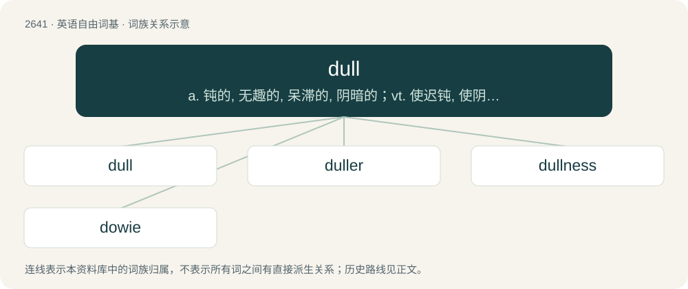

# 2744 · dull — a. 钝的, 无趣的, 呆滞的, 阴暗的；vt. 使迟钝, 使阴暗, 缓和；vi. 变迟钝, 减少

[总目录](../00_总目录_按常用程度.md)

**类型**：英语自由词基　｜　**来源语言**：见词源记录

## 核心含义与来源

- 核心含义：a. 钝的, 无趣的, 呆滞的, 阴暗的；vt. 使迟钝, 使阴暗, 缓和；vi. 变迟钝, 减少
- 英文含义：Lacking the ability to cut easily; not sharp.
- 词形：dull

**来源记录 1**（形容词；Lacking the ability to cut easily; not sharp.）

From Middle English dull, dul (also dyll, dill, dwal), from Old English dol (“dull, foolish, erring, heretical; foolish, silly; presumptuous”), from Proto-West Germanic \*dol, from Proto-Germanic \*dulaz, from earlier \*dwulaz, a variant of \*dwalaz (“stunned, mad, foolish, misled”), from Proto-Indo-European \*dʰwel-, \*dʰewel- (“to dim, dull, cloud, make obscure, swirl, whirl”). Cognate with Scots dull, doll (“slow to understand or hear, deaf, dull”), North Frisian dol (“rash, unthinking, giddy, flippant”), Dutch dol (“crazy, mad, insane”), Low German dul, dol (“mad, silly, stupid, fatuous”), German toll (“crazy, mad, wild, fantastic”), Danish dval (“foolish, absurd”), Icelandic dulur (“secretive, silent”), West-Flemish dul (angry, furious).

## 词族图

## 单词速览（常用到不常用）

| 单词 | 音标 | 释义 |
|---|---|---|
| [dull](#w-1) | 英 /dʌl/ | a. 钝的, 无趣的, 呆滞的, 阴暗的；vt. 使迟钝, 使阴暗, 缓和；vi. 变迟钝, 减少 |
| [duller](#w-2) |  | (刀等)钝的；呆滞的；不活跃的（dull的比较级） |
| [dullness](#w-3) | /ˈdʌl.nəs/ | \[医\] 迟钝, 浊音 |
| [dowie](#w-4) |  | 【英文】Dull, dreary; melancholy. |

## 逐词详解

### 1. dull

**词性**：形容词　｜　**音标**：英 /dʌl/

**中文释义**：a. 钝的, 无趣的, 呆滞的, 阴暗的；vt. 使迟钝, 使阴暗, 缓和；vi. 变迟钝, 减少

**英文义项**：Lacking the ability to cut easily; not sharp. / Boring; not exciting or interesting.

**词源与演化**：

From Middle English dull, dul (also dyll, dill, dwal), from Old English dol (“dull, foolish, erring, heretical; foolish, silly; presumptuous”), from Proto-West Germanic \*dol, from Proto-Germanic \*dulaz, from earlier \*dwulaz, a variant of \*dwalaz (“stunned, mad, foolish, misled”), from Proto-Indo-European \*dʰwel-, \*dʰewel- (“to dim, dull, cloud, make obscure, swirl, whirl”). Cognate with Scots dull, doll (“slow to understand or hear, deaf, dull”), North Frisian dol (“rash, unthinking, giddy, flippant”), Dutch dol (“crazy, mad, insane”), Low German dul, dol (“mad, silly, stupid, fatuous”), German toll (“crazy, mad, wild, fantastic”), Danish dval (“foolish, absurd”), Icelandic dulur (“secretive, silent”), West-Flemish dul (angry, furious).

**例句**：

> He sat through the dull lecture and barely stayed awake.

该用例对应义项：Boring; not exciting or interesting.

### 2. duller

**词性**：名词

**中文释义**：(刀等)钝的；呆滞的；不活跃的（dull的比较级）

**英文义项**：One who, or that which, dulls.

**构词拆分**：From dull (verb) + -er.

**词源与演化**：

From dull (verb) + -er.

**例句**：

> What could be duller than a semantics class with Ben Stein?

### 3. dullness

**词性**：名词　｜　**音标**：/ˈdʌl.nəs/

**中文释义**：\[医\] 迟钝, 浊音

**英文义项**：The quality of being slow of understanding things. / The quality of being uninteresting; boring; humorless or irksome.

**构词拆分**：dull + -ness

**词源与演化**：

From dull + -ness.

**用法示例／搭配（非完整句）**：

> dullness of sight, or of hearing

该用例对应义项：The quality of not perceiving or kenning things distinctly.

### 4. dowie

**词性**：形容词

**英文义项**：Dull, dreary; melancholy.

**构词拆分**：dull + -ly

**词源与演化**：

From Scots dowie, apparently a form of dull + -ly.

**例句**：

> Football manager and former player Iain Dowie coined the word 'bouncebackability'.
