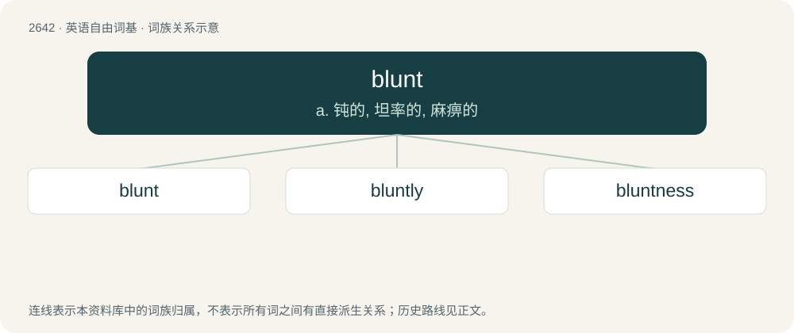

# 2746 · blunt — a. 钝的, 坦率的, 麻痹的

[总目录](../00_总目录_按常用程度.md)

**类型**：英语自由词基　｜　**来源语言**：见词源记录

## 核心含义与来源

- 核心含义：a. 钝的, 坦率的, 麻痹的
- 英文含义：Having a thick edge or point; not sharp.
- 词形：blunt

**多个词源／构词路径**：同一拼写可能有不同来源；以下按词性和含义分别列出。

**来源记录 1**（形容词；Having a thick edge or point; not sharp.）

From Middle English blunt, blont, from Old English \*blunt, probably of North Germanic origin, possibly related to Old Norse blunda (“to shut eyes, to doze”), related to blind (&gt; Icelandic blunda, Swedish blunda, Danish blunde). Compare the Scandinavian-German munitons term blind (“non-live, dummy”), opposite of skarp (“live”, literally, “sharp”): Swedish and Danish blind patron (“dummy round”), Danish blindt skud, German blinder schuss (“dummy shot”), blinde granate (“dummy grenade”).

**来源记录 2**（动词；To dull the edge or point of, by making it thicker; to make blunt.）

From Middle English blunten, blonten, from the adjective (see above).

## 词族图

## 单词速览（常用到不常用）

| 单词 | 音标 | 释义 |
|---|---|---|
| [blunt](#w-1) | 英 /blʌnt/ | a. 钝的, 坦率的, 麻痹的 |
| [bluntly](#w-2) | /ˈblʌntli/ | adv. 坦率地, 率直地 |
| [bluntness](#w-3) | 美 /ˈblʌnt.nəs/ | n. 钝, 率直, 迟钝 |

## 逐词详解

### 1. blunt

**词性**：形容词　｜　**音标**：英 /blʌnt/

**中文释义**：a. 钝的, 坦率的, 麻痹的

**英文义项**：Having a thick edge or point; not sharp. / Dull in understanding; slow of discernment; opposed to acute.

**词源与演化**：

From Middle English blunt, blont, from Old English \*blunt, probably of North Germanic origin, possibly related to Old Norse blunda (“to shut eyes, to doze”), related to blind (&gt; Icelandic blunda, Swedish blunda, Danish blunde). Compare the Scandinavian-German munitons term blind (“non-live, dummy”), opposite of skarp (“live”, literally, “sharp”): Swedish and Danish blind patron (“dummy round”), Danish blindt skud, German blinder schuss (“dummy shot”), blinde granate (“dummy grenade”).

**例句**：

> I was taken aback by the blunt admission that he had never liked my company.

该用例对应义项：Abrupt in address; plain; unceremonious; wanting in the forms of civility; rough in manners or speech.

### 2. bluntly

**词性**：副词　｜　**音标**：/ˈblʌntli/

**中文释义**：adv. 坦率地, 率直地

**英文义项**：In a blunt manner; without delicacy, or the usual forms of civility.

**构词拆分**：blunt + -ly

**词源与演化**：

From blunt + -ly.

**例句**：

> Nobody will say it so bluntly, but that is the gist of it.

### 3. bluntness

**词性**：名词　｜　**音标**：美 /ˈblʌnt.nəs/

**中文释义**：n. 钝, 率直, 迟钝

**英文义项**：The characteristic of being blunt.

**构词拆分**：blunt + -ness

**词源与演化**：

From Middle English bluntnes, bluntnesse, equivalent to blunt + -ness.

**例句**：

> The bluntness of a Yorkshireman.

该用例对应义项：the quality of being direct and outspoken
