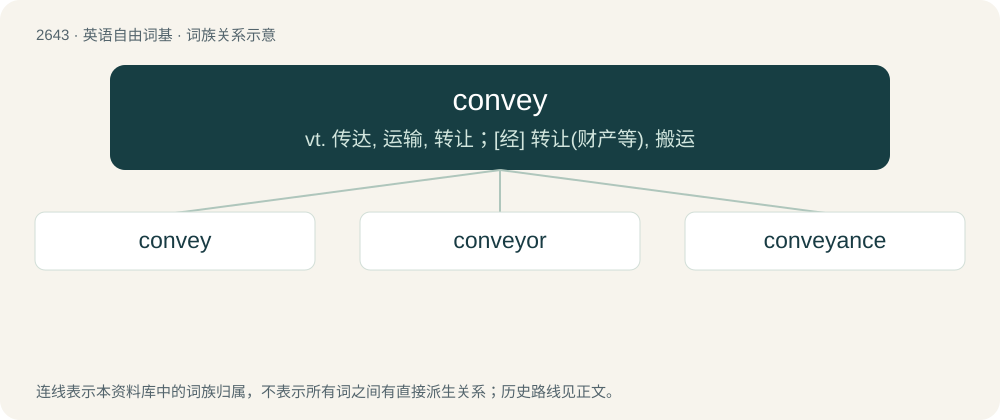

# 2747 · convey — vt. 传达, 运输, 转让；\[经\] 转让(财产等), 搬运

[总目录](../00_总目录_按常用程度.md)

**类型**：英语自由词基　｜　**来源语言**：见词源记录

## 核心含义与来源

- 核心含义：vt. 传达, 运输, 转让；\[经\] 转让(财产等), 搬运
- 英文含义：To move (something) from one place to another.
- 词形：convey

**来源记录 1**（动词；To move (something) from one place to another.）

From Middle English conveien, from Old French conveier (French convoyer), from Vulgar Latin \*convio, from Classical Latin via (“way”). Compare convoy.

## 词族图

## 单词速览（常用到不常用）

| 单词 | 音标 | 释义 |
|---|---|---|
| [convey](#w-1) | /kənˈveɪ/ | vt. 传达, 运输, 转让；\[经\] 转让(财产等), 搬运 |
| [conveyor](#w-2) | 英 /kənˈveɪə/；美 /kənˈveɪɚ/ | n. 搬运者, 传达者, 转让财产者, 输送机, 输送设备；\[计\] 传送机, 传送带 |
| [conveyance](#w-3) | /kənˈveɪəns/ | n. 运输, 运输工具, 财产转让；\[经\] 运输工具, 转让证书, 财产的转让 |

## 逐词详解

### 1. convey

**词性**：动词　｜　**音标**：/kənˈveɪ/

**中文释义**：vt. 传达, 运输, 转让；\[经\] 转让(财产等), 搬运

**英文义项**：To move (something) from one place to another. / To take or carry (someone) from one place to another.

**词源与演化**：

From Middle English conveien, from Old French conveier (French convoyer), from Vulgar Latin \*convio, from Classical Latin via (“way”). Compare convoy.

**例句**：

> The refrigerator, washer, and dryer do not convey unless it's specifically laid out in the contract.

该用例对应义项：To transfer legal rights (to).

### 2. conveyor

**词性**：名词　｜　**音标**：英 /kənˈveɪə/；美 /kənˈveɪɚ/

**中文释义**：n. 搬运者, 传达者, 转让财产者, 输送机, 输送设备；\[计\] 传送机, 传送带

**英文义项**：A person that conveys, transports or delivers. / Anything that conveys, transports or delivers.

**构词拆分**：From convey + -or.

**词源与演化**：

From convey + -or.

**例句**：

> Words are a conveyor of meaning.

该用例对应义项：Anything that conveys, transports or delivers.

### 3. conveyance

**词性**：名词　｜　**音标**：/kənˈveɪəns/

**中文释义**：n. 运输, 运输工具, 财产转让；\[经\] 运输工具, 转让证书, 财产的转让

**英文义项**：An act or instance of conveying. / A means of transporting, especially a vehicle.

**构词拆分**：convey + -ance

**词源与演化**：

From Middle English conveiance, conveyaunce, equivalent to convey + -ance.

**例句**：

> For the conveyance of a holiday home, the estate agent gets a commission of 8% of the cost of rent.
