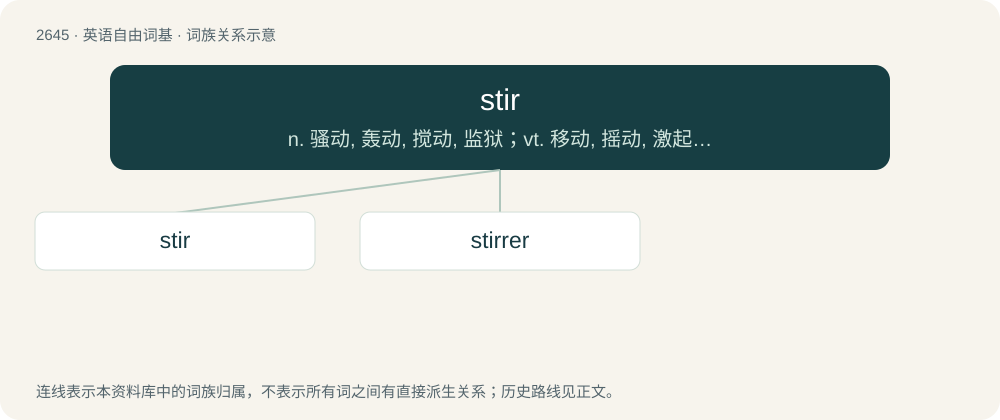

# 2748 · stir — n. 骚动, 轰动, 搅动, 监狱；vt. 移动, 摇动, 激起, 惹起, 搅拌；vi. 走动, 传播, 搅拌

[总目录](../00_总目录_按常用程度.md)

**类型**：英语自由词基　｜　**来源语言**：见词源记录

## 核心含义与来源

- 核心含义：n. 骚动, 轰动, 搅动, 监狱；vt. 移动, 摇动, 激起, 惹起, 搅拌；vi. 走动, 传播, 搅拌
- 英文含义：To disturb the relative position of the particles (of a liquid or similar) by passing an object through it.
- 词形：stir

**多个词源／构词路径**：同一拼写可能有不同来源；以下按词性和含义分别列出。

**来源记录 1**（动词；To disturb the relative position of the particles (of a liquid or similar) by passing an object through it.）

From Middle English stiren, sturien, steren, from Old English styrian (“to be in motion, move, agitate, stir, disturb, trouble”), from Proto-Germanic \*sturiz (“turmoil, noise, confusion”), related to Proto-West Germanic \*staurijan (“to destroy, disturb”). Cognate with Old Norse styrr (“turmoil, noise, confusion”), German stören (“to disturb”), Dutch storen (“to disturb”).

**来源记录 2**（名词；Jail; prison.）

From Romani stariben (“prison”), nominalisation of (a)star (“seize”), causative of ast (“remain”), probably from Sanskrit आतिष्ठति (ātiṣṭhati, “stand or remain by”), from तिष्ठति (tiṣṭhati, “stand”).

## 词族图

## 单词速览（常用到不常用）

| 单词 | 音标 | 释义 |
|---|---|---|
| [stir](#w-1) | 英 /stɜː/；美 /stɝ/ | n. 骚动, 轰动, 搅动, 监狱；vt. 移动, 摇动, 激起, 惹起, 搅拌；vi. 走动, 传播, 搅拌 |
| [stirrer](#w-2) | 英 /ˈstɜːɹə/；美 /ˈstɝɚ/ | n. 搅拌者, 搅拌器；\[化\] 搅拌器 |

## 逐词详解

### 1. stir

**词性**：动词　｜　**音标**：英 /stɜː/；美 /stɝ/

**中文释义**：n. 骚动, 轰动, 搅动, 监狱；vt. 移动, 摇动, 激起, 惹起, 搅拌；vi. 走动, 传播, 搅拌

**英文义项**：To disturb the relative position of the particles (of a liquid or similar) by passing an object through it. / To disturb the content of (a container) by passing an object through it.

**词源与演化**：

From Middle English stiren, sturien, steren, from Old English styrian (“to be in motion, move, agitate, stir, disturb, trouble”), from Proto-Germanic \*sturiz (“turmoil, noise, confusion”), related to Proto-West Germanic \*staurijan (“to destroy, disturb”). Cognate with Old Norse styrr (“turmoil, noise, confusion”), German stören (“to disturb”), Dutch storen (“to disturb”).

**例句**：

> Would you please stir this pot so that the chocolate doesn't burn?

该用例对应义项：To disturb the content of (a container) by passing an object through it.

### 2. stirrer

**词性**：名词　｜　**音标**：英 /ˈstɜːɹə/；美 /ˈstɝɚ/

**中文释义**：n. 搅拌者, 搅拌器；\[化\] 搅拌器

**英文义项**：A device used to stir. (Cardinal types include wood or plastic strips (for beverages) and magnetic objects that react to a spinning magnet nearby (for chemistry beakers). / A person who stirs something.

**构词拆分**：stir + -er

**词源与演化**：

From stir + -er.

**例句**：

> I heard some early stirrers in the kitchen at dawn, but I saw no reason to get up yet.

该用例对应义项：One who stirs or moves about, as after sleep.
