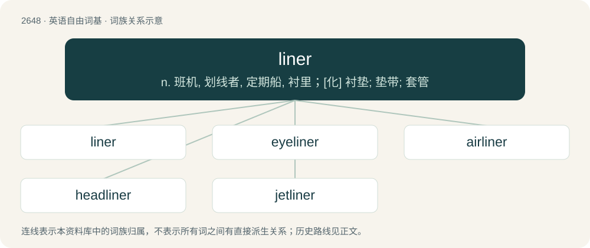

# 2749 · liner — n. 班机, 划线者, 定期船, 衬里；\[化\] 衬垫; 垫带; 套管

[总目录](../00_总目录_按常用程度.md)

**类型**：英语自由词基　｜　**来源语言**：见词源记录

## 核心含义与来源

- 核心含义：n. 班机, 划线者, 定期船, 衬里；\[化\] 衬垫; 垫带; 套管
- 英文含义：Someone who fits a lining to something.
- 词形：liner

**多个词源／构词路径**：同一拼写可能有不同来源；以下按词性和含义分别列出。

**来源记录 1**（名词；Someone who fits a lining to something.）

From line (verb) + -er.

**来源记录 2**（名词；A large passenger-carrying ship, especially one on a regular route; an ocean liner.）

From line (noun) + -er (relational suffix) or -er (measurement suffix) (sense 5).

## 词族图

## 单词速览（常用到不常用）

| 单词 | 音标 | 释义 |
|---|---|---|
| [liner](#w-1) | /ˈlaɪnɚ/ | n. 班机, 划线者, 定期船, 衬里；\[化\] 衬垫; 垫带; 套管 |
| [eyeliner](#w-2) | 美 /ˈaɪˌlaɪnɚ/ | n. 眼线膏 |
| [airliner](#w-3) | /ˈєəlainə/ | n. 班机, 大型客机 |
| [headliner](#w-4) | 美 /ˈhɛdˌlaɪnɚ/ | 【英文】The interior fabric covering the ceiling-like area inside of a vehicle. |
| [jetliner](#w-5) | /ˈd͡ʒɛtˌlaɪ.nə(ɹ)/ | n. 喷气客机 |

## 逐词详解

### 1. liner

**词性**：名词　｜　**音标**：/ˈlaɪnɚ/

**中文释义**：n. 班机, 划线者, 定期船, 衬里；\[化\] 衬垫; 垫带; 套管

**英文义项**：Someone who fits a lining to something. / A removable cover or lining.

**构词拆分**：line + -er

**词源与演化**：

From line (verb) + -er.

**例句**：

> I threw out the trash can liner.

该用例对应义项：A removable cover or lining.

### 2. eyeliner

**词性**：名词　｜　**音标**：美 /ˈaɪˌlaɪnɚ/

**中文释义**：n. 眼线膏

**英文义项**：Makeup used to outline the eye, generally applied along or close to the lashline.

**构词拆分**：eye + liner

**词源与演化**：

From eye + liner.

**例句**：

> I'm wearing some foundation, a bit of blush and some eyeliner.

### 3. airliner

**词性**：名词　｜　**音标**：/ˈєəlainə/

**中文释义**：n. 班机, 大型客机

**英文义项**：A passenger-carrying aircraft, especially one of a fleet operated by an airline.

**构词拆分**：air + liner

**词源与演化**：

From air + liner.

**例句**：

> The pilot of an airliner is responsible for the safety of passengers.

### 4. headliner

**词性**：名词　｜　**音标**：美 /ˈhɛdˌlaɪnɚ/

**英文义项**：The interior fabric covering the ceiling-like area inside of a vehicle.

**构词拆分**：head + liner

**词源与演化**：

From head + liner.

### 5. jetliner

**词性**：名词　｜　**音标**：/ˈd͡ʒɛtˌlaɪ.nə(ɹ)/

**中文释义**：n. 喷气客机

**英文义项**：A jet-propelled airliner.

**构词拆分**：jet + liner

**词源与演化**：

From blend of jet + airliner; analyzable as jet + liner.
