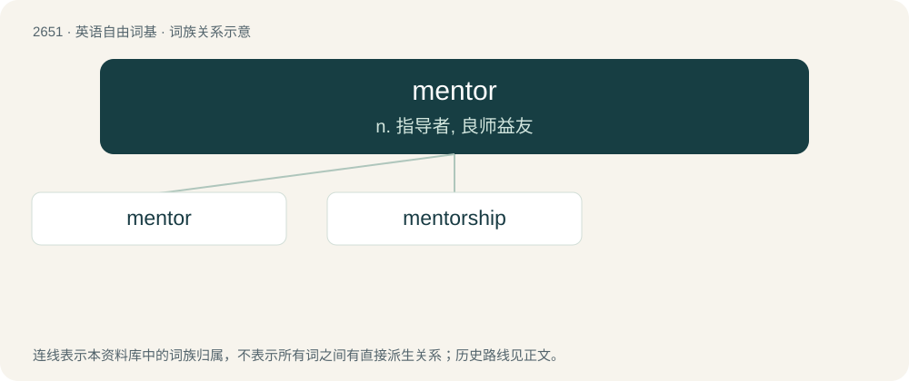

# 2752 · mentor — n. 指导者, 良师益友

[总目录](../00_总目录_按常用程度.md)

**类型**：英语自由词基　｜　**来源语言**：见词源记录

## 核心含义与来源

- 核心含义：n. 指导者, 良师益友
- 英文含义：A wise and trusted counselor or teacher.
- 词形：mentor

**来源记录 1**（名词；A wise and trusted counselor or teacher.）

From French mentor, from Ancient Greek Μέντωρ (Méntōr, “Mentor”), a mythological character in the Odyssey, whose name, a historical name from Ancient Greece, shares the same root as English mind. Cognate to Sanskrit मन्तृ (mantṛ, “advisor, counselor”) and Latin monitor (“one who admonishes”), and perhaps ultimately from Proto-Indo-European \*monéyeti (compare Latin moneō (“to warn”), causative form of \*men- (“to think”).

## 词族图

## 单词速览（常用到不常用）

| 单词 | 音标 | 释义 |
|---|---|---|
| [mentor](#w-1) | 英 /ˈmɛn.tɔː/；美 /ˈmɛn.toɹ/ | n. 指导者, 良师益友 |
| [mentorship](#w-2) | /ˈmentɔːʃɪp/ | n. 导师制, 辅导教师；师徒制 |

## 逐词详解

### 1. mentor

**词性**：名词　｜　**音标**：英 /ˈmɛn.tɔː/；美 /ˈmɛn.toɹ/

**中文释义**：n. 指导者, 良师益友

**英文义项**：A wise and trusted counselor or teacher.

**词源与演化**：

From French mentor, from Ancient Greek Μέντωρ (Méntōr, “Mentor”), a mythological character in the Odyssey, whose name, a historical name from Ancient Greece, shares the same root as English mind. Cognate to Sanskrit मन्तृ (mantṛ, “advisor, counselor”) and Latin monitor (“one who admonishes”), and perhaps ultimately from Proto-Indo-European \*monéyeti (compare Latin moneō (“to warn”), causative form of \*men- (“to think”).

**例句**：

> Sami was more than a boss to Layla. He was her mentor.

### 2. mentorship

**词性**：名词　｜　**音标**：/ˈmentɔːʃɪp/

**中文释义**：n. 导师制, 辅导教师；师徒制

**英文义项**：The role or state of being a mentor.

**构词拆分**：mentor + -ship

**词源与演化**：

From mentor + -ship.

**例句**：

> The camp counselors are supposed to provide guidance and mentorship to the students.
