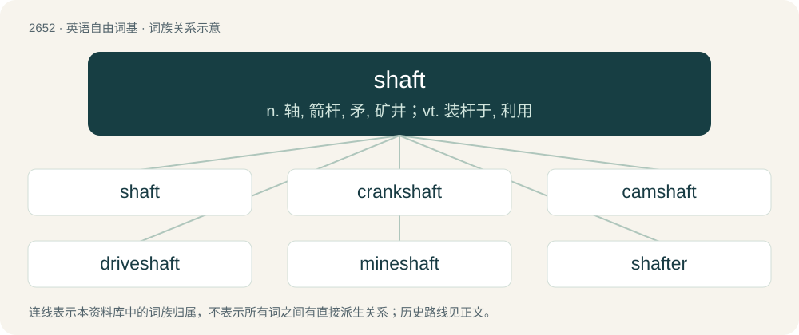

# 2753 · shaft — n. 轴, 箭杆, 矛, 矿井；vt. 装杆于, 利用

[总目录](../00_总目录_按常用程度.md)

**类型**：英语自由词基　｜　**来源语言**：见词源记录

## 核心含义与来源

- 核心含义：n. 轴, 箭杆, 矛, 矿井；vt. 装杆于, 利用
- 英文含义：The long, narrow, central body of a spear, arrow, or javelin.
- 词形：shaft

**来源记录 1**（名词；The long, narrow, central body of a spear, arrow, or javelin.）

From Middle English chafte, saft, scaft, schaft, schafte, scheft, shaffet, shaft, from Old English sċeaft, from Proto-West Germanic \*skaft, from Proto-Germanic \*skaftaz (“shaft”), from Proto-Indo-European \*skeh₂p- (“club, rod, shaft, staff”). Cognates Cognate with Dutch schacht (“shaft”), German Schaft (“shaft”), Low German Schacht, Skacht (“shaft; cane, stick; beating”), Danish, Icelandic, Norwegian Bokmål, Norwegian Nynorsk, and Swedish skaft (“handle; stem; shaft”); also Latin scapus (“stalk, stem; shaft”), Greek σκήπτρο (skíptro, “sceptre”), Albanian shkop (“staff, stick”), Belarusian кап'ё (kapʺjó, “spear”), Bulgarian ко́пие (kópie, “spear”), Czech kopí (“spear”), Macedonian копје (kopje, “spear”), Polish kopia (“spear”), Russian копьё (kopʹjó, “spear”), Serbo-Croatian ко̏пље, kȍplje (“spear”), Slovak kopija (“spear”), Slovene kopje (“javelin”). In Early Modern English, shaft referred to the entire body of a long weapon, such that an arrow's “shaft” was composed of its tip, stale, and fletching. Over time, the word came to be used in place of the former stale and lost its original meaning.

## 词族图

## 单词速览（常用到不常用）

| 单词 | 音标 | 释义 |
|---|---|---|
| [shaft](#w-1) | 英 /ˈʃɑːft/；美 /ˈʃæft/ | n. 轴, 箭杆, 矛, 矿井；vt. 装杆于, 利用 |
| [crankshaft](#w-2) | /ˈkræŋkʃæft/ | n. 曲轴；\[机\] 曲柄轴 |
| [camshaft](#w-3) | /ˈkæmʃæft/ | n. 凸轮轴 |
| [driveshaft](#w-4) |  | （机器的）传动轴, 驱动轴 |
| [mineshaft](#w-5) | 美 /ˈmaɪnˌʃæft/ | 井筒；竖井 |
| [shafter](#w-6) |  | \[人名\] 沙夫特; \[地名\] \[美国\] 沙夫特 |

## 逐词详解

### 1. shaft

**词性**：名词　｜　**音标**：英 /ˈʃɑːft/；美 /ˈʃæft/

**中文释义**：n. 轴, 箭杆, 矛, 矿井；vt. 装杆于, 利用

**英文义项**：The long, narrow, central body of a spear, arrow, or javelin. / Anything cast or thrown as a spear or javelin.

**词源与演化**：

From Middle English chafte, saft, scaft, schaft, schafte, scheft, shaffet, shaft, from Old English sċeaft, from Proto-West Germanic \*skaft, from Proto-Germanic \*skaftaz (“shaft”), from Proto-Indo-European \*skeh₂p- (“club, rod, shaft, staff”). Cognates Cognate with Dutch schacht (“shaft”), German Schaft (“shaft”), Low German Schacht, Skacht (“shaft; cane, stick; beating”), Danish, Icelandic, Norwegian Bokmål, Norwegian Nynorsk, and Swedish skaft (“handle; stem; shaft”); also Latin scapus (“stalk, stem; shaft”), Greek σκήπτρο (skíptro, “sceptre”), Albanian shkop (“staff, stick”), Belarusian кап'ё (kapʺjó, “spear”), Bulgarian ко́пие (kópie, “spear”), Czech kopí (“spear”), Macedonian копје (kopje, “spear”), Polish kopia (“spear”), Russian копьё (kopʹjó, “spear”), Serbo-Croatian ко̏пље, kȍplje (“spear”), Slovak kopija (“spear”), Slovene kopje (“javelin”). In Early Modern English, shaft referred to the entire body of a long weapon, such that an arrow's “shaft” was composed of its tip, stale, and fletching. Over time, the word came to be used in place of the former stale and lost its original meaning.

**例句**：

> Your grandfather used to work with a crane hauling ore out of the gold mine's shafts.

该用例对应义项：A vertical or inclined passage sunk into the earth as part of a mine.

### 2. crankshaft

**词性**：名词　｜　**音标**：/ˈkræŋkʃæft/

**中文释义**：n. 曲轴；\[机\] 曲柄轴

**英文义项**：A rotating shaft with throws (parts that stick out) and which drives, is driven by (cranked by), or functions as a crank.

**构词拆分**：crank + shaft

**词源与演化**：

From crank + shaft.

**例句**：

> As I turned the handle of the crankshaft, the old tractor sputtered to life.

### 3. camshaft

**词性**：名词　｜　**音标**：/ˈkæmʃæft/

**中文释义**：n. 凸轮轴

**英文义项**：A shaft fitted with cams; especially one in a piston engine that activates the valves.

**构词拆分**：cam + shaft

**词源与演化**：

From cam + shaft.

### 4. driveshaft

**词性**：名词

**中文释义**：（机器的）传动轴, 驱动轴

**英文义项**：A shaft used to transmit rotary motion.

**构词拆分**：drive + shaft

**词源与演化**：

From drive + shaft.

**例句**：

> The driveshaft of an automobile transfers power from the engine to the wheels.

该用例对应义项：A shaft used to transmit rotary motion.

### 5. mineshaft

**词性**：名词　｜　**音标**：美 /ˈmaɪnˌʃæft/

**中文释义**：井筒；竖井

**英文义项**：A vertical hole through the strata to reach the mineral which is being mined.

**构词拆分**：mine + shaft

**词源与演化**：

From mine + shaft.

### 6. shafter

**词性**：名词

**中文释义**：\[人名\] 沙夫特; \[地名\] \[美国\] 沙夫特

**英文义项**：One who or that which shafts.

**构词拆分**：shaft + -er

**词源与演化**：

From shaft + -er.
