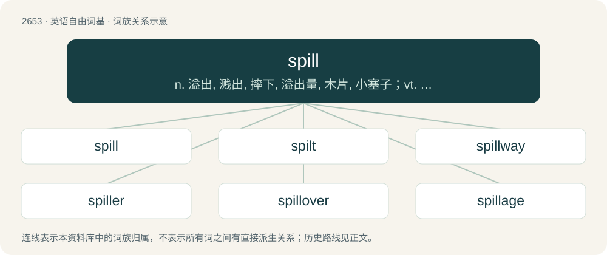

# 2754 · spill — n. 溢出, 溅出, 摔下, 溢出量, 木片, 小塞子；vt. 使溢出, 使散落, 洒, 使流出, 倒出, 使摔下；vi. 溢出, 涌流, 摔下

[总目录](../00_总目录_按常用程度.md)

**类型**：英语自由词基　｜　**来源语言**：见词源记录

## 核心含义与来源

- 核心含义：n. 溢出, 溅出, 摔下, 溢出量, 木片, 小塞子；vt. 使溢出, 使散落, 洒, 使流出, 倒出, 使摔下；vi. 溢出, 涌流, 摔下
- 英文含义：To drop something so that it spreads out or makes a mess; to accidentally pour.
- 词形：spill

**来源记录 1**（动词；To drop something so that it spreads out or makes a mess; to accidentally pour.）

From Middle English spillen, from Old English spillan, spildan (“to kill, destroy, waste”), from Proto-West Germanic \*spilþijan, from Proto-Germanic \*spilþijaną (“to spoil, kill, murder”), from Proto-Indo-European \*(s)pel- (“to sunder, split, rend, tear”). Cognate with Dutch spillen (“to use needlessly, waste”), French gaspiller ("to waste, squander" &lt; Germanic), Bavarian spillen (“to split, cleave, splinter”), Danish spilde (“to spill, waste”), Swedish spilla (“to spill, waste”), Icelandic spilla (“to contaminate, spoil”). See also spool.

## 词族图

## 单词速览（常用到不常用）

| 单词 | 音标 | 释义 |
|---|---|---|
| [spill](#w-1) | /spɪl/ | n. 溢出, 溅出, 摔下, 溢出量, 木片, 小塞子；vt. 使溢出, 使散落, 洒, 使流出, 倒出, 使摔下；vi. 溢出, 涌流, 摔下 |
| [spilt](#w-2) | /spɪlt/ | spill的过去式和过去分词 |
| [spillway](#w-3) | /ˈspilwei/ | n. 溢洪道, 泄洪道；\[电\] 流溢水路 |
| [spiller](#w-4) | /ˈspilə/ | n. 使溢出者, 使溅出者, 堕落网 |
| [spillover](#w-5) | 英 /ˈspɪlˌəʊ̯.və/；美 /ˈspɪlˌoʊ̯.vɚ/ | n. 溢出, 外流人口, 伴随的发展, 间接影响；\[电\] 流溢 |
| [spillage](#w-6) | /ˈspɪl.ɪd͡ʒ/ | n. 漏, 溢出, 溢出物；\[化\] 泄漏量 |

## 逐词详解

### 1. spill

**词性**：动词　｜　**音标**：/spɪl/

**中文释义**：n. 溢出, 溅出, 摔下, 溢出量, 木片, 小塞子；vt. 使溢出, 使散落, 洒, 使流出, 倒出, 使摔下；vi. 溢出, 涌流, 摔下

**英文义项**：To drop something so that it spreads out or makes a mess; to accidentally pour. / To spread out or fall out, as above.

**词源与演化**：

From Middle English spillen, from Old English spillan, spildan (“to kill, destroy, waste”), from Proto-West Germanic \*spilþijan, from Proto-Germanic \*spilþijaną (“to spoil, kill, murder”), from Proto-Indo-European \*(s)pel- (“to sunder, split, rend, tear”). Cognate with Dutch spillen (“to use needlessly, waste”), French gaspiller ("to waste, squander" &lt; Germanic), Bavarian spillen (“to split, cleave, splinter”), Danish spilde (“to spill, waste”), Swedish spilla (“to spill, waste”), Icelandic spilla (“to contaminate, spoil”). See also spool.

**例句**：

> I spilled some sticky juice on the kitchen floor.

该用例对应义项：To drop something so that it spreads out or makes a mess; to accidentally pour.

### 2. spilt

**词性**：形容词　｜　**音标**：/spɪlt/

**中文释义**：spill的过去式和过去分词

**英文义项**：That has been spilled.

**构词拆分**：From spill + -t.

**词源与演化**：

From spill + -t.

**例句**：

> Don't cry over spilt milk; tears won't put it back in the glass.

该用例对应义项：That has been spilled.

### 3. spillway

**词性**：名词　｜　**音标**：/ˈspilwei/

**中文释义**：n. 溢洪道, 泄洪道；\[电\] 流溢水路

**英文义项**：A path designed to take away overflow safely.

**构词拆分**：spill + way

**词源与演化**：

From spill + way.

**例句**：

> The dam design includes an emergency spillway weir, to handle flood flows without risking erosion on the rest of the embankment.

### 4. spiller

**词性**：名词　｜　**音标**：/ˈspilə/

**中文释义**：n. 使溢出者, 使溅出者, 堕落网

**英文义项**：One who spills. / A party who is liable for spillage, particularly of oil or waste, in a body of water.

**构词拆分**：spill + -er

**词源与演化**：

From Middle English spiller, from spill + -er.

**例句**：

> A great hunter and spiller of blood.

该用例对应义项：an attacker who sheds or spills blood

### 5. spillover

**词性**：名词　｜　**音标**：英 /ˈspɪlˌəʊ̯.və/；美 /ˈspɪlˌoʊ̯.vɚ/

**中文释义**：n. 溢出, 外流人口, 伴随的发展, 间接影响；\[电\] 流溢

**英文义项**：That which overflows; the excess or side effect. / The spread of infectious disease between different species of animal and particularly to humans.

**构词拆分**：spill + over

**词源与演化**：

From spill + over.

**例句**：

> The spillover from this war will be many little massacres of civilians by civilians.

该用例对应义项：That which overflows; the excess or side effect.

### 6. spillage

**词性**：名词　｜　**音标**：/ˈspɪl.ɪd͡ʒ/

**中文释义**：n. 漏, 溢出, 溢出物；\[化\] 泄漏量

**英文义项**：The process or action of spilling. / That which has been spilled.

**构词拆分**：spill + -age

**词源与演化**：

From spill + -age.

**例句**：

> The important fishing industry was brought to a standstill by the oil spillage.
