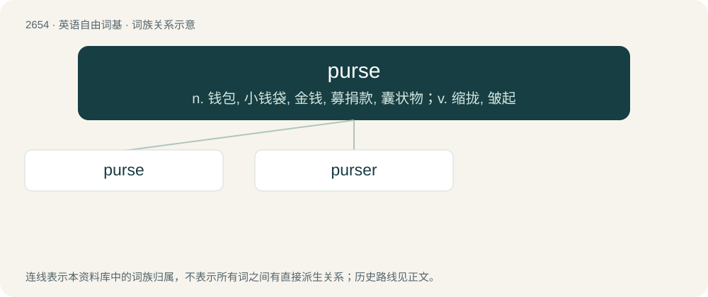

# 2755 · purse — n. 钱包, 小钱袋, 金钱, 募捐款, 囊状物；v. 缩拢, 皱起

[总目录](../00_总目录_按常用程度.md)

**类型**：英语自由词基　｜　**来源语言**：见词源记录

## 核心含义与来源

- 核心含义：n. 钱包, 小钱袋, 金钱, 募捐款, 囊状物；v. 缩拢, 皱起
- 英文含义：A small bag for carrying money.
- 词形：purse

**来源记录 1**（名词；A small bag for carrying money.）

From Middle English purs, from Old English purs (“purse”), partly from pusa (“wallet, bag, scrip”) and partly from burse (“pouch, bag”). Old English pusa comes from Proto-West Germanic \*pusō, from Proto-Germanic \*pusô (“bag, sack, scrip”), and is cognate with Old High German pfoso (“pouch, purse”), Low German pūse (“purse, bag”), Old Norse posi (“purse, bag”), Danish pose (“purse, bag”). Old English burse comes from Medieval Latin bursa (“leather bag”) (compare English bursar), from Ancient Greek βύρσα (búrsa, “hide, wine-skin”). Compare also Old French borse (French bourse), Old Saxon bursa (“bag”), Old High German burissa (“wallet”).

## 词族图

## 单词速览（常用到不常用）

| 单词 | 音标 | 释义 |
|---|---|---|
| [purse](#w-1) | 英 /pɜːs/；美 /pɚs/ | n. 钱包, 小钱袋, 金钱, 募捐款, 囊状物；v. 缩拢, 皱起 |
| [purser](#w-2) | 英 /ˈpɜːsə/；美 /ˈpɝsɚ/ | n. 事务长；\[经\] 会计员, 出纳员, 事务长 |

## 逐词详解

### 1. purse

**词性**：名词　｜　**音标**：英 /pɜːs/；美 /pɚs/

**中文释义**：n. 钱包, 小钱袋, 金钱, 募捐款, 囊状物；v. 缩拢, 皱起

**英文义项**：A small bag for carrying money. / A handbag (small bag usually used by women for carrying various small personal items)

**词源与演化**：

From Middle English purs, from Old English purs (“purse”), partly from pusa (“wallet, bag, scrip”) and partly from burse (“pouch, bag”). Old English pusa comes from Proto-West Germanic \*pusō, from Proto-Germanic \*pusô (“bag, sack, scrip”), and is cognate with Old High German pfoso (“pouch, purse”), Low German pūse (“purse, bag”), Old Norse posi (“purse, bag”), Danish pose (“purse, bag”). Old English burse comes from Medieval Latin bursa (“leather bag”) (compare English bursar), from Ancient Greek βύρσα (búrsa, “hide, wine-skin”). Compare also Old French borse (French bourse), Old Saxon bursa (“bag”), Old High German burissa (“wallet”).

**例句**：

> The purse barely covered the winner's expenses.

该用例对应义项：a sum of money offered as a prize

### 2. purser

**词性**：名词　｜　**音标**：英 /ˈpɜːsə/；美 /ˈpɝsɚ/

**中文释义**：n. 事务长；\[经\] 会计员, 出纳员, 事务长

**英文义项**：The person responsible for handling the accounts on a ship, or for dealing with the passengers on a ship or aircraft.

**构词拆分**：From purse + -er.

**词源与演化**：

From purse + -er.

**例句**：

> The purser acts as the crew's private merchant aboard the ship.
