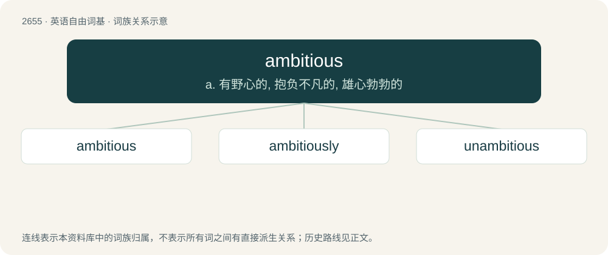

# 2756 · ambitious — a. 有野心的, 抱负不凡的, 雄心勃勃的

[总目录](../00_总目录_按常用程度.md)

**类型**：英语自由词基　｜　**来源语言**：见词源记录

## 核心含义与来源

- 核心含义：a. 有野心的, 抱负不凡的, 雄心勃勃的
- 英文含义：Having or showing ambition; wanting a lot of power, honor, respect, superiority, or other distinction.
- 词形：ambitious

**来源记录 1**（形容词；Having or showing ambition; wanting a lot of power, honor, respect, superiority, or other distinction.）

From Middle English ambitious, from Middle French ambitieus, from Latin ambitiosus, from ambitio; see ambition. Compare with French ambitieux. By surface analysis, ambit + -ious.

## 词族图

## 单词速览（常用到不常用）

| 单词 | 音标 | 释义 |
|---|---|---|
| [ambitious](#w-1) | 美 /æmˈbɪʃ.əs/ | a. 有野心的, 抱负不凡的, 雄心勃勃的 |
| [ambitiously](#w-2) |  | adv. 雄心勃勃地；劲头十足地；热切地 |
| [unambitious](#w-3) | /.ʌnæmˈbiʃəs/ | a. 无名利心的, 无野心的, 谦虚的 |

## 逐词详解

### 1. ambitious

**词性**：形容词　｜　**音标**：美 /æmˈbɪʃ.əs/

**中文释义**：a. 有野心的, 抱负不凡的, 雄心勃勃的

**英文义项**：Having or showing ambition; wanting a lot of power, honor, respect, superiority, or other distinction. / Very desirous.

**词源与演化**：

From Middle English ambitious, from Middle French ambitieus, from Latin ambitiosus, from ambitio; see ambition. Compare with French ambitieux. By surface analysis, ambit + -ious.

**用法示例／搭配（非完整句）**：

> an ambitious attempt to take power

该用例对应义项：Resulting from, characterized by, or indicating, ambition.

### 2. ambitiously

**词性**：副词

**中文释义**：adv. 雄心勃勃地；劲头十足地；热切地

**英文义项**：In an ambitious manner.

**构词拆分**：ambitious + -ly

**词源与演化**：

From ambitious + -ly.

**例句**：

> She pursued her goals ambitiously.

该用例对应义项：with ambition; in an ambitious and energetic manner

### 3. unambitious

**词性**：形容词　｜　**音标**：/.ʌnæmˈbiʃəs/

**中文释义**：a. 无名利心的, 无野心的, 谦虚的

**英文义项**：Having little ambition for success or achievement

**构词拆分**：un- + ambitious

**词源与演化**：

From un- + ambitious.

**例句**：

> I wonder if Tom is still unambitious.
