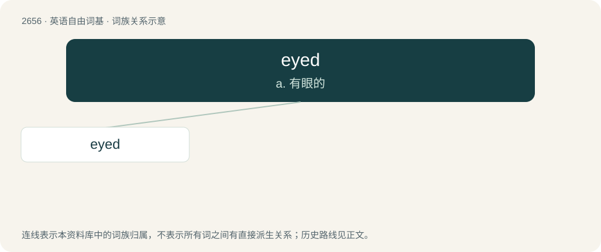

# 2757 · eyed — a. 有眼的

[总目录](../00_总目录_按常用程度.md)

**类型**：英语自由词基　｜　**来源语言**：见词源记录

## 核心含义与来源

- 核心含义：a. 有眼的
- 英文含义：Having eyes.
- 词形：eyed

**来源记录 1**（形容词；Having eyes.）

From Middle English eyed, eied, iȝed, y-yȝed, equivalent to eye + -ed.

## 词族图

## 单词速览（常用到不常用）

| 单词 | 音标 | 释义 |
|---|---|---|
| [eyed](#w-1) | /aɪd/ | a. 有眼的 |

## 逐词详解

### 1. eyed

**词性**：形容词　｜　**音标**：/aɪd/

**中文释义**：a. 有眼的

**英文义项**：Having eyes. / Having eye-like spots.

**构词拆分**：eye + -ed

**词源与演化**：

From Middle English eyed, eied, iȝed, y-yȝed, equivalent to eye + -ed.

**例句**：

> The back of the beetle was eyed to make it appear to be a snake to a predator.

该用例对应义项：Having eye-like spots.
